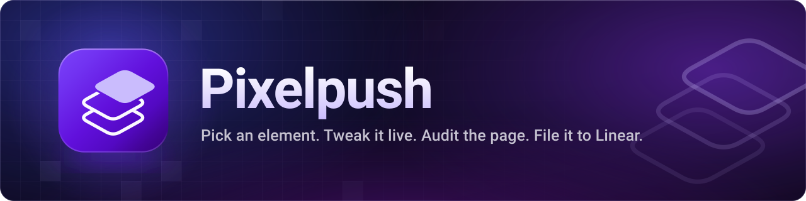
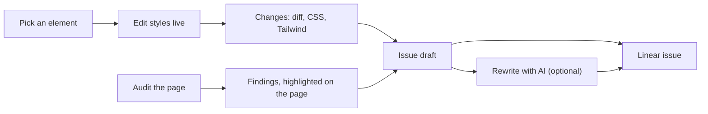

<div align="center">



<p>
  <strong>A Chrome side panel for fixing UI in place.</strong><br>
  Inspect, tweak and audit any page, then file the fix to Linear, with your own AI model if you want one.
</p>

<p>
  <a href="#install">Install</a> &nbsp;·&nbsp;
  <a href="#features">Features</a> &nbsp;·&nbsp;
  <a href="docs/README.md">Docs</a> &nbsp;·&nbsp;
  <a href="#develop">Develop</a>
</p>

<p>
  <a href="LICENSE"></a>
  <a href="extension/manifest.json"></a>
  
</p>

<table>
  <tr>
    <td align="center" valign="top">
      <br>
      <sub><b>Design</b>: element tree and live style editor</sub>
    </td>
    <td align="center" valign="top">
      <br>
      <sub><b>Audit</b>: findings, highlighted on the page</sub>
    </td>
    <td align="center" valign="top">
      <br>
      <sub><b>Changes</b>: every edit as a diff</sub>
    </td>
  </tr>
</table>

</div>

## Why Pixelpush

Pick any element on a page, nudge its styles until it looks right, run a design audit,
and then send the result to Linear as a ready-to-build issue. An AI model you choose can
rewrite that issue for you.

It is built for the moment when you can see what is wrong with a screen but writing it
up for whoever builds it takes longer than the fix itself. The issue Pixelpush files
carries the evidence: a From/To table for every property you changed, the audit findings you
selected, and the page it came from.

Pixelpush has no backend of its own. Requests go from your browser straight to Linear and
to the AI provider you configure.

## Features

| Tab | What you get |
| --- | --- |
| **Design** | An element tree for the page, plus a style editor for layout, spacing, size, colour, type, borders, radius and shadow. Edits apply live on the page. |
| **Inspect** | The selected element's size, colours, font and box model, with the text/background contrast ratio and one-click copy as CSS or Tailwind. |
| **Colors** | The colours in use on the page, most used first, with the roles each one plays (text, background, border), so you reuse a value instead of inventing one. Filter by hex or role, copy a value, or export the lot as CSS variables. |
| **Issue** | Writes up your edits, notes and audit findings as a Linear issue, then files it to the team and project you pick. Also lists recent and matching issues. |
| **Changes** | Every edit you made, as a diff. Copy it as CSS or as Tailwind classes. |
| **Audit** | By default scrolls the page first so lazy-loaded sections exist, then runs 72 checks in two groups, 41 AI tells and 31 quality issues (contrast, tiny text, cramped padding, overused patterns, missing labels and more), and highlights each finding on the page. How it works: [docs/audit.md](docs/audit.md). |

AI features are optional and off until you add a provider. **Rewrite with AI** turns the
raw capture into a clean issue, **Propose edits** suggests CSS for the selected element from
a note you write, and **Enrich with AI** reviews the audit: it can hide false hits and add
findings, and the panel drops any suggestion it cannot tie back to the page outline it sent
(see [How suggestions are checked](docs/audit.md#how-suggestions-are-checked)). The
**Disable AI features** checkbox in Settings turns all three off and keeps your keys.

The panel is keyboard operable. The tabs move with the arrow keys, Home and End, Esc closes
Settings, and the divider between the element tree and the editor resizes with the up and
down arrow keys. Toasts and status messages are announced through live regions, and motion
respects `prefers-reduced-motion`. The full key list is in
[docs/features.md](docs/features.md#keyboard-navigation-and-accessibility).

<p align="center">
  
  &nbsp;&nbsp;
  
  <br>
  <sub><b>Inspect</b> and <b>Issue</b></sub>
</p>

Each tab is covered in detail in [docs/features.md](docs/features.md).

### From capture to filed issue



You pick an element and edit it, or you audit the page, or both. Either path ends in an
issue draft, which you can send through an AI rewrite before it is filed to Linear.

## Install

Pixelpush is not on the Chrome Web Store yet. Load it unpacked:

1. Clone this repository.
2. Open `chrome://extensions` and switch on **Developer mode**.
3. Click **Load unpacked** and choose the `extension/` folder.
4. Pin Pixelpush, then click its toolbar icon to open the side panel.

You need Chrome 116 or later, the first version that lets an extension open its side panel on demand.

## First fix in two minutes

1. Open any page and click the Pixelpush icon.
2. Click an element on the page. Selection mode (the cursor button in the panel header)
   starts on and is unavailable on the Audit tab. Right-clicking the page and choosing
   **Design with Pixelpush** also opens the panel.
3. Change a value in the **Design** tab, for example the padding or the font size.
4. Open **Changes** to see the diff, and use **Copy CSS** or **Copy Tailwind**.

To file it instead, connect Linear (below), then press the primary button in the bar at the
bottom of the panel. On every tab except Issue it builds a draft in the **Issue** tab. Check
the title, team and project, then press it again to create the issue.

New to the panel? [docs/getting-started.md](docs/getting-started.md) walks through the same
steps with more detail.

## Connect Linear

Pixelpush files issues with a Linear personal API key.

1. In Linear, open **Settings → API** and create a personal API key (it starts with `lin_api_`).
2. In Pixelpush, open **Issue → Connect Linear** and paste the key.

The key is stored in this Chrome profile's local extension storage and carries your full
Linear permissions. Linear sign-in through OAuth is not configured in this build.

Pixelpush treats `localhost`, `127.0.0.1` and `[::1]` as your own app. Add your production
and staging hosts under **Settings → App origins**. Captures from any other host ask you to
acknowledge that before they are filed, so you do not send someone else's site to Linear by
accident. Details: [docs/linear.md](docs/linear.md).

## AI providers

Open **Settings** (gear icon) and add one or more providers. Pixelpush uses the active
provider, which defaults to the first enabled one.

| Provider | You supply | Notes |
| --- | --- | --- |
| OpenAI compatible | Base URL, model, API key | Defaults to `https://api.openai.com/v1` and `gpt-4.1-mini`. Any server that speaks the chat completions API works. |
| Bedrock Mantle | AWS region (default `us-east-1`), model, Bedrock API key | Models in the menu: `anthropic.claude-opus-5-5`, `openai.gpt-6.1-sol`, `openai.gpt-6.1-terra` (default). Claude Opus 5.5 uses `/anthropic/v1/messages`; GPT 6.1 Sol and Terra use `/openai/v1/responses` with `store: false`. Claude Sonnet 5.5 is not in this menu: the panel notes it is not on Mantle outside GovCloud, so use Bedrock Runtime for it. The key needs `bedrock-mantle:CreateInference`. |
| Bedrock Runtime | AWS region (default `us-east-1`), model, Bedrock API key | The menu lists `us.` and `global.` inference profiles for GPT 6.1 Sol and Terra (default `us.openai.gpt-6.1-terra`), Claude Opus 5.5, Claude Sonnet 5.5 and Kimi K3 (`us.moonshotai.kimi-k3`, `global.moonshotai.kimi-k3`), which is offered on Runtime only. Any other model ID, including an unprefixed one, is rejected before a request is sent. Claude models use the Anthropic Messages route; GPT 6.1 and Kimi K3 use Chat Completions, with `max_completion_tokens` for GPT 6.1 (if the server answers 400 and names that parameter as unsupported, the request is retried once with the other name). Needs `bedrock:InvokeModel`. |
| Local CLI | CLI profile (`claude`, `codex`, `grok`, `gemini`, `ollama`, `llm`) or a custom binary path | Talks to a local bridge on `127.0.0.1:58932`. The bridge is **not** included with Pixelpush, so this provider only works if you run your own. |

Use **Test connection** on each provider card to check the key and model. Per-provider
details are in [docs/ai-providers.md](docs/ai-providers.md).

## Privacy

Pixelpush has no analytics and no telemetry. Network requests happen only when you ask
for them:

- **Linear** (`api.linear.app`) when you connect, list issues or file one.
- **Your AI provider** at the endpoint you configured, when you press an AI button or
  **Test connection**. The first time an AI button sends something to a provider other
  than Local CLI, Pixelpush asks you to confirm what will be sent. Enrich with AI asks
  separately for each provider type, because it also sends a compact outline of the page
  (headings, button and link labels, short copy excerpts, style statistics) and the page URL
  without its query string or fragment.
- **The local bridge** on `127.0.0.1`, only if you added a Local CLI provider.

Settings sync through your Chrome profile (`chrome.storage.sync`). API keys and the Linear
credential stay in local extension storage (`chrome.storage.local`) and never sync. The only
trace of a saved key in synced settings is a short hint, its first three and last four
characters. The content scripts are injected into every page (`<all_urls>`) so the inspector
is ready as soon as you open the panel.

The extension asks Chrome for the `sidePanel`, `scripting`, `contextMenus` and `storage`
permissions, plus access to all sites. See
[docs/privacy-and-permissions.md](docs/privacy-and-permissions.md) for what each one is for.

## Develop

The `extension/` folder is the complete, loadable extension: plain files, no build step.
The side panel, page inspector, audit bridge and background worker are compiled,
minified bundles. The design-audit detector (`audit/detect.js`) and the panel's design
layer (`panel/pixelpush.css`) are readable source.

Node 22.2 or later runs the helper scripts. Only `npm run icons` needs `npm install`; the
others use Node built-ins.

```sh
npm run verify    # manifest references, syntax, licenses, leftover strings, colour contrast
npm run package   # verify, then write dist/pixelpush-<version>.zip for the Web Store
npm run preview   # serve the side panel in a normal tab at http://localhost:4173/__preview/?demo=1
npm run icons     # re-render extension/icons/ from brand/icon.svg
```

The preview harness stubs the `chrome.*` APIs and renders the real panel bundle. Add
`?demo=1` for the built-in sample element and `&motion=off` to freeze transitions for
screenshots. Behaviour that needs a live page, such as selection, the Audit tab and Linear, only
works in Chrome. Two fixture pages for the audit sit in `tools/preview/fixtures/`:
`slop.html` is a deliberately generic, AI-looking page with a section that only exists once
scrolled into view, and `clean.html` is a negative control that should report little or
nothing. [docs/audit.md](docs/audit.md#testing-it-yourself) shows how to run the detector on them by hand.

The look of the panel lives in one readable stylesheet, `extension/panel/pixelpush.css`.
[docs/DESIGN.md](docs/DESIGN.md) explains the palette, type, shape and motion rules
behind it, and the layers mark. More in [docs/development.md](docs/development.md) and
[docs/architecture.md](docs/architecture.md).

<details>
<summary>Repository layout</summary>

```text
extension/
  manifest.json            Manifest V3
  sidepanel.html           Side panel entry
  panel/
    panel.js               Side panel bundle
    tailwind.css           Compiled Tailwind utilities
    pixelpush.css          Design system: tokens, palette, components
    fonts/                 Instrument Sans and JetBrains Mono
  icons/                   Toolbar and store icons
  background.js            Service worker: injection, context menu, AI provider calls
  content-scripts/
    inspector.js           Element picking, live style edits, page tokens
    audit.js               Bridge between the panel and the detector
  audit/
    detect.js              Design-audit detector (Apache-2.0)
    antipatterns.json      Audit rule catalog (72 rules)
brand/                     Icon sources: icon.svg (512 px PNG master), mark.svg (vector glyph)
docs/                      Documentation, design system notes, banner and screenshots
research/                  Audit research record: sources, claim ledger, decision report
scripts/                   verify, contrast, package, icons
tools/preview/             Browser preview harness for the side panel, plus audit fixtures
licenses/                  Full license texts for bundled third-party code
```

</details>

## Documentation

The [documentation hub](docs/README.md) lists every page by what you are trying to do.

| Page | What it covers |
| --- | --- |
| [Getting started](docs/getting-started.md) | Install the extension, open the panel and make a first fix. |
| [Features](docs/features.md) | Every tab and control, one tab at a time. |
| [Audit](docs/audit.md) | How a scan runs, the page scroll, the 72 rules and how an AI review is checked. |
| [AI providers](docs/ai-providers.md) | The four providers: what each needs, which models and endpoints it uses, and how to test it. |
| [Linear](docs/linear.md) | Connecting a personal API key, app origins and filing an issue. |
| [Privacy and permissions](docs/privacy-and-permissions.md) | Network requests, stored data and the permissions the extension asks for. |
| [Architecture](docs/architecture.md) | The service worker, content scripts and side panel, and how they work together. |
| [Development](docs/development.md) | Helper scripts, the preview harness and packaging. |
| [Design system](docs/DESIGN.md) | The palette, type, glass, motion and the layers brand mark. |
| Assets | [`docs/assets/banner.svg`](docs/assets/banner.svg) and the [`docs/screenshots/`](docs/screenshots) folder. |

## License

Pixelpush is released under the [MIT License](LICENSE). It contains code from other
open-source projects under their own licenses, including the Apache-2.0 design-audit
detector in `extension/audit/`. See [THIRD_PARTY_NOTICES.md](THIRD_PARTY_NOTICES.md).
