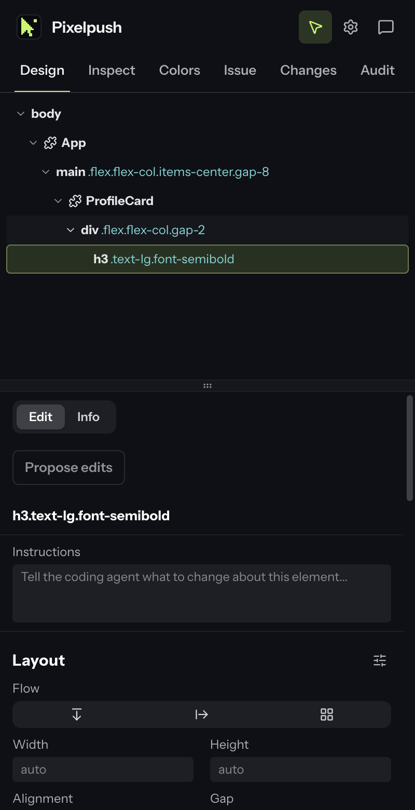
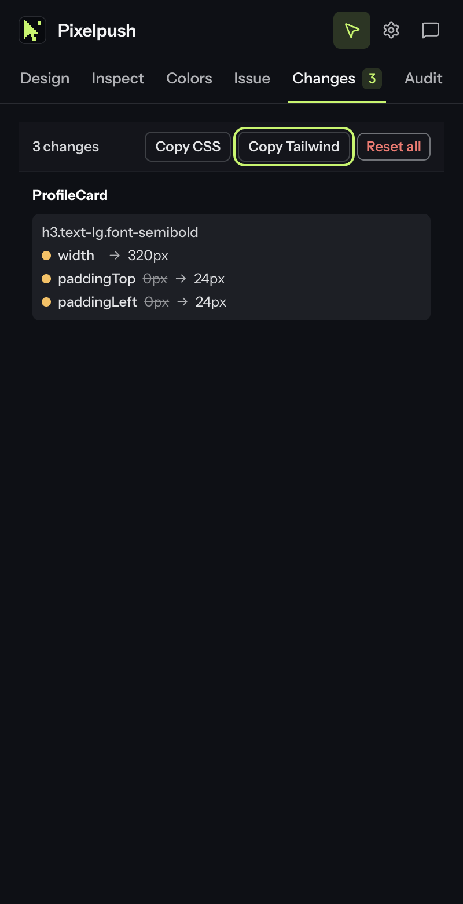

# Pixelpush

Pixelpush is a Chrome side panel for fixing UI in place. Pick any element on a page,
nudge its styles until it looks right, run a design audit, and then send the result to
Linear as a ready-to-build issue. An AI model you choose can rewrite that issue for you.

It is built for the moment when you can see what is wrong with a screen but writing it
up for whoever builds it takes longer than the fix itself.

<p>
  
  
</p>

*The side panel rendered by the preview harness with its built-in demo data.*

## What it does

| Tab | What you get |
| --- | --- |
| **Design** | An element tree for the page, plus a style editor for layout, spacing, size, colour, type, borders, radius and shadow. Edits apply live on the page. |
| **Inspect** | The selected element's size, colours, font and box model, with one-click copy as CSS or Tailwind. |
| **Colors** | The page's colour tokens and every other colour in use, so you reuse a value instead of inventing one. |
| **Changes** | Every edit you made, as a diff. Copy it as CSS or as Tailwind classes. |
| **Audit** | Scans the page against 46 design and quality rules (contrast, tiny text, cramped padding, overused patterns and more) and highlights each finding on the page. |
| **Issue** | Writes up your edits, notes and audit findings as a Linear issue, then files it to the team and project you pick. |

AI features are optional and off until you add a provider. **Rewrite with AI** turns the
raw capture into a clean issue, **Propose edits** suggests CSS for the selected element from
a note you write, and **Enrich with AI** adds context to audit findings. The
**Disable AI features** switch in Settings turns all three off and keeps your keys.

## Install

Pixelpush is not on the Chrome Web Store yet. Load it unpacked:

1. Clone this repository.
2. Open `chrome://extensions` and switch on **Developer mode**.
3. Click **Load unpacked** and choose the `extension/` folder.
4. Pin Pixelpush, then click its toolbar icon to open the side panel.

You need Chrome 114 or later, the first version with the side panel API.

## First fix in two minutes

1. Open any page and click the Pixelpush icon.
2. Turn on selection mode (the cursor button in the panel header), then click an element
   on the page. You can also right-click it and choose **Design with Pixelpush**.
3. Change a value in the **Design** tab, for example the padding or the font size.
4. Open **Changes** to see the diff, and use **Copy CSS** or **Copy Tailwind**.

To file it instead, open **Issue**, connect Linear (below), pick a team and press the
primary button.

## Connect Linear

Pixelpush files issues with a Linear personal API key.

1. In Linear, open **Settings → API** and create a personal API key (it starts with `lin_api_`).
2. In Pixelpush, open **Issue → Connect Linear** and paste the key.

The key is stored in this Chrome profile's local extension storage and carries your full
Linear permissions. Linear sign-in through OAuth is not configured in this build.

## Add an AI provider

Open **Settings** (gear icon) and add one or more providers. Pixelpush uses the active
provider, which defaults to the first enabled one.

| Provider | You supply | Notes |
| --- | --- | --- |
| OpenAI compatible | Base URL, model, API key | Defaults to `https://api.openai.com/v1`. Any server that speaks the same API works. |
| Bedrock Mantle | AWS region, model, Bedrock API key | The key needs `bedrock-mantle:CreateInference`. |
| Bedrock Runtime | AWS region, model, Bedrock API key | Needs a geo or global inference profile and `bedrock:InvokeModel`. |
| Local CLI | CLI profile (`claude`, `codex`, `grok`, `gemini`, `ollama`, `llm`) or a custom binary | Talks to a local bridge on `127.0.0.1:58932`. The bridge is **not** part of this repository yet, so this provider only works if you run your own. |

Use **Test connection** on each provider card to check the key and model.

### App origins

Pixelpush treats `localhost`, `127.0.0.1` and `[::1]` as your own app. Add your
production and staging hosts under **Settings → App origins**. Captures from any other host
ask you to confirm before they are filed, so you do not send someone else's site to Linear
by accident.

## Privacy

Pixelpush has no analytics and no telemetry. Network requests happen only when you ask
for them:

- **Linear** (`api.linear.app`) when you connect, list issues or file one.
- **Your AI provider** at the endpoint you configured, when you press an AI button.
- **The local bridge** on `127.0.0.1`, only if you added a Local CLI provider.

Settings sync through your Chrome profile (`chrome.storage.sync`). API keys stay in local
extension storage (`chrome.storage.local`) and never sync. The content scripts are injected
into every page (`<all_urls>`) so the inspector is ready as soon as you open the panel.

## Develop

The `extension/` folder is the complete, loadable extension: plain files, no build step.
The side panel and the page inspector are compiled bundles (`panel/panel.js`,
`content-scripts/inspector.js`). The background worker, the audit bridge and the detector
are readable JavaScript.

Node 22 or later runs the helper scripts. Only `npm run icons` needs `npm install`; the
others use Node built-ins.

```sh
npm run verify    # manifest references, syntax, licenses, leftover strings, colour contrast
npm run package   # verify, then write dist/pixelpush-<version>.zip for the Web Store
npm run preview   # serve the side panel in a normal tab at http://localhost:4173/__preview/?demo=1
npm run icons     # re-render extension/icons/ from brand/icon.svg
```

The preview harness stubs the `chrome.*` APIs and renders the real panel bundle. Add
`?demo=1` for the built-in sample element and `&motion=off` to freeze transitions for
screenshots. Behaviour that needs a live page, such as selection, audits and Linear, only
works in Chrome.

The look of the panel lives in one readable stylesheet, `extension/panel/pixelpush.css`.
[docs/DESIGN.md](docs/DESIGN.md) explains the palette, type, shape and motion rules
behind it.

```text
extension/
  manifest.json            Manifest V3
  sidepanel.html           Side panel entry
  panel/
    panel.js               Side panel bundle
    tailwind.css           Compiled Tailwind utilities
    pixelpush.css          Design system: tokens, palette, components
    fonts/                 Instrument Sans and JetBrains Mono
  icons/                   Toolbar and store icons
  background.js            Service worker: injection, context menu, AI provider calls
  content-scripts/
    inspector.js           Element picking, live style edits, page tokens
    audit.js               Bridge between the panel and the detector
  audit/
    detect.js              Design-audit detector (Apache-2.0)
    antipatterns.json      Audit rule catalog
brand/                     Icon sources (SVG)
docs/                      Design system notes and screenshots
scripts/                   verify, contrast, package, icons
tools/preview/             Browser preview harness for the side panel
licenses/                  Full license texts for bundled third-party code
```

## License

Pixelpush is released under the [MIT License](LICENSE). It contains code from other
open-source projects under their own licenses. See
[THIRD_PARTY_NOTICES.md](THIRD_PARTY_NOTICES.md).
