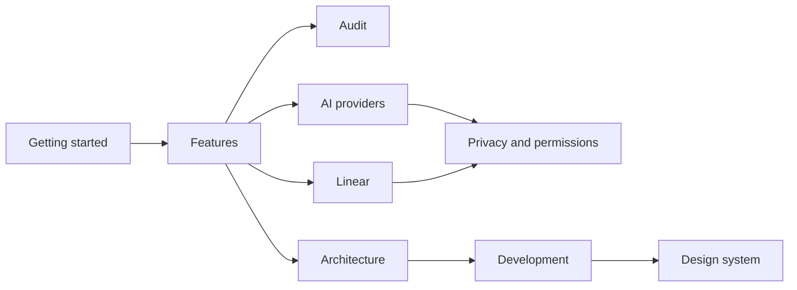

# Pixelpush documentation

The hub for everything about Pixelpush: installing it, using the panel, connecting Linear and an AI model, checking what leaves your browser, and working on the code.

**Docs:** **Home** · [Getting started](getting-started.md) · [Features](features.md) · [Audit](audit.md) · [AI providers](ai-providers.md) · [Linear](linear.md) · [Privacy and permissions](privacy-and-permissions.md) · [Architecture](architecture.md) · [Development](development.md) · [Design system](DESIGN.md) · [Project README](../README.md)

## Find what you need

| I want to... | Read | What you get |
| --- | --- | --- |
| Install the extension and make a first fix | [Getting started](getting-started.md) | Load the unpacked extension, open the side panel and change your first value. |
| Understand what each tab does | [Features](features.md) | The Design, Inspect, Colors, Issue, Changes and Audit tabs, one at a time. |
| Understand how the design audit works | [Audit](audit.md) | How a scan runs, the page scroll, the 72 rules, and how an AI review is checked. |
| Connect an AI model | [AI providers](ai-providers.md) | The four providers, the models and endpoints behind them, and how to test a connection. |
| File issues to Linear | [Linear](linear.md) | Connecting a personal API key, app origins, and how an issue is built and filed. |
| Understand privacy and permissions | [Privacy and permissions](privacy-and-permissions.md) | Which network requests the extension makes, what it stores and where, and why it asks for each permission. |
| Understand how it is built | [Architecture](architecture.md) | The service worker, content scripts and side panel, and how they work together. |
| Contribute or run the scripts | [Development](development.md) | The helper scripts, the browser preview harness and packaging. |
| Understand the design system | [Design system](DESIGN.md) | The palette, type, glass, shape and motion rules, plus the layers brand mark. |

## Panel tour

Screenshots of the Design, Inspect, Issue, Changes and Audit tabs, plus Settings. The Colors tab has no screenshot; the [Features](features.md) page explains every tab in turn.

<table>
  <tr>
    <td align="center" valign="top">
       
      <b>Design</b>
    </td>
    <td align="center" valign="top">
       
      <b>Inspect</b>
    </td>
    <td align="center" valign="top">
       
      <b>Issue</b>
    </td>
  </tr>
  <tr>
    <td align="center" valign="top">
       
      <b>Changes</b>
    </td>
    <td align="center" valign="top">
       
      <b>Audit</b>
    </td>
    <td align="center" valign="top">
       
      <b>Settings</b>
    </td>
  </tr>
</table>

## Suggested reading order

Read Getting started and Features first. Audit goes deeper on the Audit tab. AI providers and Linear are the two integrations
you set up yourself, and Privacy and permissions explains what they send. Architecture,
Development and the Design system are for people working on the code.

## Facts at a glance

| Fact | Value |
| --- | --- |
| Version | 2.1.0 ([`extension/manifest.json`](../extension/manifest.json)) |
| Browser | Chrome 116 or later, Manifest V3, side panel |
| Scripts | Node 22.2 or later ([`package.json`](../package.json)) |
| License | MIT ([`LICENSE`](../LICENSE)); the audit detector is Apache-2.0, see [`THIRD_PARTY_NOTICES.md`](../THIRD_PARTY_NOTICES.md) |
| Source | [github.com/andrewr303/pixelpush](https://github.com/andrewr303/pixelpush) |

> [!NOTE]
> These pages describe the code in this repository. The side panel, page inspector, audit
> bridge and service worker ship as minified bundles, so where a page and the code disagree,
> the code wins. Please [open an issue](https://github.com/andrewr303/pixelpush/issues) if you spot a difference.

## Next

New here? Start with [Getting started](getting-started.md).
