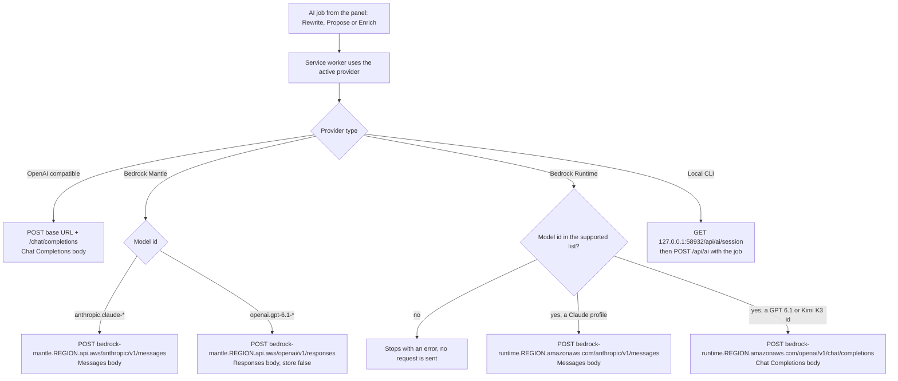
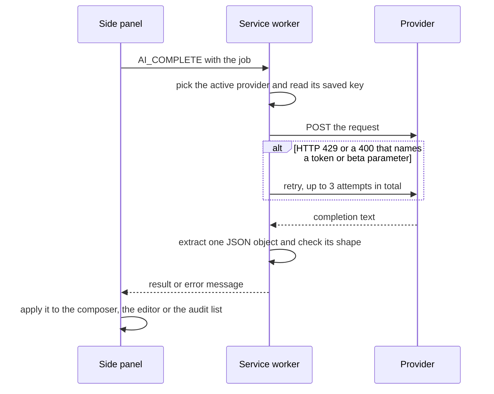

# AI providers

How Pixelpush's three optional AI features work, which providers they can call, and exactly what each provider needs.

**Docs:** [Home](README.md) · [Getting started](getting-started.md) · [Features](features.md) · [Audit](audit.md) · **AI providers** · [Linear](linear.md) · [Privacy and permissions](privacy-and-permissions.md) · [Architecture](architecture.md) · [Development](development.md) · [Design system](DESIGN.md)

## What AI does here

Pixelpush does not host a model and ships with none configured. AI is off until you add a provider in **Settings**, and the **Disable AI features** switch turns it off again without deleting your keys.

| Feature | Where | What it does | What you get back |
| --- | --- | --- | --- |
| **Rewrite with AI** | Issue tab | Turns the raw draft into a cleaner Linear issue. | A new title and body that replace the composer text. **Show raw draft** restores the original. |
| **Propose edits** | Design tab, Edit mode | Suggests CSS for the selected element from the note you wrote in **Instructions**. | A list of property edits applied live to the element. **Undo AI proposal** reverts them. |
| **Enrich with AI** | Audit tab | An AI design review on top of the detector. It does not replace the detector. See [Enrich with AI](#enrich-with-ai-audit-review). | Findings it hides as false hits, up to eight new findings that cite the page outline (suggestions that are not grounded in the page are dropped), reworded findings and a short brief. |

> [!IMPORTANT]
> With no provider saved, the three buttons are visible but disabled (their tooltip reads `Add a provider in Settings`) and Pixelpush makes no AI request. With **Disable AI features** on, the three buttons are hidden, and in this build so are the Audit tab's **Suppress** and **Preview fix** row actions. The switch's own hint reads: `Formatter still runs. Keys stay saved. Rewrite, Propose, and Enrich turn off.`

  

<em>Settings holds the AI switch and the provider cards.</em>

## What gets sent

Every AI job sends a **context pack**, not the page's HTML. Before the first Rewrite or Propose job for each provider type, Pixelpush shows a confirmation dialog that includes: `A context pack (page URL, compact selector, edits, notes — not cookies, HTML, or keys) will be sent to <endpoint>.` The endpoint is the Bedrock host for the two Bedrock types and your base URL, as typed, for OpenAI compatible. If you accept, the answer is remembered for that provider type. If you cancel, nothing is sent and you are asked again next time. Enrich with AI has its own dialog and its own saved answer (see below). Local CLI providers skip both dialogs: the pack goes to your own bridge on `127.0.0.1`, and what the bridge does with it is up to the bridge.

| In the pack | Notes |
| --- | --- |
| Page | URL (for Enrich with AI, without its query string and fragment), host, path, title and capture time. |
| App origins | Whether the page's host matches your app origins, and the list itself. |
| Selected element | Compact selector, full selector path (first 500 characters), tag, component name and a text snippet (first 200 characters). |
| Styles | Computed values for a fixed allowlist of 29 properties (display, flex alignment, gap, padding, margin, width, height, radius, colours, border, opacity, overflow, font family, size and weight, text content). |
| Edits and notes | Each recorded property with its `from` and `to`, and your Instructions notes. |
| Audit findings | Enrich only: key, rule id, category, severity, detail and compact selector for every finding in the list, selected or not. |
| Page digest | Enrich only: a compact outline of the page. See [Enrich with AI](#enrich-with-ai-audit-review). |
| Colour tokens | Up to 40 colour variables from the page. |

Which parts are included depends on the feature. Rewrite adds the raw title and body of your draft, and Propose adds your note. A pack is capped at 40 KiB. If it is larger, Pixelpush drops the page digest, then the tokens, then the full selector, then trims the audit list to 30 findings, and if it is still too large it stops with `The capture is too large to send. Select fewer findings or edits.`

## Enrich with AI (audit review)

Enrich with AI is the one feature that reads more of the page than a selected element. [Design audit](audit.md#ai-review) describes the review from the audit's side; this section covers the provider side: what is sent, which confirmation applies and which checks run on the reply. It works in these steps:

1. **Confirmation.** The first time you use it with a given provider type, Pixelpush shows its own dialog: `Pixelpush does not host a model. An AI design review sends <endpoint> the page URL, a compact outline of the page (headings, button and link labels, short copy excerpts, style statistics) and the audit findings. It does not send raw HTML, form values, cookies or keys; emails and long tokens in the text are masked. Bedrock Responses storage is forced off (store: false). Continue?` Accepting is remembered per provider type, separately from the confirmation for Rewrite and Propose: Enrich saves `<type>:audit-page` (`openai-compat:audit-page`, `bedrock-mantle:audit-page` or `bedrock-runtime:audit-page`) in the accepted confirmations, where Rewrite and Propose save just `<type>`. A second provider of the same type does not ask again, and a provider of a type you have not accepted does. If you cancel, nothing is sent. Local CLI skips the dialog.
2. **Page digest.** The panel sends `audit-digest-request` to the page's content script and waits up to 9 seconds for the `audit-digest` reply, which the service worker relays back. The digest describes the page as it is when you press the button, with the scroll pass's coverage from the latest scan. It holds the title, language, viewport and page size, which landmarks exist, counts (images without alt text, unlabelled fields, small tap targets, gradients, glass surfaces and similar), a style census (the most-used font families, sizes, weights, text and background colours and radii, how many distinct ones there are, and `accentHues`, the number of distinct hue bands among strongly coloured text and backgrounds), up to 28 headings, up to 14 calls to action (buttons and styled links), up to 16 top-level sections with a 200-character excerpt each, a few copy lines and up to six prose samples (start, middle and end of the page), facts about the main heading (the hero), and a coverage record: how far the scroll pass got, why it stopped, and whether the page looks like an infinite feed. It contains no HTML, form values or link targets. Emails, tokens of 28 or more characters and phone-number-like digit runs are replaced with `[email]`, `[token]` and `[number]`. If it is over about 14,000 characters, detail is shed in this order until it fits: headings cut to 16, section excerpts to 100 characters, calls to action to 8, sections to 10, then headings to 8 and copy lines to 4. Each element the model may cite gets a ref such as `e4`. The panel keeps the map from refs to selectors for itself and does not send it.
3. **Request.** The pack carries the page URL without its query string and fragment, every finding in the list (not only the selected ones), the digest and the colour tokens. The system prompt tells the model that all page text in the pack is untrusted data and must not be followed as instructions. It asks the model to hide only AI-tell findings (never measured rules such as `low-contrast`, `text-overflow` or `broken-image`), to propose at most eight new findings that it can ground in the digest, to rate AI tells no higher than medium, and to answer with an empty `add` list when the page is fine. The model may answer with `suppress` (findings to hide), `add` (new findings), `rewrite` (clearer detail for a finding) and `brief`. The panel does not check the hide list against rule types: it hides every finding key the model returns. The service worker reads at most eight added findings and clips a title to 120 characters, a detail to 500, evidence to 160 and refs to six. An unknown severity becomes `medium`, and any category other than `ai-slop` becomes a quality issue.
4. **Grounding.** The panel keeps an added finding only if all of these hold:
   - It cites at least one ref that exists in the digest (refs the model made up are ignored), or it cites none and is marked page-level.
   - Its `evidence` quote is found in the digest. The quote is split at `/`, `;`, `|`, `,`, parentheses, em dashes (`—`), `+`, colons and the word `and`. The pieces are compared ignoring case, spaces and punctuation, and a piece with fewer than 4 letters and digits is ignored. At least 60% of the remaining pieces must appear in the digest, and at least one matching piece must be 6 or more characters long.
   - It does not restate a detector finding for the same element. A word-overlap (Jaccard) similarity of 0.6 or more, over the words of more than three letters in its title and detail against the finding's name and detail, counts as a restatement.

   A kept finding is rated at most `medium` unless it cites a heading or call to action and the model did not label it `ai-slop`; only then can it stay `high`. Kept findings are added to the end of the list with the **AI** source chip. They all share one internal rule id (`ai-product`), so the Audit tab groups them into one card per category, titled with the first one's title, and each keeps its own row. Their category is **AI tells** when the model labelled them `ai-slop` and **Quality issues** otherwise, and a finding with evidence gets `Evidence: …` appended to its description.

The panel tells you what it dropped by adding a note to the brief, such as `2 AI suggestions were dropped: not grounded in the page.` (`1 AI suggestion was dropped: …` for one). The count includes restatements as well as ungrounded findings. If at least three findings were proposed and half or more were ungrounded (a bad ref or evidence that is not in the digest), none is kept and the brief ends with `The AI output was mostly ungrounded, so its suggestions were ignored.` Hides and rewrites from that reply still apply.

If the digest cannot be produced (the page does not answer within 9 seconds, or it errors), Enrich still runs, but it can only hide, reword and write the brief: every added finding is dropped because nothing can be grounded, and the brief says how many. Hidden rows behave like **Suppress**: they stay selected, so they are still counted and filed with the selection (see [Linear](linear.md#what-the-issue-body-contains)). A rescan replaces the list, so added rows and the brief go away and Enrich has to be run again.

## Choose a provider

Pixelpush uses the **active provider**, chosen with the radio button on each card. If none is chosen it falls back to the first enabled provider. Pressing **Test connection** also makes that provider the active one.

| | OpenAI compatible | Bedrock Mantle | Bedrock Runtime | Local CLI |
| --- | --- | --- | --- | --- |
| You supply | Base URL, model, API key | Region, model, Bedrock API key | Region, model, Bedrock API key | CLI profile or absolute binary path |
| Defaults | `https://api.openai.com/v1`, `gpt-4.1-mini` | `us-east-1`, `openai.gpt-6.1-terra` | `us-east-1`, `us.openai.gpt-6.1-terra` | Profile `claude`, 60,000 ms timeout |
| Models | Any text you enter | 3 in a menu | 10 in a menu | Whatever the CLI uses |
| Request goes to | Your base URL, ending in `/chat/completions` | `bedrock-mantle.<region>.api.aws` | `bedrock-runtime.<region>.amazonaws.com` | A bridge on `127.0.0.1` |
| Wire format | Chat Completions | Anthropic Messages for Claude, OpenAI Responses for GPT 6.1 | Anthropic Messages for Claude, Chat Completions for GPT 6.1 and Kimi K3 | Defined by the bridge |
| Auth | `Authorization: Bearer <key>` | `Authorization: Bearer <key>` | `Authorization: Bearer <key>` | `Authorization: Bearer <session token>` from the bridge |
| Needs in AWS | n/a | `bedrock-mantle:CreateInference` | `bedrock:InvokeModel` | n/a |
| In this repo | Yes | Yes | Yes | Client side only. The bridge is not included. |

### Which request path each provider takes

*In words: OpenAI compatible always uses Chat Completions. Bedrock Mantle and Bedrock Runtime pick the wire format from the model id: Claude models use Messages, and the others use Responses (Mantle GPT 6.1) or Chat Completions (Runtime GPT 6.1 and Kimi K3). Local CLI skips HTTP model endpoints and talks to a bridge on your machine.*

## OpenAI compatible

Use this for OpenAI itself or any server that speaks the Chat Completions API.

**Fields.** Base URL, Model (free text), API key. Defaults are `https://api.openai.com/v1` and `gpt-4.1-mini`.

**Endpoint.** Pixelpush trims a trailing slash from the base URL, then builds the request URL like this:

| Base URL you enter | Request URL |
| --- | --- |
| `https://api.openai.com/v1` | `https://api.openai.com/v1/chat/completions` |
| `http://127.0.0.1:8080` | `http://127.0.0.1:8080/v1/chat/completions` |
| `https://example.com/v1/chat/completions` | used as entered |

A URL that already ends in `/responses` is also left as entered, but the request body is always the Chat Completions shape for this provider.

**Request.** `POST` with `Authorization: Bearer <key>` and a JSON body of `model`, the token limit, a system and a user message, and `response_format: { "type": "json_object" }`. The token limit is sent as `max_tokens`, or as `max_completion_tokens` when the model id contains `gpt-6.1`. For model ids that contain `anthropic.` or `gpt-6.1-sol` or `gpt-6.1-terra` it also sends `reasoning_effort: "medium"`.

**Notes.**

- The key is required. With no saved key Pixelpush stops with `Add an API key in Settings.` even for a server that ignores authentication.
- JSON mode is always requested. A server that rejects `response_format` will answer with an HTTP error, which Pixelpush shows as `<label> returned HTTP <status>.`
- If a server answers HTTP 400 with a message that names `max_tokens` or `max_completion_tokens` and contains `unsupported`, `not supported` or `instead`, Pixelpush swaps the parameter name and retries once. This applies to any Chat Completions request, so it also covers Bedrock Runtime requests for GPT 6.1 and Kimi K3.
- An empty Base URL stops with `Set a base URL for this provider.`

## Bedrock Mantle

**Fields.** Region (default `us-east-1`), Model, Bedrock API key.

**Models.** The menu offers `anthropic.claude-opus-5-5`, `openai.gpt-6.1-sol` and `openai.gpt-6.1-terra`. The default is `openai.gpt-6.1-terra`. The card's hint says that Claude Sonnet 5.5 is not on Mantle outside GovCloud and points you to Bedrock Runtime for it.

**Endpoint and wire format.** The host is `bedrock-mantle.<region>.api.aws`, and the model id picks the path:

| Model | URL | Body |
| --- | --- | --- |
| Claude Opus 5.5 | `https://bedrock-mantle.<region>.api.aws/anthropic/v1/messages` | Messages: `model`, `max_tokens`, `system`, one user message, `anthropic_beta: ["effort-2025-11-24"]` and `output_config: { "effort": "medium" }` |
| GPT 6.1 Sol, GPT 6.1 Terra | `https://bedrock-mantle.<region>.api.aws/openai/v1/responses` | Responses: `model`, `store: false`, `max_output_tokens`, a system and a user input, `reasoning: { "effort": "medium" }` |

The path comes from the model id, not from the menu. A saved id that has `anthropic.` at the start or after a dot goes to the Messages path, even if it is not in the menu (the select keeps showing a saved value that is not in its list). An id that neither starts with `openai.gpt-6.1-` nor is a Claude id would go to `https://bedrock-mantle.<region>.api.aws/v1/responses`. You cannot choose those from the menu.

**Headers.** `Authorization: Bearer <key>` and `Content-Type: application/json`. Messages requests add `anthropic-version: 2023-06-01` and `anthropic-beta: effort-2025-11-24`. If a Messages request gets HTTP 400 with a message that mentions `beta`, `output_config` or `effort`, Pixelpush drops those fields and the beta header and retries once.

**IAM.** The identity behind the key needs `bedrock-mantle:CreateInference`.

**Storage is forced off.** Responses requests always carry `store: false`, and Pixelpush refuses to send a Responses request without it (`Bedrock Responses requests must set store: false.`).

## Bedrock Runtime

**Fields.** Region (default `us-east-1`), Model, Bedrock API key.

**Models and the Runtime-profile rule.** Runtime accepts only these ten ids, and all of them are geo (`us.`) or global (`global.`) inference profile ids. A plain model id such as `openai.gpt-6.1-terra` is rejected:

| Family | Accepted ids |
| --- | --- |
| GPT 6.1 Terra | `us.openai.gpt-6.1-terra`, `global.openai.gpt-6.1-terra` |
| GPT 6.1 Sol | `us.openai.gpt-6.1-sol`, `global.openai.gpt-6.1-sol` |
| Claude Opus 5.5 | `us.anthropic.claude-opus-5-5`, `global.anthropic.claude-opus-5-5` |
| Claude Sonnet 5.5 | `us.anthropic.claude-sonnet-5-5`, `global.anthropic.claude-sonnet-5-5` |
| Kimi K3 | `us.moonshotai.kimi-k3`, `global.moonshotai.kimi-k3` |

The default is `us.openai.gpt-6.1-terra`. Any other id fails before a request is made with: `Bedrock Runtime requires a supported model: a geo or global inference profile (us./global.) for GPT 6.1 Sol/Terra, Claude Opus 5.5, Claude Sonnet 5.5 or Kimi K3.`

> [!NOTE]
> **Kimi K3 is Runtime only.** The two Kimi K3 profile ids appear in the Bedrock Runtime menu and nowhere else. They are sent without a reasoning setting and without the 4,096-token floor that Claude and GPT 6.1 ids get (see [Limits](#limits-tokens-timeouts-and-retries)).

**Endpoint.** The host is `bedrock-runtime.<region>.amazonaws.com`, and the model id picks the path:

| Model | URL | Body |
| --- | --- | --- |
| Claude Opus 5.5, Claude Sonnet 5.5 | `https://bedrock-runtime.<region>.amazonaws.com/anthropic/v1/messages` | Messages, the same body as on Mantle |
| GPT 6.1 Sol, GPT 6.1 Terra, Kimi K3 | `https://bedrock-runtime.<region>.amazonaws.com/openai/v1/chat/completions` | Chat Completions: `model`, the token limit, system and user messages and `response_format: { "type": "json_object" }`. The limit is `max_completion_tokens` for GPT 6.1 and `max_tokens` for Kimi K3. GPT 6.1 also gets `reasoning_effort: "medium"`. |

**Headers.** `Authorization: Bearer <key>` and `Content-Type: application/json`. Claude requests add `anthropic-version: 2023-06-01` and `anthropic-beta: effort-2025-11-24`, and have the same one-time retry on a `beta`, `output_config` or `effort` HTTP 400 as on Mantle.

**Token-parameter retry.** Chat Completions requests (GPT 6.1 and Kimi K3) get the same one-time swap as OpenAI compatible. If the server answers HTTP 400 with a message that names `max_tokens` or `max_completion_tokens` and contains `unsupported`, `not supported` or `instead`, Pixelpush renames the parameter (`max_completion_tokens` to `max_tokens`, or the reverse) and retries once.

**IAM.** The identity needs `bedrock:InvokeModel` on the inference profile and on `arn:aws:bedrock:<region>:<account-id>:project/default` (the account's default project). A key that cannot do both gets the `403` message in the error table below.

## Local CLI

Use this to route jobs through a command-line model tool on your own machine.

**Fields.** Profile (`claude`, `codex`, `grok`, `gemini`, `ollama`, `llm`, or `custom path`) and Binary. Choosing a profile fills Binary with the profile name (`custom path` leaves Binary as it was). The card's hint says a custom path must be absolute.

> [!WARNING]
> Pixelpush does not include the local bridge. The provider only works if you run your own bridge on `127.0.0.1:58932` that implements the contract below. Without one, you get `No local bridge is running on 127.0.0.1:58932. Pixelpush does not include one.`

**What the bridge must do** (from the client code):

1. `GET http://127.0.0.1:<port>/api/ai/session` must return `200` with JSON `{ "token": "<non-empty string>" }` and optionally `"port"`. Pixelpush tries the saved port (default `58932`), then `58932`, then `58933`.
2. `POST http://127.0.0.1:<port>/api/ai` with `Authorization: Bearer <token>` and a JSON body of `{ job, binary, args, timeoutMs }`. `job` is the full job object (id, kind, creation time, pack and input). Unlike the HTTP providers, the bridge receives no system prompt, so it is responsible for the prompt. `args` is `[]` and `timeoutMs` is `60000` unless you edit the saved settings by hand.
3. The reply must be JSON with a `text` string (the model output, which should contain one JSON object) or an `error` object (the panel shows its `message`). A `401` status is reported as a rejected token.

## Test connection

Each card has a **Test connection** button. The provider must be **Enabled**, otherwise you get `Enable this provider before testing it.`

- **HTTP providers** (OpenAI compatible, Mantle, Runtime) need a saved key, then send a tiny ping request through the same code path as real jobs. The system message is `Reply with JSON {"ping":true,"model":"<your model id>"} only.` The test passes if the provider returns any non-empty text.
- **Local CLI** only checks that a bridge session can be obtained. It does not run the CLI. The result names the profile.
- An HTTP test is aborted after **5 seconds** and then reports `Cancelled.`
- On success the line under the cards reads `OK · <latency>ms · <model or profile>`. On failure it shows the error message.

## Limits: tokens, timeouts and retries

| Setting | Value |
| --- | --- |
| Default output tokens | 2,048, saved on each new HTTP provider. There is no control for it in Settings. |
| Range | Clamped to 16 to 8,192. |
| Floor for Claude and GPT 6.1 | At least 4,096 for any model id that contains `anthropic.`, `gpt-6.1-sol` or `gpt-6.1-terra`, whatever the provider type, so those use 4,096 with the default. Kimi K3 ids and other models keep 2,048. |
| Parameter name | `max_output_tokens` for Responses, `max_tokens` for Messages, and for Chat Completions `max_tokens` or, when the model id contains `gpt-6.1`, `max_completion_tokens`. |
| Request timeout | None of its own for HTTP providers. A job runs until the provider answers or you press <kbd>Esc</kbd>. |
| Test timeout | 5 seconds. |
| Local CLI timeout | 60,000 ms, passed to the bridge. |
| Retries | HTTP `429`: up to 3 attempts in total, with a random 200 to 599 ms pause between them. A one-time parameter fallback on certain HTTP `400` replies (see [OpenAI compatible](#openai-compatible), [Bedrock Mantle](#bedrock-mantle) and [Bedrock Runtime](#bedrock-runtime)) uses one of those attempts and has no pause. Network errors and other statuses are not retried. |
| Pack size | 40 KiB, see [What gets sent](#what-gets-sent). |

## Job lifecycle

*In words: the panel hands the job to the service worker, which calls the provider, extracts and checks the JSON reply and hands back either a result or an error message. Only extension pages can start a job.*

While a job runs, its button changes to **Cancel** but is disabled, so press <kbd>Esc</kbd> to cancel it.

Replies are expected to be one JSON object. Pixelpush also accepts JSON inside a Markdown code fence, the last `{ ... }` block in the text, and repairs curly quotes and trailing commas. It ignores reasoning, thinking and refusal blocks when joining the reply text.

## Errors and what they mean

| Message | What it means |
| --- | --- |
| `Add a provider in Settings.` | No enabled provider exists, or **Disable AI features** is on. |
| `Add an API key in Settings.` | The active provider has no saved key. Type it and press **Save key**. |
| `Enable this provider before testing it.` | The card's **Enabled** box is off. |
| `Set a base URL for this provider.` | An OpenAI-compatible provider has an empty Base URL. |
| `Bedrock Runtime requires a supported model: …` | The Runtime model id is not one of the ten accepted ids. See [Bedrock Runtime](#bedrock-runtime). |
| `Bedrock Mantle rejected this request (Region <region>). If GET /v1/models works with the same key, …` | HTTP 401. If `GET /v1/models` works with the same key, the key is valid and the IAM user is missing `bedrock-mantle:CreateInference`. Otherwise the key is expired, or it is a short-term key issued in another Region. |
| `Bedrock Runtime rejected this key (Region <region>). Check that the key has not expired; short-term keys only work in the Region that issued them.` | HTTP 401 on Runtime. |
| `The provider rejected this key. Reconnect in Settings.` | HTTP 401 from an OpenAI-compatible provider. |
| `Bedrock Mantle denied this request. Check the key and bedrock-mantle:CreateInference permission.` | HTTP 403 on Mantle. |
| `Bedrock Runtime denied this request. Check the key and bedrock:InvokeModel on the inference profile and arn:aws:bedrock:<region>:{account-id}:project/default.` | HTTP 403 on Runtime. |
| `The provider denied this request. Check the key permissions in Settings.` | HTTP 403 from an OpenAI-compatible provider. |
| `The provider rate-limited the request. Try again in a moment.` | HTTP 429 three times in a row. |
| `<label> returned HTTP <status>.` | Any other non-success status. |
| `The origin is not permitted for this provider: <url>` | The browser's fetch failed with `Failed to fetch` (or a message mentioning `Origin`). The URL is unreachable, wrong, or blocked by the server. Other network errors are shown as the browser reports them. |
| `Provider returned non-JSON.` | The HTTP body was not JSON. |
| `Provider returned an empty completion.` | The reply had no text. |
| `Provider returned text we could not use. Try another model or paste the raw output. Got: …` | The text had no usable JSON object. The first 180 characters follow. |
| `Provider returned text we could not use.` | The JSON parsed but was not an object of the expected shape for that job. |
| `Request failed after retries (HTTP <status>).` | The three attempts ran out without a usable reply. This is rare: it needs a parameter fallback and rate limiting in the same job. |
| `No response from the service worker.` | The panel got no reply to its job message. |
| `Test connection failed.` | The panel got no reply to its test message. |
| `Rewrite title was empty or too long.` | The rewritten title was empty, had a line break or was over 120 characters. |
| `Rewrite dropped recorded visual facts.` | The model flagged that it dropped recorded values. |
| `Rewrite omitted the visual spec table. The raw draft was kept.` | There were edits, but the reply had no `## Visual spec` section. |
| `Rewrite omitted recorded visual facts. The raw draft was kept.` | A `to` value you recorded does not appear in the rewritten body. |
| `Nothing here maps to the inspector.` | **Propose edits** returned nothing the Design editor can apply. |
| `The capture is too large to send. Select fewer findings or edits.` | The context pack is still over 40 KiB after everything Pixelpush can drop has been dropped. **Rewrite with AI** shows a shorter form of this message, `The capture is too large to send.` |
| `Page is not attached; rescan` | The panel has no attached tab, or **Preview fix** was used with no element selected in Design, so the edit cannot be applied. |
| `Cancelled.` | You cancelled, or the 5-second test timer fired. |
| `No local bridge is running on 127.0.0.1:58932. Pixelpush does not include one.` | No bridge answered on any of the candidate ports. |
| `The local bridge rejected the session token.` | The bridge answered `401` on `/api/ai`. |
| `The Pixelpush local bridge is down.` | The request to the bridge failed, or its reply was not JSON, after a session was obtained. |
| `CLI did not return JSON in time (auth?).` | The bridge answered without `text` or `error`. |
| `Inference jobs can only start from the Pixelpush side panel.` | A job request came from somewhere other than the panel. |

Where AWS or a provider sends back its own message, Pixelpush appends it, shortened to 300 characters, as ` AWS said: <message>`. That prefix is used for every HTTP provider, not only AWS ones.

## App origins and AI

App origins do not restrict which AI endpoint Pixelpush calls. They matter in two places:

- The context pack carries whether the page's host is one of your app origins. The Rewrite prompt tells the model to add a third-party line to the issue when it is not, and the model may return `third_party`, `unowned`, `magic_values` or `minified_component` warnings.
- Independently of AI, the Issue tab asks you to confirm before filing a capture from a host that is not an app origin. See [Linear](linear.md#first-party-app-origins-confirmation).

## Where settings and keys are stored

| Item | Storage |
| --- | --- |
| Providers (label, region, base URL, model, token limit, local CLI profile and binary, active provider, **Disable AI features**, app origins, accepted confirmations) | `chrome.storage.sync`, key `pixelpushAiSettings`. Syncs through your Chrome profile. |
| API keys | `chrome.storage.local`, one entry per provider (`pixelpushAiSecret:<provider id>`). They do not sync. |
| Key hint | After you save a key, the card shows a masked hint (first three and last four characters, for example `sk-…abcd`). The hint is stored with the synced provider settings. |

Deleting a provider card deletes its saved key as well.

## Next

- [Features](features.md): where each AI button lives.
- [Linear](linear.md): connecting and filing the issue the rewrite produces.
- [Privacy and permissions](privacy-and-permissions.md): the full list of network requests.
- [Architecture](architecture.md): the service worker's provider router.
