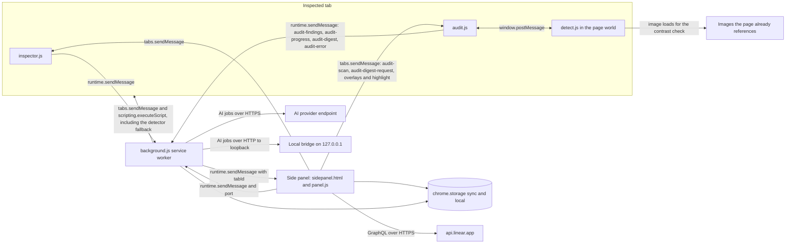
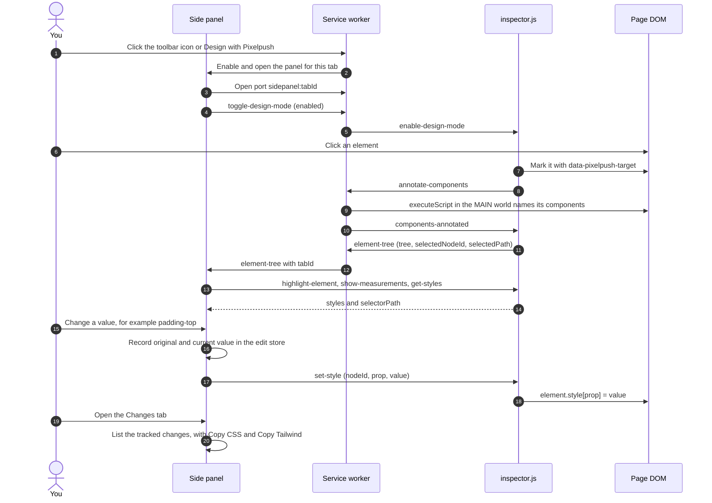
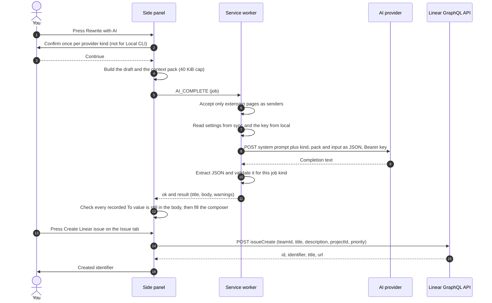
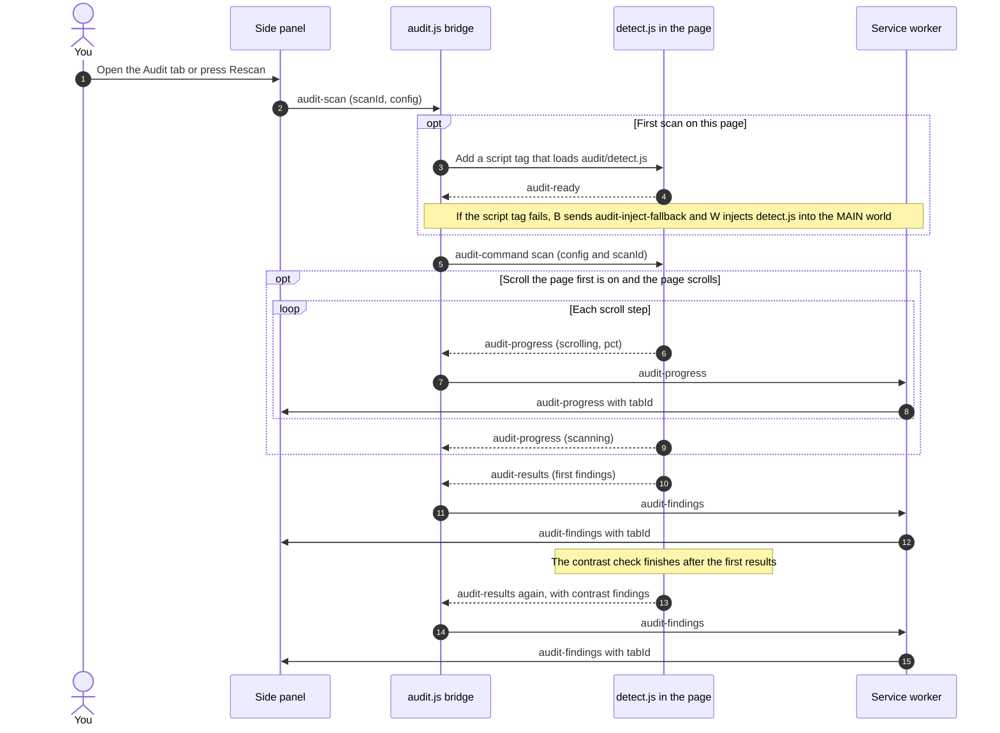
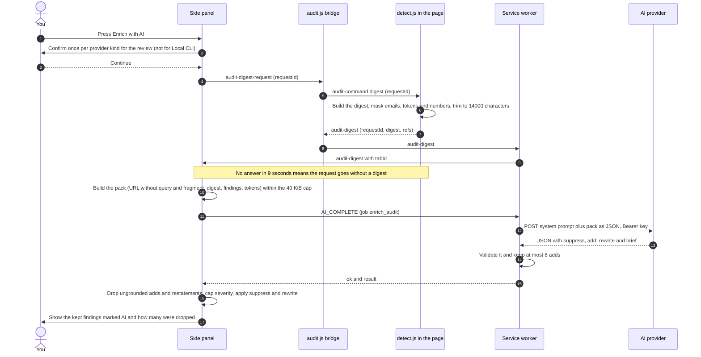

# Architecture

How Pixelpush is put together: which part runs where, what the parts say to each other, and which files you can read as source.

**Docs:** [Home](README.md) · [Getting started](getting-started.md) · [Features](features.md) · [Audit](audit.md) · [AI providers](ai-providers.md) · [Linear](linear.md) · [Privacy and permissions](privacy-and-permissions.md) · **Architecture** · [Development](development.md) · [Design system](DESIGN.md)

> [!NOTE]
> This page describes the code in this repository at version 2.1.0. The side panel, the service worker and the page inspector are compiled, minified bundles with no source tree alongside them, so everything below was read from the shipped output. Where a statement is an inference rather than something the code states, it says so.

## At a glance

Pixelpush is a Manifest V3 extension with five runtime pieces, a rule catalog and a storage layer. It has no server of its own.

| Piece | File | Runs in | Source or compiled |
| --- | --- | --- | --- |
| Side panel UI | `extension/sidepanel.html`, `extension/panel/panel.js`, `tailwind.css`, `pixelpush.css` | The extension's side panel page | `panel.js` is compiled. `pixelpush.css` is readable source. `tailwind.css` is compiled utilities. |
| Service worker | `extension/background.js` | The extension's service worker | Compiled |
| Page inspector | `extension/content-scripts/inspector.js` | Every page, in the content-script (isolated) world | Compiled |
| Audit bridge | `extension/content-scripts/audit.js` | Every page, in the content-script (isolated) world | Compiled |
| Detector | `extension/audit/detect.js` | The page's own JavaScript world, injected on the first scan | Readable source (Apache-2.0) |
| Rule catalog | `extension/audit/antipatterns.json` | Read by the side panel | Readable data |
| Storage | `chrome.storage.sync` and `chrome.storage.local` | Chrome | n/a |

## Component diagram



In words: the side panel talks to the page directly through `chrome.tabs.sendMessage`, and the page reports back through the service worker, which re-sends each message with a `tabId` so every open panel can ignore other tabs. The detector never talks to the extension directly; the audit bridge relays its `window.postMessage` traffic in both directions, so a scan request or a digest request reaches the detector through the bridge, and progress, findings and digests come back through the bridge and the worker. Apart from messages, the detector's only outbound activity is loading images the page already references, for the contrast check. The side panel calls Linear itself. The service worker is the only part that calls AI providers or the local bridge. The panel writes an API key to storage when you save it, but never puts it in a message; the worker reads it from storage for each request.

## Components

### Side panel UI

`sidepanel.html` loads `tailwind.css`, then `pixelpush.css`, then `panel.js` as a module, and mounts a React app into `#app`. The panel has six tabs, in this order in the tab bar: Design, Inspect, Colors, Issue, Changes and Audit. A Settings view replaces the tab content when the gear icon is on.

What lives in the panel, as far as the bundle shows:

- **State for the inspected tab.** The element tree, the selected element's computed styles, page colours and tokens, audit findings and the edit store (see [Data model](#data-model)). All of it is in memory. The panel does not persist edits.
- **The Linear client.** GraphQL queries and the `issueCreate` mutation, run with `fetch` from the panel (see [Linear](linear.md)).
- **The AI front end.** It builds the context pack, asks for confirmation the first time you use a provider kind (the audit review has its own confirmation, stored as `<kind>:audit-page`), sends `AI_COMPLETE` to the service worker and validates what comes back (see [AI providers](ai-providers.md)). For the audit review it also asks the page for a digest first and checks every AI-added finding against that digest before showing it (see [Flow: AI design review of the audit](#flow-ai-design-review-of-the-audit)).
- **The capture formatter.** It turns edits, notes and selected audit findings into the issue title and Markdown body, and into the CSS and Tailwind copy formats.

The panel opens per tab. The worker sets the side panel to disabled globally at start-up, then enables it for one tab and loads `sidepanel.html?tabId=<id>` when you click the toolbar icon or the **Design with Pixelpush** context-menu item. The panel reads `tabId` from its own URL.

### Service worker

`background.js` registers these listeners:

| Listener | What it does |
| --- | --- |
| `action.onClicked`, `contextMenus.onClicked` | Enable and open the side panel for that tab |
| `runtime.onInstalled` | Creates the **Design with Pixelpush** menu item (`open-pixelpush`, all contexts) and injects `inspector.js` and `audit.js` into already-open `http` and `https` tabs |
| `runtime.onConnect` | Tracks a port named `sidepanel:<tabId>`. When the panel disconnects, it tells that tab to leave design mode |
| `tabs.onUpdated` | When a tab with an open panel finishes loading, re-enables design mode (up to 5 attempts, 200 ms apart) and tells the panel with `tab-refreshed` |
| `runtime.onMessage` | Re-sends `audit-findings`, `audit-error`, `audit-overlays-toggled`, `audit-progress` and `audit-digest` from a tab to the panel with the sender's `tabId`; on `audit-inject-fallback` injects `audit/detect.js` into the tab's `MAIN` world (and reports `audit-error` if that fails); relays tree messages, forwards design-mode toggles, runs component annotation and routes AI jobs (below) |

The AI router is the other half of the worker. It accepts `AI_COMPLETE`, `AI_ABORT` and `AI_TEST` only from an extension page (a sender with no `tab` and a `chrome-extension://<id>` URL), so a page's content script cannot start an inference job. It resolves the active provider, reads the key from `chrome.storage.local`, sends one request, extracts JSON from the reply and validates it per job kind. Details are in [AI providers](ai-providers.md) and [Privacy and permissions](privacy-and-permissions.md).

### Content scripts

The manifest injects both files into every page at `document_idle`.

- **`inspector.js`** is the page inspector. It builds the element tree and sends it to the service worker (when design mode is switched on, after a selection, and when the page URL changes). It also answers the panel's messages: return computed styles, apply an inline style, text or icon edit, draw the hover outline and measurement overlay, and scan the page for colours and CSS custom properties. Hover and click capture are only attached after `enable-design-mode` and removed on `disable-design-mode`. The file is large (about 714 KB) because it bundles React and the Lucide icon set. The inspector's own code is the first 6 KB or so (selector, tree and measurement helpers) and the last 19 KB (from `main(){`).
- **`audit.js`** is a small bridge (about 7 KB). On the first `audit-scan` it appends a `<script>` that loads `audit/detect.js` from the extension into the page and holds the scan command until the detector answers `audit-ready`; later scans are posted straight away. Commands reach the detector as `window.postMessage` calls of the form `{ source: "audit-command", action }`: the panel's scan, overlay, highlight and `audit-digest-request` messages all travel this way. It checks the shape of every reply (results, errors, progress, digests and overlay state) before forwarding it to the service worker, renaming `audit-results` to `audit-findings` on the way. If the script tag fails to load (for example a strict page CSP), it sends `audit-inject-fallback` and the worker injects `detect.js` with `scripting.executeScript` into the `MAIN` world instead.

To name framework components, the worker runs two small functions in the page's `MAIN` world (`annotate-components` for the picked element and its ancestors, `annotate-component-tree` for the first 3000 elements under `body`). They read React, Vue, Angular and Svelte internals and write a `data-pixelpush-component` attribute that the inspector then reads.

### Detector

`audit/detect.js` is a vendored, readable file of several thousand lines, derived from Impeccable (Apache-2.0; see [`THIRD_PARTY_NOTICES.md`](../THIRD_PARTY_NOTICES.md)) with Pixelpush additions that are marked in the file. In extension mode it waits for `audit-command` messages and announces itself with `audit-ready`. On `scan` it first walks the page once so lazy content exists (unless the **Scroll the page first** audit setting is off), posting `audit-progress` messages while it does; then it runs its checks against the live DOM, draws overlays on the page and posts `audit-results` (or `audit-error`). The scan configuration the panel sends also switches on the detector's visual-contrast check (up to 30 text candidates), which samples the colour behind text, including images; that check finishes after the first results are out, so the detector can post `audit-results` again, and with the scroll setting off it measures text below the fold later, as it scrolls into view. On `digest` it builds a compact outline of the page for the AI review and posts `audit-digest`. The scroll pass, the rules and the review are described on the [Audit](audit.md) page; what each one reads, changes and sends is in [Privacy and permissions](privacy-and-permissions.md#what-runs-on-pages). `audit/antipatterns.json` is the matching rule catalog (72 rules at this version: 41 `slop` and 31 `quality`): one entry per rule, each with an `id`, `name`, `category` (`slop` or `quality`) and `description`. The panel fetches it from the extension to build the **Detection rules** list.

### Storage

Settings that should follow you across devices go to `chrome.storage.sync`. Secrets and caches stay in `chrome.storage.local`. The full key list, and what each holds, is in [Privacy and permissions](privacy-and-permissions.md#what-is-stored-and-where).

## Messages

All messages are plain objects with a `type` string. Nothing here is a public API; it is what the bundles send today.

### Panel to page (`chrome.tabs.sendMessage`)

| `type` | Handled by | Carries | Reply |
| --- | --- | --- | --- |
| `highlight-element`, `clear-highlight` | inspector | `nodeId` | none |
| `show-measurements` | inspector | `nodeId` | none |
| `get-styles` | inspector | `nodeId` | `{ styles, selectorPath }` |
| `set-style` | inspector | `nodeId`, `prop`, `value` | none |
| `set-text` | inspector | `nodeId`, `value` | none |
| `set-icon` | inspector | `nodeId`, `name`, `svgChildren` | none |
| `select-by-selector` | inspector | `selectorPath` | none |
| `get-page-colors` | inspector | none | `{ colors, detailed }` |
| `get-page-tokens` | inspector | none | list of `{ name, value }` |
| `audit-scan` | audit bridge | `scanId`, `config` (`disabledRules` if any, `lineLengthMax` 80 or 120, `spotlightBlur`, `autoScroll`, `visualContrast: true`, `visualContrastMaxCandidates: 30`, `visualContrastScrollOffscreen`, which follows `autoScroll`) | none (progress and results arrive as messages) |
| `audit-toggle-overlays`, `audit-unhighlight` | audit bridge | none | none |
| `audit-highlight` | audit bridge | `selector` | none |
| `audit-digest-request` | audit bridge | `requestId` (a fresh UUID per request) | none (the digest arrives as an `audit-digest` message) |

### Panel to service worker (`chrome.runtime.sendMessage` and a port)

| `type` | Carries | Reply |
| --- | --- | --- |
| `toggle-design-mode` | `enabled`, `tabId` | none. The worker forwards `enable-design-mode` or `disable-design-mode` to the tab |
| `AI_COMPLETE` | `job` (`id`, `kind`, `createdAt`, `pack`, `input`) | `{ ok: true, result }` or `{ ok: false, error }` |
| `AI_ABORT` | `id` of the job | `{ ok: true, aborted: true }` |
| `AI_TEST` | `providerId` | `{ ok, latencyMs, model }` or `{ ok: false, error }` |
| port `sidepanel:<tabId>` | none | Opened while the panel is attached to a tab. Its disconnect is the signal to leave design mode |

### Page to service worker

| `type` | From | Purpose |
| --- | --- | --- |
| `element-tree` | inspector | Tree of the page plus `selectedNodeId` and `selectedPath` |
| `inline-edit-commit` | inspector | A double-click text edit finished (`nodeId`, `selectorPath`, `original`, `value`) |
| `annotate-components`, `annotate-component-tree` | inspector | Ask the worker to name components in the `MAIN` world |
| `spa-navigation` | inspector | The URL changed without a reload. The worker has no handler for it; the panel listens for it directly |
| `audit-findings`, `audit-error`, `audit-overlays-toggled` | audit bridge | Scan results (the detector's `audit-results`, which can arrive twice per scan), a scan failure, or the overlay visibility |
| `audit-progress` | audit bridge | `scanId`, the phase (`scrolling`, then `scanning`) and, while scrolling, `pct` as a fraction from 0 to 1. Sent only while a scroll pass runs |
| `audit-digest` | audit bridge | The page digest and its reference map (`refs`) for a `requestId`, or an `error` |
| `audit-inject-fallback` | audit bridge | `scanId`. The detector script tag failed; inject it from the worker |

### Service worker to panel and page

| `type` | To | Purpose |
| --- | --- | --- |
| `element-tree`, `inline-edit-commit`, `audit-findings`, `audit-error`, `audit-overlays-toggled`, `audit-progress`, `audit-digest` | panel | Re-sent with the sender's `tabId` added. The panel ignores any whose `tabId` is not its own tab, and drops `audit-findings`, `audit-error` and `audit-progress` whose `scanId` is not the current scan |
| `tab-refreshed` | panel | A tab with an open panel finished loading |
| `enable-design-mode`, `disable-design-mode` | tab | Attach or detach the inspector's hover and click capture |
| `components-annotated`, `component-tree-annotated` | tab | Annotation finished; the inspector rebuilds and resends its tree |

The inspector and the audit bridge also contain handlers that nothing in this repository sends: `build-tree`, `hide-measurements` and `audit-remove`. The worker has a `linear-connect` handler that the panel never sends and that always fails (see [Linear](linear.md)).

### Audit messages end to end

The panel and the detector never talk directly: a request goes panel, bridge, detector, and the answer goes detector, bridge, worker, panel. This table follows each audit message from where it is produced to where it is consumed, including the three that the scroll pass and the AI review added (`audit-progress`, `audit-digest-request` and `audit-digest`).

| Message | Produced by | Relayed by | Consumed by |
| --- | --- | --- | --- |
| `audit-scan` (`scanId`, `config`) | Panel, when you open the Audit tab or press Rescan, and automatically 250 ms after a reload or a route change while the Audit tab is open | Bridge: loads the detector on the first scan, holds the command until `audit-ready`, then posts it as `audit-command` `scan` with `scanId` merged into the config | Detector: runs the scroll pass unless `autoScroll` is false, then the checks |
| `audit-progress` (`scanId`, `phase`, `pct`) | Detector, only while a scroll pass runs: `scrolling` with a `pct` after every step, then `scanning` | Bridge checks the shape and forwards it as a runtime message, the worker adds `tabId` and broadcasts it | Panel, only for its own tab and the current `scanId`. It shows "Scrolling the page to load everything… N%" while the phase is `scrolling` and "Scanning this page…" otherwise |
| `audit-findings` (the detector's `audit-results`) | Detector, after the checks and again when the contrast check finishes or, with scrolling off, when text below the fold is measured | Bridge renames it, the worker adds `tabId` | Panel, which replaces its findings list |
| `audit-digest-request` (`requestId`) | Panel, after you accept the review's dialog, with a 9-second timer | Bridge posts it as `audit-command` `digest` | Detector, which builds the digest |
| `audit-digest` (`requestId`, `digest`, `refs`, or `error`) | Detector | Bridge checks the shape and forwards it, the worker adds `tabId` | Panel, which hands it to the waiting request with the same `requestId`. An error, a timeout or a failed send all count as "no digest" |

### Between the audit bridge and the detector

The bridge and the detector share the page's `window`, so they talk with `window.postMessage`. The bridge sends `{ source: "audit-command", action: "scan" | "highlight" | "unhighlight" | "toggle-overlays" | "remove" | "digest" }`, with `config` (including `scanId`) for `scan`, `selector` for `highlight` and `requestId` for `digest`. The detector answers with `{ source: "audit-ready" }`, `{ source: "audit-progress", scanId, phase, pct }`, `{ source: "audit-results", scanId, count, findings }`, `{ source: "audit-digest", requestId, digest, refs }` (or `requestId` and `error`), `{ source: "audit-error", message }` or `{ source: "audit-overlays-toggled", visible }`. If the detector is not loaded in the page, nothing answers a `digest` command and the panel gives up after 9 seconds. Scripts on the page can see these messages too; see [Privacy and permissions](privacy-and-permissions.md#what-runs-on-pages).

## Flow: select and edit an element



In words: selection mode is on by default when the panel opens, so the panel asks the worker to switch the inspector on. A click is captured by the inspector, which asks the worker to name components, rebuilds its tree and reports the selection. The panel then asks for the element's styles. Each edit is recorded in the panel and applied to the page as an inline style. Reloading the page discards the inline styles; the panel copies any unsaved edits to the clipboard when it sees the reload.

## Flow: file an issue, with an optional AI request



In words: the AI step is optional and always started by a button press. Without it, the panel goes straight from the generated draft to `issueCreate`. On the Design, Changes and Audit tabs the primary button composes the draft and opens the Issue tab; on the Issue tab the same button files it. The other two AI jobs (`propose_edits` and `enrich_audit`) follow the same path from `AI_COMPLETE` onward and differ in the pack contents and in how the panel applies the result. `enrich_audit` also has a digest step before the job is sent and a grounding step after the result comes back; both are in [Flow: AI design review of the audit](#flow-ai-design-review-of-the-audit).

For a Local CLI provider the worker does not call a model endpoint. It asks `127.0.0.1` for a session token and posts the job to the bridge instead.

## Flow: a design audit scan



In words: the panel starts a scan with `audit-scan`. The first time on a page, the bridge loads the detector and holds the command until the detector answers `audit-ready`; if the script tag is blocked (for example by a strict page CSP) the bridge asks the worker to inject the file into the `MAIN` world instead. With the scroll setting on and a page that scrolls, the detector walks the page and reports `audit-progress` after each step, which the panel shows as a percentage. It then checks the page and posts the findings, and posts them again when the contrast check finishes. Every reply passes the bridge's shape check on its way out, and the panel drops replies from other tabs or from an older scan.

## Flow: AI design review of the audit



In words: the confirmation dialog comes first and uses its own consent entry (`<kind>:audit-page`), so declining it requests nothing from the page. The panel then asks the page for a digest and waits up to 9 seconds. If none arrives, the request is still sent with the detector findings only, and no AI-added finding is kept. The worker validates the reply as for any job and keeps at most 8 AI-added findings. The panel keeps an AI-added finding only if it cites references that exist in the digest (a page-level finding may cite none) and most of the evidence it quotes appears in the digest. It drops suggestions that restate a detector finding on the same element (word overlap of 0.6 or more), lowers a high rating to medium when the finding is an AI tell or cites no heading or call to action, and discards every AI-added finding when at least half of three or more are ungrounded. The summary line tells you how many suggestions were dropped. The exact rules are in [Privacy and permissions](privacy-and-permissions.md#what-the-panel-does-with-the-answer) and the user-facing description is in [Audit](audit.md#how-suggestions-are-checked).

## Data model

The shapes below are reconstructed from the minified code to explain it. The real code is untyped JavaScript.

### Edits and changes

Edits live only in the panel's memory, in a `Map` keyed by the element's selector path.

```ts
type EditStore = Map<string /* selectorPath */, {
  selector: string              // compact selector shown in the UI
  component: string | null      // detected framework component, if any
  componentPath: string | null
  props: Map<string /* camelCase CSS property */, {
    original: string            // value when first edited
    current: string
    tokenName?: string          // set when a page token was chosen
  }>
  note?: string                 // your note for this element
}>
```

A selector path joins each ancestor below `<html>` with ` > `. Each segment is `tag#id.class.class`, plus `:nth-child(n)` when there is no id and an identical sibling exists. Text edits are stored as the property `textContent` and icon swaps as `lucideIcon`.

The Changes tab, the issue body and the AI pack all read a grouped view of that store.

```ts
type Group = {
  component: string | undefined
  componentPath: string | null
  elements: {
    selector: string            // last segment of selectorPath
    selectorPath: string
    changes: { prop: string; from: string; to: string }[] // only where original differs from current
    note?: string
  }[]
}
```

`to` is `var(--token)` when a custom property was chosen, the token name when it is not a custom property, and the current value otherwise. Elements with neither a change nor a note are dropped, and groups are keyed by component name.

The editable property set is an allowlist of 29 camelCase names: `display`, `flexDirection`, `justifyContent`, `alignItems`, `gap`, `rowGap`, `columnGap`, the four `padding*` and four `margin*` sides, `width`, `height`, `borderRadius`, `backgroundColor`, `borderColor`, `borderWidth`, `borderStyle`, `opacity`, `overflow`, `fontFamily`, `fontSize`, `fontWeight`, `color` and `textContent`. The worker drops any AI-proposed property outside this list, with a warning. The panel uses the same list to choose which computed styles go into the AI context pack.

### The element tree

The inspector builds the tree and sends it whole.

| Limit | Value |
| --- | --- |
| Nodes per tree | 3000 |
| Depth | 25 |
| Child nodes kept per parent | 50 |
| Skipped tags | `script`, `style`, `noscript`, `link`, `meta`, and Pixelpush's own overlays |

Each element node has `nodeId`, `tag`, `id` (with a leading `#`), `classes` (with leading dots), `component`, `childCount`, `children` and `selectorPath`, plus `hidden: true` when the element is invisible (opacity 0, `visibility: hidden`, `display: none` or `aria-hidden="true"`). Non-empty text nodes become `#text` entries with their `textContent`. `nodeId` values are only meaningful for the current tree; the inspector keeps a map from id to live node and rebuilds it on every tree build.

### Audit findings

`detect.js` posts a list of items, each with a `selector`, `tagName`, a `rect`, `isPageLevel`, `isHidden` and a `findings` array. Each finding carries `type`, `category` (`slop` or `quality`), `severity`, `detail`, `ignoreValue`, `name` and `description`. The audit bridge drops any reply that does not match this shape. The panel keys a finding as `<itemIndex>:<findingIndex>`. Findings that **Enrich with AI** adds are appended to the same list in the same shape, with `type: "ai-product"`, `source: "ai"`, a `category` of `slop` (for an AI tell) or `quality`, a `severity` of `low`, `medium` or `high`, and no `rect`; they exist only in the panel's memory.

### Stored data

| Area | Key | Holds |
| --- | --- | --- |
| `sync` | `pixelpushAiSettings` | AI on/off switch, active provider, provider list (no key), app origins, accepted disclosures, bridge port |
| `sync` | `pixelpushAiPins` | Audit rules you pinned as suppressed, per host |
| `sync` | `disabledRules`, `lineLengthMode`, `spotlightBlur`, `autoScroll` | Audit settings, stored at the top level |
| `local` | `pixelpushAiSecret:<providerId>` | One AI API key per provider |
| `local` | `linearAuth` | Linear workspaces and credentials |
| `local` | `linearTeams_<orgId>` | Cached Linear teams, with a timestamp |
| `local` | `reviewPrompt` | State of the GitHub star prompt |

[Privacy and permissions](privacy-and-permissions.md#what-is-stored-and-where) explains each one, including one caveat about the synced provider list.

## What is source and what is compiled

The repository ships the extension exactly as Chrome loads it. There is no `src/` directory, no bundler configuration and no `package.json` dependency for the compiled parts. That has practical consequences.

| Path | State | What it means for you |
| --- | --- | --- |
| `extension/manifest.json`, `extension/sidepanel.html` | Readable | Edit directly |
| `extension/panel/pixelpush.css` | Readable | The design layer. Loaded after `tailwind.css`, unlayered, so it wins. Edit directly |
| `extension/audit/detect.js`, `extension/audit/antipatterns.json` | Readable, vendored | Edit directly, and keep [`THIRD_PARTY_NOTICES.md`](../THIRD_PARTY_NOTICES.md) accurate |
| `extension/panel/panel.js` (about 1.0 MB) | Compiled and minified | Identifiers are mangled to one or two letters. UI strings, message types and storage keys are intact, so search for those |
| `extension/background.js` (about 29 KB) | Compiled and minified | A few very long lines. The AI router and the message relay are in here |
| `extension/content-scripts/inspector.js` (about 714 KB) | Compiled and minified | Mostly bundled library code. Pixelpush's own code is at the start of the file and from `main(){` to the end |
| `extension/content-scripts/audit.js` (about 7 KB) | Compiled and minified | The bridge |
| `extension/panel/tailwind.css` | Compiled | Tailwind utilities that the panel bundle already uses. There is no Tailwind build here, so a utility class that is not already in the file has no styles |

Libraries compiled into the bundles, according to [`THIRD_PARTY_NOTICES.md`](../THIRD_PARTY_NOTICES.md): React and React DOM, the Lucide icon set, the WXT runtime and Tailwind CSS. Markers in the output (a `wxt:` event prefix and a content-script context class in both content scripts, and a Vite-style `modulepreload` helper in `panel.js`) point to a WXT and Vite build. That is an inference. No build configuration is in this repository.

To find your way around a bundle, search for a stable string rather than a function name. The bundles are mostly very long lines, so print only the match and some context:

```sh
grep -o '.\{80\}AI_COMPLETE.\{200\}' extension/background.js
grep -o '.\{120\}Disable AI features.\{200\}' extension/panel/panel.js
```

## The preview harness

`tools/preview/` renders the real `panel.js` in an ordinary browser tab so you can work on the panel's look without loading the extension. It is a development tool and is not part of the extension package.

- `serve.mjs` serves `extension/` at `/` and the harness at `/__preview/`, on `127.0.0.1` only.
- `chrome-stub.js` defines a minimal `chrome` object: `runtime` (`id`, `getURL`, `sendMessage`, `connect`, `onMessage`, `onConnect`), `tabs` (`query`, `get`, `sendMessage`, `create`, `onActivated`, `onUpdated`) and in-memory `storage` areas (`sync`, `local` and `session`, plus `onChanged`). Sends resolve to `undefined`, and the stub reports one tab, `https://example.com/`.
- `boot.js` fetches `sidepanel.html`, copies its stylesheets, fetches `panel.js` as text, optionally rewrites it, and imports it from a Blob URL. With `?demo=1` it patches the root render call so the panel starts in its built-in demo state with a sample element tree and styles.

No service worker, content script, side-panel API or scripting API runs in the harness, so selection, audits, Linear and AI jobs cannot work there. [Development](development.md#the-preview-harness) lists the URL parameters.

## Constants worth knowing

| Where | Constant |
| --- | --- |
| Page colours | Samples up to about 2500 elements, returns the top 40 colours by count with up to 5 example selectors each |
| Page tokens | CSS custom properties and `.bg-*` and `.text-*` utility colours from readable stylesheets, capped at 100 |
| AI context pack | 40 KiB cap, with a fixed order of things to drop (see [Privacy and permissions](privacy-and-permissions.md#what-the-ai-request-contains)) |
| AI requests | Up to 3 attempts. HTTP 429 is retried after a 200 to 599 ms pause. One HTTP 400 that complains about the token-limit parameter (or, on the Messages API, about the beta and effort fields) is retried once with the parameter swapped or the fields removed. The output token limit defaults to 2048, is clamped to 16 to 8192, and is raised to 4096 for Anthropic model ids (`anthropic.…`, or `us.anthropic.…` and other prefixed forms) and for ids containing `gpt-6.1-sol` or `gpt-6.1-terra` |
| Audit scroll | Steps of 70% of a viewport (clamped to 240 to 900 px), a 130 ms pause per step plus up to 450 ms while in-view images load, at most 48 steps, 30 viewport heights from the top or 6 seconds, a 350 ms wait at the bottom, then back to where you were and a 450 ms settle. Ends early on trusted user input (wheel, touch, key other than a bare modifier, mouse, pointer), 3 steps that did not move, 3 growth events at the bottom, a hidden tab or a route change. If more than 30% of the text is still invisible, up to 20 blocks are scrolled into view for up to 5 seconds. Details: [Audit](audit.md#scrolling-the-page-first) |
| Page digest | At most 14,000 characters of JSON: up to 28 headings, 14 calls to action, 16 sections with 200-character excerpts and 6 prose samples. Emails, 28-character-plus tokens and 10-character-plus digit runs are masked. The panel waits 9 seconds for it |
| AI-added findings | At most 8 per reply. The panel drops ungrounded ones and restatements (word overlap 0.6 or more), lowers high to medium for AI tells and for findings that cite no heading or call to action, and discards all of them when at least half of 3 or more are ungrounded |
| Contrast check | Up to 30 text candidates per scan. Each image it loads has 800 ms to arrive and is drawn onto a canvas of at most 640 pixels on its longest side |
| Test connection | Aborts after 5 seconds |
| Linear teams cache | 5 minutes, then revalidated in the background |
| Linear lists | 50 issues per list, 30 for search |

## Next

- [Development](development.md): scripts, the preview harness and how to change each file type.
- [Privacy and permissions](privacy-and-permissions.md): permissions, network traffic and storage in detail.
- [AI providers](ai-providers.md): provider setup and behaviour.
