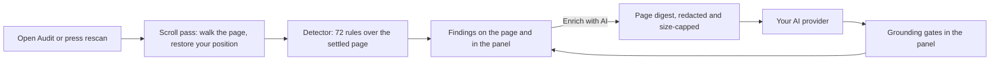

# Design audit

How the Audit tab finds design problems and AI-generated-page tells: the page scroll, the rules, the optional AI review, and how each part is tested.

**Docs:** [Home](README.md) · [Getting started](getting-started.md) · [Features](features.md) · **Audit** · [AI providers](ai-providers.md) · [Linear](linear.md) · [Privacy and permissions](privacy-and-permissions.md) · [Architecture](architecture.md) · [Development](development.md) · [Design system](DESIGN.md)

## How a scan runs



*In words: a scan first scrolls the page so lazy content exists, then the detector measures it and the findings appear. The optional AI review sends a compact digest of the page to your provider, and every suggestion that comes back is checked against that digest before it is shown.*

## Scrolling the page first

Lazy-loaded images, reveal-on-scroll sections and infinite lists only exist after the page has been scrolled, so a scan of the untouched page misses them. Before measuring, the detector walks the page once and puts you back where you were. It is on by default; turn it off with **Scroll the page first so lazy-loaded sections are audited** in the audit settings (the **Audit settings** button in the Audit toolbar).

| Behavior | Value |
| --- | --- |
| Step size | 70% of the viewport height, clamped to 240–900 px |
| Pause per step | 130 ms, plus up to 450 ms while an image in view is still loading |
| Limits | 48 steps, 30 viewport heights or 6 seconds, whichever comes first |
| At the bottom | Waits 350 ms for lazy content or infinite scroll to extend the page; stops after two quiet checks |
| Stops early on | Your own wheel, touch, key (not a bare modifier), mouse or pointer input; three stalled steps; three growth events at the bottom (an infinite feed); a hidden tab; navigation to another route |
| Scroll container | The document, or the largest inner scrolling pane when the document itself does not scroll |
| Still-hidden text | If more than 30% of the text (at least 150 characters) is still invisible after the walk, each hidden block is scrolled to the middle of the screen (up to 20 blocks, 5 seconds) to trigger its reveal |
| Afterwards | Restores your original position (unless you interrupted it or the route changed), then waits 450 ms before measuring |

The panel shows **Scrolling the page to load everything… N%** while it runs. Smooth-scroll animations are switched off for the pass and restored. If a scan starts while another is still scrolling, the older pass is cancelled and your original position is kept.

Text-over-image contrast is checked too, for up to 30 candidates; with scrolling on, off-screen candidates are scrolled into view to measure them.

## What the detector looks for

The catalog is [`extension/audit/antipatterns.json`](../extension/audit/antipatterns.json): 72 rules in two groups. **AI tells** are patterns that mark a page as generic or generated. **Quality issues** are real usability, legibility and accessibility problems. The first 46 rules come from the vendored Apache-2.0 detector (see [THIRD_PARTY_NOTICES.md](../THIRD_PARTY_NOTICES.md)); 26 were added in this repository.

Five of the original rules were declared but never ran in the browser build, so they never fired: `marketing-buzzword`, `aphoristic-cadence`, `em-dash-overuse`, `numbered-section-markers` and `broken-image`. They are implemented now. A sixth, `design-system-font-size`, still has no detection code in the browser build and cannot fire. The em-dash rule fires at 8 or more dashes and at least one per 500 characters of body copy; the catalog's earlier cut-off of three dashes was noisier.

### Added AI tells

| Rule | Flags |
| --- | --- |
| `placeholder-copy` | Lorem ipsum, "your title here" and similar filler |
| `ai-voice-copy` | Phrases such as "stands as a testament" and "ever-evolving landscape", scored by density |
| `accent-word-headline` | One word in a heading set apart by italics, colour, weight or a gradient |
| `radial-halo` | A chromatic radial-gradient glow on the page, a section or a `::before`/`::after` layer |
| `blob-decor` | A large blurred round gradient used as decoration |
| `glass-overuse` | Four or more translucent blurred surfaces |
| `emoji-icons` | Three or more emoji standing in for icons |
| `tinted-icon-coin` | Three or more icons in a faint square of their own colour |
| `uniform-card-grid` | Three or four identical icon-heading-sentence cards in a row |
| `stat-row-cliche` | A row of three or four headline numbers with small captions |
| `stock-avatars` | Avatars from generator services in testimonial-style blocks |
| `template-punctuation` | Middle-dot meta strings, typed arrows on links, "WORD - fragment" labels |
| `pulsing-dot` | A pulsing status dot with no live data |
| `placeholder-links` | Three or more links to `#` with no handler |

### Added quality issues

| Rule | Flags |
| --- | --- |
| `missing-alt` | An image with no alt text, or an alt that is a file name |
| `input-no-label` | A field with no label, or only a placeholder |
| `control-missing-name` | A link or button with no accessible name (icon-only controls) |
| `small-tap-target` | A control under 24×24 px that crowds other controls (WCAG 2.2, 2.5.8) |
| `link-not-distinguishable` | A link inside text that differs only by a subtle colour (WCAG 1.4.1) |
| `focus-outline-removed` | A stylesheet that removes the focus outline and offers no replacement (WCAG 2.4.7) |
| `generic-link-text` | Several links that just say "Learn more" or "Click here" |
| `horizontal-overflow` | The page scrolls sideways |
| `content-hidden-at-rest` | More than 30% of the text stays invisible even after scrolling through it |
| `token-sprawl` | Many near-identical font sizes, radii or shadows with no shared scale |
| `missing-lang`, `heading-one` | No `lang` on `<html>`; no `<h1>` |

Each rule has guards against its usual false positives, taken from how axe-core, Lighthouse and the cited catalogs avoid them: hidden and visually hidden elements are skipped, decorative images are allowed, a Tailwind `focus:outline-none` utility is not treated as a missing focus style when the page restyles `:focus-visible`, and so on. Thresholds are starting values and have not been calibrated on a labelled set of real pages.

### Modern colour spaces

Chrome reports computed colours in the space the page authored them in, so a page written with `oklch()` returned strings the detector could not read. They parsed as "no colour", fell back to white, and produced false contrast failures. The detector now has the browser convert `oklch()`, `oklab()`, `lab()`, `lch()`, `hwb()`, `color()` and `color-mix()` colours. On the Pixelpush panel itself this removed eight false contrast failures.

## AI review

**Enrich with AI** on the Audit tab asks your configured provider to review the page. It is optional, off until you add a provider, and asks for confirmation the first time you use it with each type of provider (a Local CLI provider is not asked). See [AI providers](ai-providers.md) for setup.

### What is sent

A compact digest of the page, built in the page and capped at about 14 KB: the title, language and viewport size; landmarks; counts such as images without alt text, unlabelled fields and small targets; a census of font families and sizes, colours and radii; up to 28 headings, 14 calls to action and 16 sections with a 200-character excerpt; a few prose samples; facts about the hero; and how much of the page the scroll pass covered. The audit findings and your design tokens go along with it, and the page URL without its query string or fragment.

Not sent: raw HTML, form values, cookies or keys. Emails, long tokens and number sequences in the text are masked. The digest labels page text as untrusted so instructions hidden in a page are not followed. Details are in [Privacy and permissions](privacy-and-permissions.md).

### How suggestions are checked

Every element the model may mention has a short id (`e4`) in the digest. A suggestion is kept only when it passes these gates in the panel:

1. It cites ids that exist in the digest and quotes a fact from the digest as evidence. Anything else is dropped.
2. It does not restate a detector finding on the same element.
3. AI-tell suggestions are rated at most medium; high is kept only for other suggestions that cite a heading or a call to action.
4. If the response has three or more suggestions and half or more are ungrounded, the whole response is ignored.

The model is asked for at most 8 new suggestions, and the service worker reads no more than 8 of them.

The panel tells you how many suggestions were dropped. Suggestions appear as rows marked **AI**, in the same lists as detector findings, and are highlighted on the page like any other row. If the scroll pass did not cover the page (a hidden tab, a stall, an infinite feed), the model is told to treat anything below the covered area as unknown, not clean.

## Testing it yourself

[`tools/preview/fixtures/slop.html`](../tools/preview/fixtures/slop.html) is a deliberately generic, AI-looking page with real design problems and a section that is only built when scrolled into view. With `npm run preview` running, open `/__preview/fixtures/slop.html`, then in the console:

```js
document.documentElement.dataset.auditExtension = "true"
const s = document.createElement("script")
s.src = "/audit/detect.js"
document.head.append(s)
window.postMessage({ source: "audit-command", action: "scan", config: { scanId: "t", autoScroll: true } }, "*")
```

Results arrive as `audit-results` messages on `window`. The research record logs 6 rule types on this page before the audit work and 29 after, scanned in extension mode in Chromium; treat that as a rough reference, because the count moves when rules change. The scroll pass does not run in a hidden tab, so keep the tab visible.

[`tools/preview/fixtures/clean.html`](../tools/preview/fixtures/clean.html) is the negative control: a plain, well-built page that should report little or nothing. Scan it after any rule change to catch false positives.

The sources and reasoning behind the thresholds are in [`research/audit-2026-10/`](../research/audit-2026-10/outputs/audit-improvements-decision-report.md).

## Next

- [AI providers](ai-providers.md): set up the provider behind Enrich with AI.
- [Privacy and permissions](privacy-and-permissions.md): what the digest and the scan send and change.
- [Features](features.md#audit): the Audit tab, control by control.
