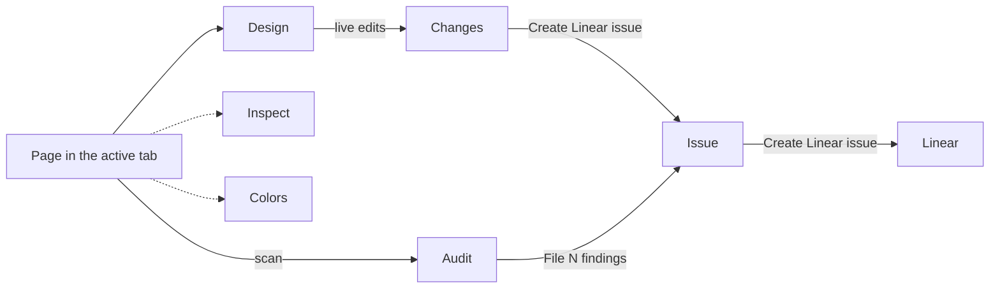
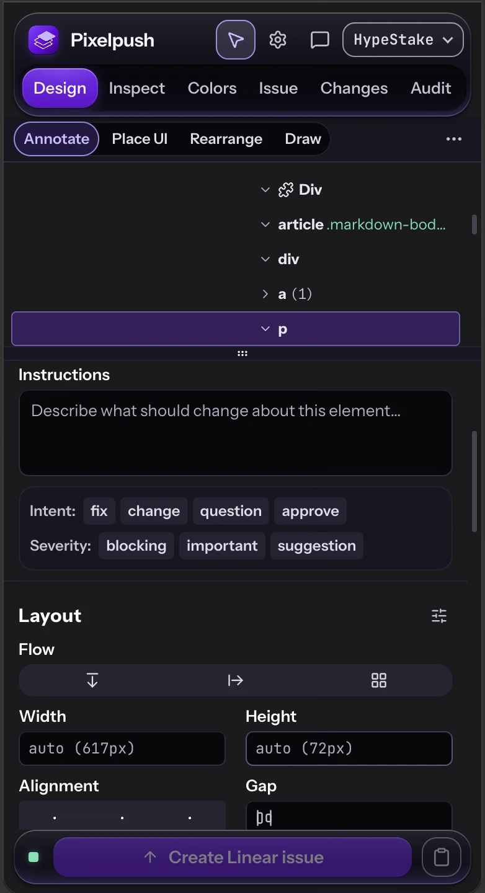
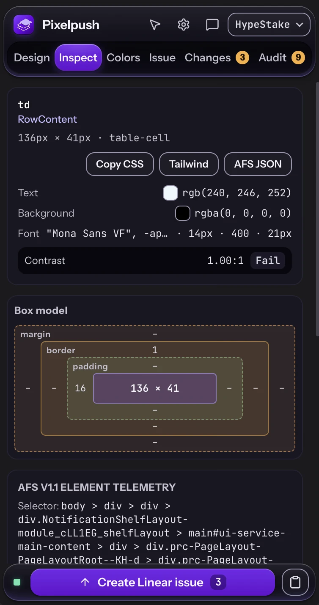
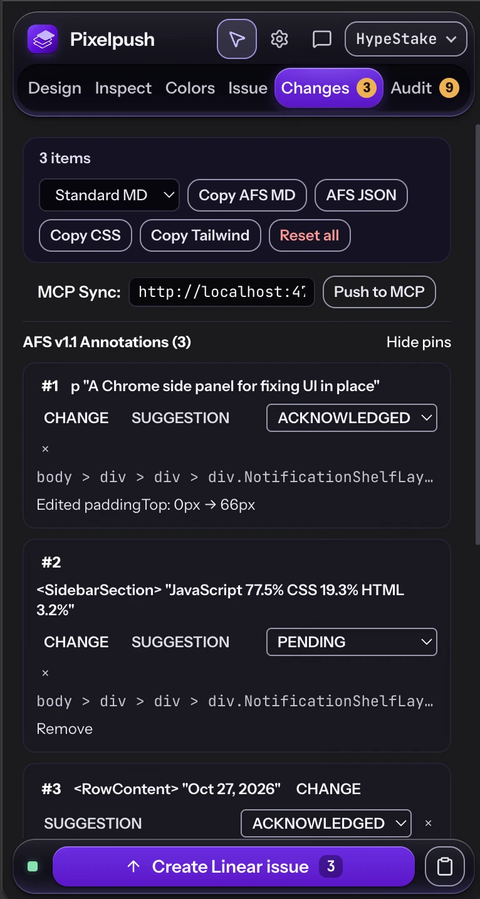
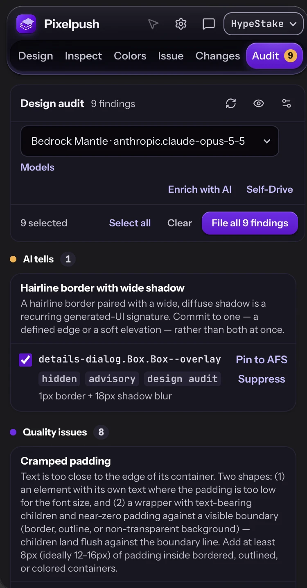
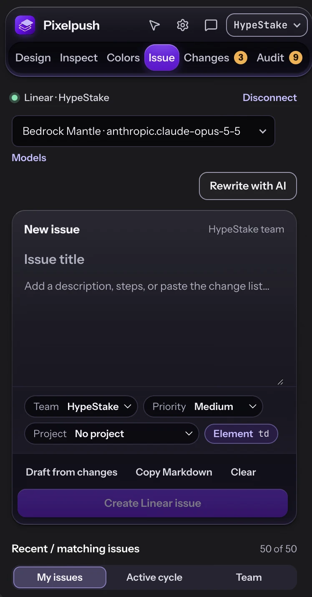
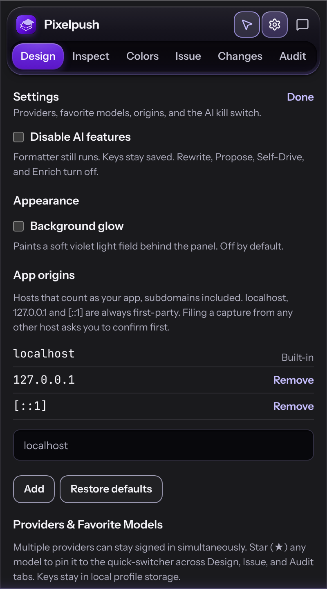

# Features

A tour of quick capture and of every tab in the Pixelpush side panel, plus Settings, the context-menu entries, selection mode and keyboard navigation.

**Docs:** [Home](README.md) · [Getting started](getting-started.md) · **Features** · [Audit](audit.md) · [AI providers](ai-providers.md) · [Linear](linear.md) · [Privacy and permissions](privacy-and-permissions.md) · [Architecture](architecture.md) · [Development](development.md) · [Design system](DESIGN.md)

## At a glance

**Quick capture** files a screenshot of an element, an area or the whole window to Linear straight from the page, without opening the side panel. The toolbar icon opens a small menu with the three capture modes and **Open side panel**. See [Quick capture](#quick-capture).

The tab strip reads **Design, Inspect, Colors, Issue, Changes, Audit**. This page covers them in a task order instead: Design, Inspect, Colors, Changes, Audit, then Issue, which is where everything ends up.

| Tab | What you get | What you can copy or send |
| --- | --- | --- |
| [Design](#design) | Element tree, in-page floating annotation toolbar (`Annotate`, `Place UI`, `Rearrange`, `Draw`, `Self-Drive`, `Freeze`), plus a live style editor and **AFS v1.1+** intent/severity/thread fields. | Edits and AFS annotations flow to Changes. |
| [Inspect](#inspect) | Size, colours, font, contrast, box model and **AFS v1.1+ Element Telemetry** of the selected element. | **Copy CSS**, **Tailwind**, **AFS JSON**. |
| [Colors](#colors) | The colours the page actually uses, with roles and contrast. | **Copy hex**, **Copy raw**, **Export all**. |
| [Changes](#changes) | Every edit as a `from → to` diff, plus **AFS v1.1+ annotations** (pins, placed UI wireframes, rearrangements, drawings, AI critiques, threads). | **Copy CSS**, **Copy Tailwind**, **Copy AFS Markdown** (`Compact`, `Standard`, `Detailed`, `Forensic`), **Copy AFS JSON**, **Sync to MCP**, **Reset all**. |
| [Audit](#audit) | Scrolls the page (by default), then scans it with 72 rules for design and quality problems, highlights each one, lets you **Pin to AFS**, and supports **Self-Drive** autonomous AI critique walkthroughs. | Selected findings and AFS pins go to an issue. |
| [Issue](#issue) | Composer (with **AI Quick Switcher** and **Rewrite with AI**) and recent issues for Linear. | **Create Linear issue**. |



*In words: Design edits feed Changes, an Audit scan produces findings, and either one can be turned into a draft on the Issue tab, which files it to Linear. Inspect and Colors only read the page.*

## Quick capture

Quick capture turns what you see on a page into a Linear issue in a few seconds: pick the element (or drag an area, or take the whole window), type what is wrong, and file it. The issue gets the screenshot and everything Pixelpush can tell about the page and the element, formatted as sections under your text.

**Start a capture.**

| From | Element | Area | Full window |
| --- | --- | --- | --- |
| Toolbar icon (opens the Pixelpush menu, <kbd>Alt</kbd><kbd>Shift</kbd><kbd>P</kbd>) | **Element** or <kbd>E</kbd> | **Area** or <kbd>A</kbd> | **Full window** or <kbd>W</kbd> |
| Keyboard, anywhere on the page | <kbd>Alt</kbd><kbd>Shift</kbd><kbd>E</kbd> | <kbd>Alt</kbd><kbd>Shift</kbd><kbd>S</kbd> | <kbd>Alt</kbd><kbd>Shift</kbd><kbd>W</kbd> |
| Right-click menu | **Capture an element for Linear** | **Capture an area for Linear** | **Capture the full window for Linear** |

These are Chrome's suggested shortcuts; Chrome skips any that clash with another extension, and you can change them on `chrome://extensions/shortcuts` (the menu's **Shortcuts** link opens it). On macOS <kbd>Alt</kbd> is <kbd>⌥</kbd>.

**Pick.** In element mode, hover to outline an element with its tag, classes and size, and click to capture it. <kbd>↑</kbd> moves to the parent and <kbd>↓</kbd> back down, <kbd>Enter</kbd> captures the outlined element, and <kbd>Esc</kbd> or right-click cancels. Clicks go to Pixelpush, not to the page. In area mode, drag a rectangle. Full window captures at once.

**Quick view.** A popover opens 40 px beside what you captured, with the subject still outlined on the page. It flips to the left near the right edge of the window; a full-window capture sits in the bottom-right corner. It has:

- **Issue title** (<kbd>Enter</kbd> moves to the description) and a description box. Your text comes first in the issue; the captured details are added below it.
- **Attached:** **Element** (or **Area**) and **Page**, which open those tabs of the full composer.
- The screenshot thumbnail with its size, the component path (`<PlanCard> › <Button>`) or, for an area, the likely subject, and **Mark up**.
- **Draft with AI**, when an AI provider is set up: the fast model writes the title and a short description from the screenshot, the element, its CSS and the console (see [Draft with AI](#draft-with-ai)).
- **Team** and **Priority** menus, **Full composer**, and **Create issue** (<kbd>⌘</kbd><kbd>↵</kbd> or <kbd>Ctrl</kbd><kbd>↵</kbd>).

After filing, the popover shows `<ID> created in <Team>` with **Open in Linear** and **New capture** (another capture in the same mode). Clicking outside the popover does nothing, so a draft is never lost by accident. <kbd>Esc</kbd> closes an open menu first; otherwise it discards the capture, and a **Capture discarded · Undo** toast gives you six seconds to bring it back.

**Full composer.** **Full composer**, **Mark up**, **Element** or **Page** expands the popover into the full composer, and **Quick view** collapses it again. Both views edit the same draft, and the draft is saved as you type, so reloading the page's composer frame keeps it.

- **Added below your text** toggles which sections go into the issue: **Screenshot**, **Element** (or **Area**), **Page**, **Console** and **Network**. **Preview description** shows the result.
- **Screenshot**: frame it as the element (or area) or the full window, **Attach full window** as a second image, **Recapture**, and mark it up with a pen, boxes, ellipses, arrows and numbered pins (each pin gets a note that is listed under the screenshot), in five colours, with undo, redo and clear.
- **Element**: the component path and its source file and line (React, Vue, Svelte and Angular dev builds), the selector, size, text, role and test id, and the computed styles with the rule that sets each one (`capture.css:130`). A style is flagged when it differs from the same property on similar elements (the matching button in the neighbouring cards, or elements with the same main class), which is often the bug.
- **Page**: URL, browser, viewport, the detected framework and capture time; the console errors and warnings the page logged before the capture; and its fetch and XHR requests, with only failed ones ticked. Tick or untick single lines. The tab's coral badge counts console errors and failed requests.
- **AI**: the model choice (**Fast** or **Thorough**), the description style (**Detailed**, **Short**, **With steps**), progress, what the model found in the code, suggested priority, labels and assignee with **Apply**, and **Restore your text**.
- **Description preview**: the issue as Linear will show it.
- **Fields**: **Team**, **Project**, **Status**, **Priority**, **Assignee** and **Labels**, loaded from the selected team. Changing the team resets the status to that team's default and drops a project, assignee or labels that do not exist in it. The last team and project you filed to are the next default.

**What the issue contains.** Your text, a rule, then `### Screenshot` (the marked-up crop, and the full window when attached, uploaded to Linear), `### Element` or `### Area`, `### Page`, `### Console` and `### Failed requests`, each only when it is included and has content, and a collapsed **Details for developers** section with the full selector, computed styles, matching CSS rules, an HTML excerpt and the AI's findings. The page URL is also attached to the issue as a link.

**Draft with AI.** It uses the provider that is active in Settings, with no extra setup. The first time per provider type it asks before sending anything. **Fast** (used by the quick view) reads the screenshot, the element, its CSS rules and the console and network lines you kept. **Thorough** also reads up to five related files the page loaded, such as the stylesheet that holds the element's rules and, on a dev server or with source maps, the component source, with more reasoning effort. With Bedrock Runtime and a Claude model, Fast is Claude Sonnet 5.5 and Thorough is Claude Opus 5.5; for other providers both use the model you configured. A model that does not accept images drafts from the page data alone. The model's findings must cite a file or rule that is in the capture, or they are dropped. What is sent is listed in [Privacy and permissions](privacy-and-permissions.md#quick-capture).

**Limits.** Linear must be connected on the side panel's Issue tab first. Pages Chrome does not let extensions script (`chrome://` pages, other extensions, the Chrome Web Store) cannot be captured; the menu says so. Console and network lines are recorded from the moment a page loads, so a tab that was open before Pixelpush was installed starts recording at install time. Iframes are captured as part of the screenshot, but their elements cannot be picked one by one.

## The send bar

The bar along the bottom is shared by Design, Inspect, Colors and Changes. The Issue tab carries its own **Create Linear issue** button in the composer footer, and the Audit tab carries **File N findings** in its header, so the bar is hidden on those two tabs.

- **Connection line.** `Linear · <workspace>`, or `Not connected to Linear — open the Issue tab to connect`.
- **Main button.** It reads **Create Linear issue** with your change count. Pressing it builds a draft and switches to the Issue tab. It does not file yet. It is disabled when Linear is not connected or there is nothing to send. Audit's **File N findings** (or **File all N findings** when every finding is selected) does the same for the selected findings.
- **Copy button.** Copies the issue as Markdown (`# title`, a blank line, then the body). If you have not typed a title or description it copies a freshly built draft.

Pressing the main button (or **Draft from changes** in the Issue composer) again rebuilds the draft and replaces the text in the composer.

## Design

<p align="center">
  
</p>

<p align="center"><em>Design: the tree on top, the editor below, and the grip between them.</em></p>

**What it shows.** An element tree of the page (`body` down, 148 px tall by default) with a draggable grip below it, and the editor for the selected element. Tree rows show the tag, `#id` and `.classes`, or the component name when one is detected (React, Vue, Angular and Svelte are recognised). Text nodes appear as quoted rows. An amber dot at the end of a row marks an edited element, and elements that are invisible on the page (opacity 0, `visibility: hidden`, `display: none` or `aria-hidden="true"`) are dimmed. An **Edit / Info** switch above the editor flips between the editor and the same card the Inspect tab shows.

**How you use it.**

1. Select an element by clicking it on the page (see [Selection mode](#selection-mode)) or by choosing a row in the tree. Hovering or focusing a row outlines that element on the page.
2. Edit values. Single-line fields commit when you press <kbd>Enter</kbd> or click out of the field, and <kbd>Esc</kbd> puts the draft back to the current value. In numeric fields <kbd>↑</kbd> and <kbd>↓</kbd> nudge the value by 1 (10 with <kbd>Shift</kbd>; 0.1 for opacity and 100 for font weight) without committing it. A field whose value differs from the page's original wears an amber ring, and the small undo control next to its label restores that one value on the page.
3. Optionally write what should change in **Instructions** at the top. It is a multi-line box, so <kbd>Enter</kbd> adds a line and the note is saved when you click out of it. The note travels with the element into Changes and the issue, and it is what **Propose edits** works from.

The editor has these groups:

| Group | Controls |
| --- | --- |
| In-Page Floating Toolbar Bar | Controls for the in-page floating annotation toolbar (`Toolbar: On/Off`, `Annotate`, `Place UI`, `Rearrange`, `Draw`, `Self-Drive`, `Freeze`, `Pins: On/Off`, and `Clear AFS`). |
| Instructions & AFS v1.1+ | A free-text note for the element, **AFS v1.1+ Intent** (`fix`, `change`, `question`, `approve`), **Severity** (`blocking`, `important`, `suggestion`) as single-select pills (press the selected pill again to clear it), **Status** (`pending`, `acknowledged`, `resolved`, `dismissed`), an **AI Quick Switcher** + **Propose edits** button, a **Proposed fix** card with **Apply proposed fix** and **Dismiss** when an AI or Self-Drive fix is attached, and an **AFS Thread** reply list. Saving a note or editing styles automatically creates or updates a numbered in-page AFS pin (`[data-annotation-marker]`). |
| Layout | Flow (vertical, horizontal, grid) and alignment, width and height, an optional min and max size toggle, gap (row and column gap for grids, plus grid columns and rows), padding and margin (top, bottom, left, right), and **Clip content**. |
| Appearance | Opacity, corner radius (with a toggle for the four corners). |
| Fill | Colour, through a picker with **Custom** and **Tokens** tabs. **Tokens** lists the page's colour variables. A value picked there is recorded by token name. |
| Stroke | Border style (none, solid, dashed, dotted, double), weight (with a per-side toggle) and colour. |
| Effects | Add or remove one drop shadow and edit its X, Y, blur, spread and colour. |
| Typography | Font family, weight, size, line height, letter spacing, alignment and text colour. |
| Content | **Text** when the element holds only text, and an icon picker when the element carries a `lucide` class. |

### In-Page Floating Annotation Toolbar & AFS v1.1+ Modes

When design mode is active, Pixelpush renders a floating bottom-right toolbar (`#pixelpush-floating-toolbar`) inside `#pixelpush-afs-root` on the page alongside the sidebar:

- **Annotate (`select`)**: Hover to outline an element and click to select it. Hold <kbd>Alt</kbd> / <kbd>Option</kbd> and click repeatedly to cycle through the overlapping layers at the cursor, or <kbd>Ctrl</kbd> / <kbd>Cmd</kbd> + click to add a multi-select annotation. Elements inside open shadow roots are outlined on hover but cannot be selected, and iframe contents are not inspected (see Limits). Click a numbered pin to open the inline AFS v1.1+ popover editor with Intent (`fix`, `change`, `question`, `approve`) and Severity (`blocking`, `important`, `suggestion`) pills.
- **Place UI (`place`)**: Choose from 12 wireframe component types (`button`, `input`, `text`, `card`, `image`, `section`, `nav`, `modal`, `badge`, `divider`, `avatar`, `toggle`), optionally dim the page with `Blank Canvas`, then drag on the page to draw a wireframe box (its size and position are fixed once placed) with spatial context (nearest siblings and parent container) and a configuration popover.
- **Rearrange (`rearrange`)**: Click elements to capture their original bounding boxes and drag them to new positions with dashed ghost outlines, connector lines, and automatic `rearrangeSpec` spatial deltas.
- **Draw (`draw`)**: Freehand SVG drawing directly over the viewport, grouped into `drawingStroke` AFS annotations.
- **Self-Drive (`Self-Drive`)**: Launches an autonomous AI design walkthrough (`self_driving_critique`) that inspects candidate elements on the page, spotlights each target in the viewport, and attaches structured AFS v1.1+ annotations with 2–3 sentence design critiques and one-click CSS/text fix proposals.
- **Freeze (`Freeze`)**: Injects a global pause stylesheet (`animation-play-state: paused !important`) and pauses `<video>` elements so transient motion states can be inspected and annotated.
- **Block Clicks (`Blocked` / `Block Clicks`)**: On by default, so a click selects the element and the page does not act on it. Switch it off to let the page handle the click as well (a link navigates, a button runs its handler) while the element is still selected.
- **Pins (`Pins: On/Off`) & Copy AFS**: Toggles numbered `[data-annotation-marker]` pins on the page and copies the full AFS v1.1+ report directly to the clipboard.

**Limits.**

- Edits are inline styles applied to the live page in that tab. Nothing is written to the site, and a reload discards them (Pixelpush copies the unsaved list to your clipboard when that happens).
- The tree reads at most 3,000 nodes (text nodes count), 25 levels deep and 50 children per element, and skips `script`, `style`, `noscript`, `link` and `meta`.
- The content scripts run in the top frame only (the manifest does not set `all_frames`) and the tree walks `childNodes`, so iframe contents and shadow roots are not inspected.
- A shadow with several layers, or an inset shadow, cannot be edited. The editor says so and, if you had already changed that shadow, offers **Revert**.
- Selecting by clicking is only available while selection mode is on and the Audit tab is not open.
- **Propose edits** needs a configured provider and a non-empty note. Its result waits in a **Proposed fix** card under the AI row, listing each `property from → to` with the model's reason. **Apply proposed fix** applies the edits as tracked changes (and **Undo AI proposal** takes them back); **Dismiss** drops them. See [AI providers](ai-providers.md).

## Inspect

<p align="center">
  
</p>

<p align="center"><em>Inspect: a read-only card for the selected element.</em></p>

**What it shows.** For the selected element: its tag, id and classes (and component name if found), its width × height and `display`, the **Text** and **Background** colours, the **Font** (family, size, weight, line height), a **Contrast** row, a **Box model** diagram (margin, border, padding, content size), and an **AFS v1.1+ Element Telemetry** card (`fullPath`, `accessibility`, `reactComponents`, `cssClasses`). With nothing selected it says `Select an element to inspect.`

**How you use it.** Select an element, read the card, and press **Copy CSS**, **Tailwind**, or **AFS JSON** to put its values or full AFS v1.1+ telemetry payload on the clipboard.

- **Contrast** is the ratio of the element's own computed text colour to its own computed background colour, with AA, AAA or Fail badges (and an AA Large badge when the large-text result differs). It does not look at ancestor backgrounds: a semi-transparent or transparent colour is blended over the other colour of the pair, not over what is behind the element. The row is left out when either colour cannot be parsed.
- **Copy CSS** writes a rule whose selector is the element's full selector path and whose body lists every captured style value that is a non-empty string.
- **Tailwind** converts the same values mechanically.

**Limits.**

- Copy CSS dumps everything the inspector captured, including helper entries that are not CSS properties: `width-computed` and `height-computed` always, and `text-content` when the element holds only text. Delete those lines before pasting into a stylesheet.
- Tailwind output is a starting point. Longhand properties such as `padding-top` become utilities like `pt-[24px]`. Properties with no mapping fall back to a `property-[value]` token (for example the `padding: 8px 16px` shorthand becomes `padding-[8px_16px]`), which is not a valid Tailwind class.

## Colors

**What it shows.** A **Page palette** strip, one segment per colour sized by how often it is used, with `N colors · M uses`. Below it the colours in use on the page, most-used first. Each row has a swatch, the hex value in capitals with its count (`6×`), the roles it appears in (`background`, `border`, `text`), a WCAG grade (AAA, AA, AA Large or Fail) with the contrast ratio against white (`#ffffff`), and an "Aa" sample in the colour on a white tile.

**How you use it.**

- Type in **Filter hex / role…** to narrow the list by hex, raw value or role.
- Click a row, or its segment in the palette strip, to expand it: the raw computed value (for example `rgb(17, 24, 39)`), the contrast ratio against `#FFFFFF`, **Used by** with up to five selectors (the last two parts, the full path on hover), and **Copy hex**, **Copy raw** and, when an element is selected in Design, **Use as fill**, which sets that element's background colour as a tracked change.
- **Export all** copies the filtered list as a `:root { --color-1: #…; }` block followed by a `/* palette (hex,count,roles) */` list.

**Limits.**

- The scan reads each element's computed `background-color`, `border-color` and `color`. On pages with more than about 2,500 elements it samples every n-th element, and it keeps the 40 most-used colours.
- Only values it can parse as `rgb()`, `rgba()` or hex are counted, and transparent values are skipped.
- The palette is read when the panel opens and again after a page load. It does not refresh when the page changes in other ways, such as in-page navigation or your own edits.
- The contrast badge is always against white, not against the colour the text sits on. Use Inspect for an element's real pair.

## Changes

<p align="center">
  
</p>

<p align="center"><em>Changes: every edit as a diff, ready to copy or file.</em></p>

**What it shows.** A count (`N changes`) and every tracked edit grouped by component, or under `Unowned Elements` when no component name was found. Each element lists `property  old → new` for every edited property and shows your **Instructions** note in quotes. The tab strip badge shows the same count.

**How you use it.**

- Click an element card (or focus it and press <kbd>Enter</kbd> or <kbd>Space</kbd>) to jump back to Design with that element selected. A card shows the selector, a `#N · intent · severity` chip when the element has an AFS pin, each edit as `property old → new` with the old value struck through, and your note in quotes.
- The toolbar stays at the top while you scroll. Its copy buttons and **Reset all** are disabled while there is nothing to copy or reset.
- **Copy CSS** puts one rule per edited element on the clipboard. The selector is the element's full selector path, the declarations are the edited properties in kebab-case, and a note becomes a `/* note: … */` comment. A value you picked from the colour **Tokens** tab is written as `var(--token-name)`.
- **Copy Tailwind** puts one `<!-- selector path -->` comment per element followed by one line of utility classes. A note becomes a `<!-- note: … -->` comment.
- **AFS v1.1+ Export & MCP Sync** lets you choose a Markdown verbosity level (**Compact**, **Standard**, **Detailed**, or **Forensic**), **Copy AFS Markdown**, **Copy AFS JSON** (each item of `annotations` conforms to `extension/schema/annotation.v1.1.json`), or **Push to MCP** to push the session's annotations to an MCP server (default `http://localhost:4747`). The address must start with `http://` or `https://`; the button reads **Pushing…** while the request runs, and a success shows `Synced N annotations`. The push reports an error when the server stores fewer annotations than were sent.
- **AFS v1.1+ Annotations List** shows every in-page pin, placed UI wireframe, rearranged element, freehand drawing, and Self-Drive critique with its `#N` badge, `intent`, `severity`, `status`, thread replies, and a one-click **Apply Proposed Fix** button when an AI fix is attached.
- **Reset all** puts every edited style and text back to its original value on the page, then clears the tracked list, including your Instructions notes and AFS pins, and shows `Changes & pins cleared`.

```css
body > main > h1#title {
  padding-top: 24px;
  font-size: 32px;
}
```

```html
<!-- body > main > h1#title -->
pt-[24px] text-[32px]
```

*Illustrative. Selectors and values come from your page. The class mapping covers display, flex and grid alignment, gap, padding, margin, sizes, radius, opacity, colours, borders, overflow, type, shadow and grid templates; any other property is written as `property-[value]`.*

**Limits.**

- Text edits (changing the visible text of an element) are tracked but are not part of the Copy CSS or Copy Tailwind output. They do appear in the issue.
- **Reset all** restores each edited property by writing its original value back as an inline style, the same way the per-field undo does, so reload the page to drop those inline styles entirely. Icon swaps are not reverted.
- Edits are per panel session. They are cleared after you file an issue and when the page reloads.

## Audit

<p align="center">
  
</p>

<p align="center"><em>Audit: findings grouped by category, each highlighted on the page.</em></p>

**What it shows.** A scan of the whole page against a catalogue of design rules, grouped into two categories:

| Category | Count | What it covers |
| --- | --- | --- |
| **AI tells** | 41 | Patterns typical of generated UIs, for example gradient text, side-tab accent borders, nested cards, bounce easing, overused fonts, marketing buzzwords, placeholder copy and emoji used as icons. |
| **Quality issues** | 31 | Contrast, tiny text, tight leading, cramped padding, line length, skipped headings, broken images, missing alt text, unlabelled fields, small tap targets, text overflow and similar. |

That is 72 rules in [`extension/audit/antipatterns.json`](../extension/audit/antipatterns.json), run by the detector in [`extension/audit/detect.js`](../extension/audit/detect.js) (Apache-2.0, see [THIRD_PARTY_NOTICES.md](../THIRD_PARTY_NOTICES.md)). Each rule appears once as a card with its name and description, and under it one row per occurrence: the element's selector (or `page-level`), a `hidden` chip if the element is not visible, a severity chip, and a source chip (`Design audit`, or `AI` for rows added by **Enrich with AI**). [Design audit](audit.md) explains how a scan runs, which 26 rules were added to the original 46, and how the AI review is checked.

<details>
<summary>All 72 rules by name</summary>

**AI tells (41):** Side-tab accent border, Border accent on rounded element, Overused font, Single font for everything, Flat type hierarchy, Gradient text, AI color palette, Cream / beige palette, Nested cards, Monotonous spacing, Bounce or elastic easing, Dark mode with glowing accents, Icon tile stacked above heading, Italic serif display headline, Hero eyebrow / pill chip, Repeated section kicker labels, Numbered section markers (01 / 02 / 03), Em-dash overuse, Marketing buzzword, Aphoristic-cadence copy, Oversized hero headline, Crushed letter spacing, Hairline border with wide shadow, Repeating-gradient stripes, Decorative grid-line background, Theater framing copy, Image hover transform, Placeholder copy, Blurred gradient blob, Emoji used as icons, Glassmorphism overuse, Headline stat strip, Identical feature cards, One accented word in the headline, Radial glow halo, Template punctuation, Placeholder avatars, Copy that reads as generated, Icons in tinted squares, Decorative pulsing dot, Links that go nowhere.

**Quality issues (31):** Broken or placeholder image, Gray text on colored background, Low contrast text, Layout property animation, Line length too long, Cramped padding, Body text touching viewport edge, Tight line height, Skipped heading level, Justified text, Tiny body text, All-caps body text, Wide letter spacing on body text, Content overflowing its container, Positioned child clipped by overflow container, Font outside DESIGN.md, Color outside DESIGN.md, Radius outside DESIGN.md, Font size outside DESIGN.md, Image without alt text, Form field without a label, Tap target too small, Link looks like body text, Focus outline removed, Page scrolls sideways, Missing page language, Page heading problem, Content stays invisible, Control without an accessible name, Repeated "Learn more" links, No shared type, radius or shadow scale.

</details>

> [!NOTE]
> The four `... outside DESIGN.md` rules do not fire in Pixelpush, but they still appear in the rule list. Font, Color and Radius outside DESIGN.md are implemented in the detector, but they only run when the scan config carries a `designSystem` object, and the panel's scan request does not send one (it carries the disabled rules, the line-length limit, the spotlight and auto-scroll settings and the text-over-image contrast settings). Font size outside DESIGN.md has no detection code at all.

**How you use it.**

1. Open the **Audit** tab. It scans the page every time you open it, and rescans after a page reload or in-page navigation while the tab is open. **Rescan page** (refresh icon) scans on demand. Every finding starts selected. By default the scan first scrolls the page (see below) and the status reads `Scrolling the page to load everything… N%` before it switches to `Scanning this page…`.
2. Hover or click a row to scroll to and highlight that element on the page. The overlays button in the header hides and shows the highlight boxes (it reads as pressed while they are hidden). The header card stays put while the findings list scrolls under it.
3. Open **Audit settings** to choose **Strict · 80** or **Lax · 120** for the line-length rule, switch **Blur page outside highlighted findings** and **Scroll the page first so lazy-loaded sections are audited** on or off, and tick or untick individual **Detection rules**. These are saved in your Chrome profile settings and trigger a rescan.
4. Use the checkboxes, **Select all** and **Clear** to choose findings. **File N findings** (or **File all N findings**) in the header's selection bar builds an issue from the selection and switches to the Issue tab. See [Linear](linear.md).
5. **Enrich with AI** runs an AI design review on top of the detector. Unless the provider is Local CLI, the first use with each provider type asks you to confirm. It sends the audit findings, the page's design tokens and a compact outline of the page (about 14 KB at most, with the URL stripped of its query string and fragment) to your provider, which can hide false hits, reword findings, add up to eight new findings and show a short brief. The panel checks every added finding against the outline: it must quote evidence found there and, unless it is page-level, cite elements that exist there. Ungrounded suggestions and restatements of detector findings are dropped, AI-tell suggestions are capped at medium severity (high is kept only for headings and calls to action), and a response in which at least half of three or more suggestions are ungrounded is ignored entirely. The brief area tells you how many suggestions were dropped, or that the whole output was ignored. See [AI review](audit.md#ai-review) for the details and [AI providers](ai-providers.md#enrich-with-ai-audit-review) for setup.

Two row actions appear while AI features are enabled:

- **Suppress** hides the row until the next scan. Rows that Enrich with AI marks as false hits are hidden the same way.
- **Preview fix** is offered for five rules: cramped padding, tiny text, tight leading, line length and low contrast. It applies a canned edit (padding top and bottom `16px`, font size `16px`, width `42rem`, or text colour `#f5f5f7`; tight leading has no canned edit) as a normal tracked change.

**Limits.**

- Selection mode is switched off while the Audit tab is open, and the cursor button is disabled.
- **Preview fix** acts on the element currently selected in Design, which is not necessarily the element the finding points at. Select the right element first.
- As written, hiding a row (with **Suppress** or through Enrich with AI) does not clear its checkbox, so a hidden finding that was selected still counts toward **File N findings**. Untick it first if you do not want it filed.
- Auto-scroll walks the page in steps of 70% of a viewport (clamped to 240 to 900 px), for at most 48 steps, 30 viewport heights or 6 seconds, then returns you to where you were. Scrolling, typing or clicking while it runs stops it early, and in that case your position is not restored. [Design audit](audit.md#scrolling-the-page-first) lists every stop condition. It scrolls the document, or the largest inner scroll pane when the document itself does not scroll. Turn the setting off to scan only what is already loaded.
- Text over an image is checked for contrast too, for up to 30 candidates per scan. With the scroll setting on, off-screen candidates are scrolled into view to measure them.
- While an AI job runs, the **Enrich with AI** button reads **Cancel** but is disabled. Press <kbd>Esc</kbd> to cancel.
- **Suppress** and **Preview fix** sit behind the same checkbox as the AI buttons: with **Disable AI features** on, they are not shown.
- The detector walks the main document's elements (`document.querySelectorAll('*')`), so it does not look inside iframes.

## Issue

<p align="center">
  
</p>

<p align="center"><em>Issue: compose, optionally rewrite with AI, and file to Linear.</em></p>

**What it shows.** Before Linear is connected, a **Connect Linear** form for a personal API key (it must start with `lin_api_`). After that, a status line (`Linear · <workspace>` and **Disconnect**), a **New issue** composer (a title, a description, **Team**, **Priority** and **Project** pills, and an **Element** chip with the attached element's selector) whose footer holds **Draft from changes**, **Copy Markdown**, **Clear** and **Create Linear issue**, then **Recent / matching issues** with an `N of M` count, a scope switch (**My issues**, **Active cycle**, **Team**), a search box and **All / Active / Backlog / Done** filter chips. Each issue row shows a state circle (dashed for backlog, outlined for to-do, half-filled amber for in progress, filled jade for done), its ID, its title and its state.

**How you use it.** Build a draft with **Draft from changes**, the send bar's main button or Audit's **File N findings**, adjust it, pick the team, project and priority, and press **Create Linear issue** (it reads **Creating…** while the request runs). It is disabled until the title and team are set and, for a page outside your app origins, until you tick the confirmation. **Disconnect** removes the workspace's stored key from this browser profile. If an AI provider is configured, **Rewrite with AI** replaces the draft with a cleaner version and **Show raw draft** brings the original back. If the captured page is not one of your app origins, tick the third-party confirmation first.

**Limits.** Pixelpush sends a team, project, priority, title and description. It does not set a status, label, assignee or cycle. Everything else about keys, workspaces, the body layout and errors is on [Linear](linear.md).

## Settings

<p align="center">
  
</p>

<p align="center"><em>Settings: the AI checkbox, app origins and providers.</em></p>

**What it shows.** Open it with the gear icon in the header. It replaces the tab content and has these parts:

- **Disable AI features.** One checkbox that turns off Rewrite, Propose, Enrich, and Self-Drive while keeping your saved keys.
- **Appearance → Background glow.** Paints the soft violet light field behind the panel. It is off by default and stored only in this browser profile.
- **App origins.** The hosts that count as your own app, with **Add**, **Remove** and **Restore defaults**. Capturing any other host asks you to confirm before filing. **Add** strips a scheme, path and port, and refuses anything that is not a host name or address, and hosts already in the list, with a message under the field.
- **Favorite Models (1-Click Switch).** A quick-switch pill bar at the top of the Providers section listing every model you starred (`★`) across all enabled providers. Clicking any favorite immediately switches the active provider and model.
- **Providers.** Buttons to add **Bedrock Mantle**, **Bedrock Runtime**, **OpenAI-compat**, **Cloudflare Workers AI**, or **local CLI** providers, one card per provider, a **★ Favorited / ☆ Favorite** toggle next to the model selector on each card, and a **Test connection** button on each card.

**How you use it.** Press **Done**, press <kbd>Esc</kbd> or click any tab to close it. Provider fields, the active provider and app origins save as you change them. An API key is saved only when you press **Save key**.

**Limits.** There are no controls for maximum output tokens, timeouts or the local bridge port in this build. The full story for each provider is in [AI providers](ai-providers.md).

## Context-menu entries

Right-click anywhere on a page and choose **Design with Pixelpush** to open the side panel for that tab (the same as **Open side panel** in the toolbar menu), or one of the three **Capture … for Linear** items to start a [quick capture](#quick-capture). The items are registered when the extension is installed and apply to every context (`all`), including the toolbar icon's own right-click menu.

## Selection mode

Selection mode is how you pick elements on the page. It is on when the panel opens, and the cursor button in the header shows and toggles its state (`Select element on page`).

- **Hover** outlines the topmost visible element under the pointer in violet.
- **Click** selects it. While selection mode is on, Pixelpush captures the click, so links and buttons on the page do not fire. Turn it off to use the page normally.
- **Text-only elements** wait a quarter of a second after a click in case you double-click. **Double-click** edits the text in place: <kbd>Enter</kbd> keeps it, <kbd>Esc</kbd> reverts it, and clicking away keeps it. Kept text edits appear in Changes.
- Selecting an element expands the tree to it, outlines it and shows measurement guides on the page.
- When the tab finishes loading a page (a reload, or a new page) with the panel open, selection mode is turned back on. **In-page navigation** (pushState, replaceState, back and forward) clears the tree and the selection and rebuilds the tree.
- Opening the **Audit** tab turns selection mode off, and it stays off when you leave Audit until you press the cursor button. Closing the panel turns it off on the page.

## Keyboard navigation and accessibility

| Key | Where | What it does |
| --- | --- | --- |
| <kbd>←</kbd> <kbd>→</kbd> | Tab strip | Moves focus to the previous or next tab, wrapping at the ends. |
| <kbd>Home</kbd> <kbd>End</kbd> | Tab strip | Moves focus to the first or last tab. |
| <kbd>Enter</kbd> <kbd>Space</kbd> | A focused tab | Activates it. Moving focus alone does not switch tabs. |
| <kbd>↑</kbd> <kbd>↓</kbd> | Element tree | Moves focus to the previous or next row. |
| <kbd>→</kbd> <kbd>←</kbd> | Element tree | Expands or collapses the focused row. |
| <kbd>Enter</kbd> <kbd>Space</kbd> | Element tree | Selects the focused element. |
| <kbd>↑</kbd> <kbd>↓</kbd> | Tree/editor splitter | <kbd>↓</kbd> makes the tree 16 px taller and <kbd>↑</kbd> 16 px shorter, between 80 and 600 px. |
| <kbd>Enter</kbd> | Single-line editor fields | Commits the value. |
| <kbd>Esc</kbd> | Settings open | Closes Settings. |
| <kbd>Esc</kbd> | An AI job running | Cancels it. |

Other details you can rely on:

- The tab strip is a `tablist` named `Panel views`, and only the selected tab is in the page's tab order. Clicking a tab always closes Settings.
- The splitter is a focusable `separator` named `Resize element tree`. It exposes its minimum, maximum and current height, and you can also drag it with the mouse.
- The element tree uses `tree` and `treeitem` roles. Changes rows are focusable buttons.
- Toasts, the send bar's connection line, copy confirmations, test-connection results and audit status (`Scanning this page`, `No design audit findings on this page`, or the finding count) are announced through polite live regions. Errors from AI jobs, Linear and the key field use `alert`.
- When your system asks for reduced motion, the element-picker outline on the page does not animate between elements and the tree scrolls to the selected row without smoothing. The audit overlays use a shorter, linear animation.

## Next

- [Design audit](audit.md): how a scan runs, the page scroll, the 72 rules and the AI review.
- [Linear](linear.md): connecting, filing and the issue body.
- [AI providers](ai-providers.md): the four AI features and the five provider types.
- [Privacy and permissions](privacy-and-permissions.md): what each permission is used for.
- [Architecture](architecture.md): how the panel, service worker and content scripts fit together.
