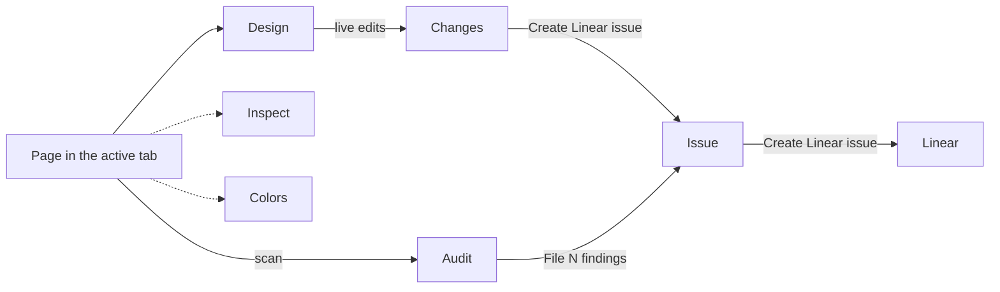
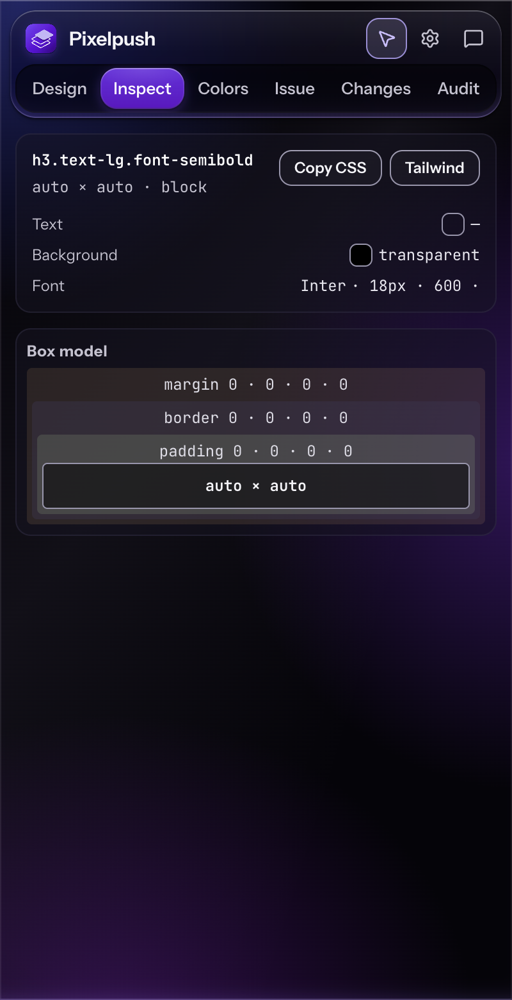
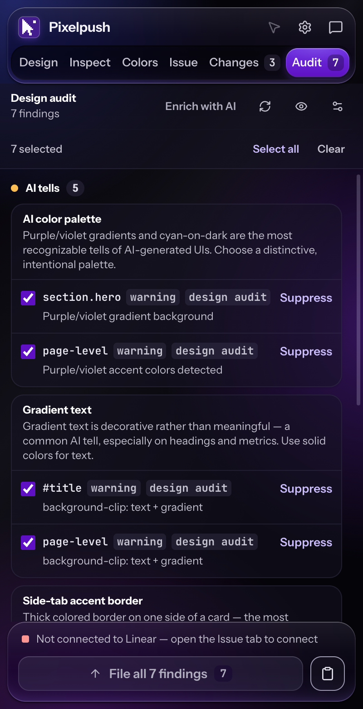

# Features

A tour of every tab in the Pixelpush side panel, plus Settings, the context-menu entry, selection mode and keyboard navigation.

**Docs:** [Home](README.md) · [Getting started](getting-started.md) · **Features** · [Audit](audit.md) · [AI providers](ai-providers.md) · [Linear](linear.md) · [Privacy and permissions](privacy-and-permissions.md) · [Architecture](architecture.md) · [Development](development.md) · [Design system](DESIGN.md)

## At a glance

The tab strip reads **Design, Inspect, Colors, Issue, Changes, Audit**. This page covers them in a task order instead: Design, Inspect, Colors, Changes, Audit, then Issue, which is where everything ends up.

| Tab | What you get | What you can copy or send |
| --- | --- | --- |
| [Design](#design) | Element tree plus a style editor. Edits apply live to the page. | Edits flow to Changes. |
| [Inspect](#inspect) | Size, colours, font, contrast and box model of the selected element. | **Copy CSS**, **Tailwind**. |
| [Colors](#colors) | The colours the page actually uses, with roles and contrast. | **Copy hex**, **Copy raw**, **Export all**. |
| [Changes](#changes) | Every edit as a `from → to` diff, plus your notes. | **Copy CSS**, **Copy Tailwind**, **Reset all**. |
| [Audit](#audit) | Scrolls the page (by default), then scans it with 72 rules for design and quality problems and highlights each one. | Selected findings go to an issue. |
| [Issue](#issue) | Composer and recent issues for Linear. | **Create Linear issue**. |



*In words: Design edits feed Changes, an Audit scan produces findings, and either one can be turned into a draft on the Issue tab, which files it to Linear. Inspect and Colors only read the page.*

## The send bar

The bar along the bottom is shared by all tabs.

- **Connection line.** `Linear · <workspace>`, or `Not connected to Linear — open the Issue tab to connect`.
- **Main button.** On Design, Inspect, Colors and Changes it reads **Create Linear issue** with your change count. On Audit, once at least one finding is selected, it reads **File N findings** (or **File all N findings** when every finding is selected). On both, pressing it builds a draft and switches to the Issue tab. It does not file yet. On the Issue tab the same button files the issue and reads **Creating…** while the request runs. It is disabled when Linear is not connected or there is nothing to send. On the Issue tab it is also disabled until the title and team are set and, for a page outside your app origins, until you tick the confirmation.
- **Copy button.** Copies the issue as Markdown (`# title`, a blank line, then the body). If you have not typed a title or description it copies a freshly built draft.

Pressing the main button from another tab again rebuilds the draft and replaces the text in the composer.

## Design

<p align="center">
  
</p>

<p align="center"><em>Design: the tree on top, the editor below, and the grip between them.</em></p>

**What it shows.** An element tree of the page (`body` down) with a draggable grip below it, and the editor for the selected element. Tree rows show the tag, `#id` and `.classes`, or the component name when one is detected (React, Vue, Angular and Svelte are recognised). Text nodes appear as quoted rows. A dot marks an edited element, and elements that are invisible on the page (opacity 0, `visibility: hidden`, `display: none` or `aria-hidden="true"`) are dimmed. An **Edit / Info** switch above the editor flips between the editor and the same card the Inspect tab shows.

**How you use it.**

1. Select an element by clicking it on the page (see [Selection mode](#selection-mode)) or by choosing a row in the tree. Hovering or focusing a row outlines that element on the page.
2. Edit values. Single-line fields commit when you press <kbd>Enter</kbd> or click out of the field. Edited fields are highlighted, and the small undo control next to a label restores that one value on the page.
3. Optionally write what should change in **Instructions** at the top. It is a multi-line box, so <kbd>Enter</kbd> adds a line and the note is saved when you click out of it. The note travels with the element into Changes and the issue, and it is what **Propose edits** works from.

The editor has these groups:

| Group | Controls |
| --- | --- |
| Instructions | A free-text note for the element. |
| Layout | Flow (vertical, horizontal, grid) and alignment, width and height, an optional min and max size toggle, gap (row and column gap for grids, plus grid columns and rows), padding and margin (top, bottom, left, right), and **Clip content**. |
| Appearance | Opacity, corner radius (with a toggle for the four corners). |
| Fill | Colour, through a picker with **Custom** and **Tokens** tabs. **Tokens** lists the page's colour variables. A value picked there is recorded by token name. |
| Stroke | Border style (none, solid, dashed, dotted, double), weight (with a per-side toggle) and colour. |
| Effects | Add or remove one drop shadow and edit its X, Y, blur, spread and colour. |
| Typography | Font family, weight, size, line height, letter spacing, alignment and text colour. |
| Content | **Text** when the element holds only text, and an icon picker when the element carries a `lucide` class. |

**Limits.**

- Edits are inline styles applied to the live page in that tab. Nothing is written to the site, and a reload discards them (Pixelpush copies the unsaved list to your clipboard when that happens).
- The tree reads at most 3,000 nodes (text nodes count), 25 levels deep and 50 children per element, and skips `script`, `style`, `noscript`, `link` and `meta`.
- The content scripts run in the top frame only (the manifest does not set `all_frames`) and the tree walks `childNodes`, so iframe contents and shadow roots are not inspected.
- A shadow with several layers, or an inset shadow, cannot be edited. The editor says so and, if you had already changed that shadow, offers **Revert**.
- Selecting by clicking is only available while selection mode is on and the Audit tab is not open.
- **Propose edits** needs a configured provider and a non-empty note. See [AI providers](ai-providers.md).

## Inspect

<p align="center">
  
</p>

<p align="center"><em>Inspect: a read-only card for the selected element.</em></p>

**What it shows.** For the selected element: its tag, id and classes (and component name if found), its width × height and `display`, the **Text** and **Background** colours, the **Font** (family, size, weight, line height), a **Contrast** row, and a **Box model** diagram (margin, border, padding, content size). With nothing selected it says `Select an element to inspect.`

**How you use it.** Select an element, read the card, and press **Copy CSS** or **Tailwind** to put its values on the clipboard.

- **Contrast** is the ratio of the element's own computed text colour to its own computed background colour, with AA, AAA or Fail badges (and an AA Large badge when the large-text result differs). It does not look at ancestor backgrounds: a semi-transparent or transparent colour is blended over the other colour of the pair, not over what is behind the element. The row is left out when either colour cannot be parsed.
- **Copy CSS** writes a rule whose selector is the element's full selector path and whose body lists every captured style value that is a non-empty string.
- **Tailwind** converts the same values mechanically.

**Limits.**

- Copy CSS dumps everything the inspector captured, including helper entries that are not CSS properties: `width-computed` and `height-computed` always, and `text-content` when the element holds only text. Delete those lines before pasting into a stylesheet.
- Tailwind output is a starting point. Longhand properties such as `padding-top` become utilities like `pt-[24px]`. Properties with no mapping fall back to a `property-[value]` token (for example the `padding: 8px 16px` shorthand becomes `padding-[8px_16px]`), which is not a valid Tailwind class.

## Colors

**What it shows.** The colours in use on the page, most-used first. Each row has a swatch, the hex value, `N instances`, the roles it appears in (`background`, `border`, `text`), the raw computed value (for example `rgb(17, 24, 39)`), and a contrast badge against white (`#ffffff`).

**How you use it.**

- Type in **Filter hex / role…** to narrow the list by hex, raw value or role.
- Click a row to expand it: roles, the contrast ratio against `#ffffff`, up to five example selectors, and **Copy hex** and **Copy raw** buttons.
- **Export all** copies the filtered list as a `:root { --color-1: #…; }` block followed by a `/* palette (hex,count,roles) */` list.

**Limits.**

- The scan reads each element's computed `background-color`, `border-color` and `color`. On pages with more than about 2,500 elements it samples every n-th element, and it keeps the 40 most-used colours.
- Only values it can parse as `rgb()`, `rgba()` or hex are counted, and transparent values are skipped.
- The palette is read when the panel opens and again after a page load. It does not refresh when the page changes in other ways, such as in-page navigation or your own edits.
- The contrast badge is always against white, not against the colour the text sits on. Use Inspect for an element's real pair.
- As written, the **highlight** buttons next to example selectors do not send anything to the page, so they do not highlight anything yet.

## Changes

<p align="center">
  
</p>

<p align="center"><em>Changes: every edit as a diff, ready to copy or file.</em></p>

**What it shows.** A count (`N changes`) and every tracked edit grouped by component, or under `Unowned Elements` when no component name was found. Each element lists `property  old → new` for every edited property and shows your **Instructions** note in quotes. The tab strip badge shows the same count.

**How you use it.**

- Click an element row (or focus it and press <kbd>Enter</kbd> or <kbd>Space</kbd>) to jump back to Design with that element selected.
- **Copy CSS** puts one rule per edited element on the clipboard. The selector is the element's full selector path, the declarations are the edited properties in kebab-case, and a note becomes a `/* note: … */` comment. A value you picked from the colour **Tokens** tab is written as `var(--token-name)`.
- **Copy Tailwind** puts one `<!-- selector path -->` comment per element followed by one line of utility classes. A note becomes a `<!-- note: … -->` comment.
- **Reset all** clears the tracked list, including your Instructions notes, and shows `Changes cleared`.

```css
body > main > h1#title {
  padding-top: 24px;
  font-size: 32px;
}
```

```html
<!-- body > main > h1#title -->
pt-[24px] text-[32px]
```

*Illustrative. Selectors and values come from your page. The class mapping covers display, flex and grid alignment, gap, padding, margin, sizes, radius, opacity, colours, borders, overflow, type, shadow and grid templates; any other property is written as `property-[value]`.*

**Limits.**

- Text edits (changing the visible text of an element) are tracked but are not part of the Copy CSS or Copy Tailwind output. They do appear in the issue.
- As written, **Reset all** clears Pixelpush's list. It does not send anything to the page, so reload the page to drop the inline styles themselves, or use the per-field undo in Design to restore one value live.
- Edits are per panel session. They are cleared after you file an issue and when the page reloads.

## Audit

<p align="center">
  
</p>

<p align="center"><em>Audit: findings grouped by category, each highlighted on the page.</em></p>

**What it shows.** A scan of the whole page against a catalogue of design rules, grouped into two categories:

| Category | Count | What it covers |
| --- | --- | --- |
| **AI tells** | 41 | Patterns typical of generated UIs, for example gradient text, side-tab accent borders, nested cards, bounce easing, overused fonts, marketing buzzwords, placeholder copy and emoji used as icons. |
| **Quality issues** | 31 | Contrast, tiny text, tight leading, cramped padding, line length, skipped headings, broken images, missing alt text, unlabelled fields, small tap targets, text overflow and similar. |

That is 72 rules in [`extension/audit/antipatterns.json`](../extension/audit/antipatterns.json), run by the detector in [`extension/audit/detect.js`](../extension/audit/detect.js) (Apache-2.0, see [THIRD_PARTY_NOTICES.md](../THIRD_PARTY_NOTICES.md)). Each rule appears once as a card with its name and description, and under it one row per occurrence: the element's selector (or `page-level`), a `hidden` chip if the element is not visible, a severity chip, and a source chip (`Design audit`, or `AI` for rows added by **Enrich with AI**). [Design audit](audit.md) explains how a scan runs, which 26 rules were added to the original 46, and how the AI review is checked.

<details>
<summary>All 72 rules by name</summary>

**AI tells (41):** Side-tab accent border, Border accent on rounded element, Overused font, Single font for everything, Flat type hierarchy, Gradient text, AI color palette, Cream / beige palette, Nested cards, Monotonous spacing, Bounce or elastic easing, Dark mode with glowing accents, Icon tile stacked above heading, Italic serif display headline, Hero eyebrow / pill chip, Repeated section kicker labels, Numbered section markers (01 / 02 / 03), Em-dash overuse, Marketing buzzword, Aphoristic-cadence copy, Oversized hero headline, Crushed letter spacing, Hairline border with wide shadow, Repeating-gradient stripes, Decorative grid-line background, Theater framing copy, Image hover transform, Placeholder copy, Blurred gradient blob, Emoji used as icons, Glassmorphism overuse, Headline stat strip, Identical feature cards, One accented word in the headline, Radial glow halo, Template punctuation, Placeholder avatars, Copy that reads as generated, Icons in tinted squares, Decorative pulsing dot, Links that go nowhere.

**Quality issues (31):** Broken or placeholder image, Gray text on colored background, Low contrast text, Layout property animation, Line length too long, Cramped padding, Body text touching viewport edge, Tight line height, Skipped heading level, Justified text, Tiny body text, All-caps body text, Wide letter spacing on body text, Content overflowing its container, Positioned child clipped by overflow container, Font outside DESIGN.md, Color outside DESIGN.md, Radius outside DESIGN.md, Font size outside DESIGN.md, Image without alt text, Form field without a label, Tap target too small, Link looks like body text, Focus outline removed, Page scrolls sideways, Missing page language, Page heading problem, Content stays invisible, Control without an accessible name, Repeated "Learn more" links, No shared type, radius or shadow scale.

</details>

> [!NOTE]
> The four `... outside DESIGN.md` rules do not fire in Pixelpush, but they still appear in the rule list. Font, Color and Radius outside DESIGN.md are implemented in the detector, but they only run when the scan config carries a `designSystem` object, and the panel's scan request does not send one (it carries the disabled rules, the line-length limit, the spotlight and auto-scroll settings and the text-over-image contrast settings). Font size outside DESIGN.md has no detection code at all.

**How you use it.**

1. Open the **Audit** tab. It scans the page every time you open it, and rescans after a page reload or in-page navigation while the tab is open. **Rescan page** (refresh icon) scans on demand. Every finding starts selected. By default the scan first scrolls the page (see below) and the status reads `Scrolling the page to load everything… N%` before it switches to `Scanning this page…`.
2. Hover or click a row to scroll to and highlight that element on the page. **Hide overlays** and **Show overlays** toggle the highlight boxes.
3. Open **Audit settings** to choose **Strict · 80** or **Lax · 120** for the line-length rule, switch **Blur page outside highlighted findings** and **Scroll the page first so lazy-loaded sections are audited** on or off, and tick or untick individual **Detection rules**. These are saved in your Chrome profile settings and trigger a rescan.
4. Use the checkboxes, **Select all** and **Clear** to choose findings. The `N selected` count feeds the main button, **File N findings**, which builds an issue from the selection. See [Linear](linear.md).
5. **Enrich with AI** runs an AI design review on top of the detector. Unless the provider is Local CLI, the first use with each provider type asks you to confirm. It sends the audit findings, the page's design tokens and a compact outline of the page (about 14 KB at most, with the URL stripped of its query string and fragment) to your provider, which can hide false hits, reword findings, add up to eight new findings and show a short brief. The panel checks every added finding against the outline: it must quote evidence found there and, unless it is page-level, cite elements that exist there. Ungrounded suggestions and restatements of detector findings are dropped, AI-tell suggestions are capped at medium severity (high is kept only for headings and calls to action), and a response in which at least half of three or more suggestions are ungrounded is ignored entirely. The brief area tells you how many suggestions were dropped, or that the whole output was ignored. See [AI review](audit.md#ai-review) for the details and [AI providers](ai-providers.md#enrich-with-ai-audit-review) for setup.

Two row actions appear while AI features are enabled:

- **Suppress** hides the row until the next scan. Rows that Enrich with AI marks as false hits are hidden the same way.
- **Preview fix** is offered for five rules: cramped padding, tiny text, tight leading, line length and low contrast. It applies a canned edit (padding top and bottom `16px`, font size `16px`, width `42rem`, or text colour `#f5f5f7`; tight leading has no canned edit) as a normal tracked change.

**Limits.**

- Selection mode is switched off while the Audit tab is open, and the cursor button is disabled.
- **Preview fix** acts on the element currently selected in Design, which is not necessarily the element the finding points at. Select the right element first.
- As written, hiding a row (with **Suppress** or through Enrich with AI) does not clear its checkbox, so a hidden finding that was selected still counts toward **File N findings**. Untick it first if you do not want it filed.
- Auto-scroll walks the page in steps of 70% of a viewport (clamped to 240 to 900 px), for at most 48 steps, 30 viewport heights or 6 seconds, then returns you to where you were. Scrolling, typing or clicking while it runs stops it early, and in that case your position is not restored. [Design audit](audit.md#scrolling-the-page-first) lists every stop condition. It scrolls the document, or the largest inner scroll pane when the document itself does not scroll. Turn the setting off to scan only what is already loaded.
- Text over an image is checked for contrast too, for up to 30 candidates per scan. With the scroll setting on, off-screen candidates are scrolled into view to measure them.
- While an AI job runs, the **Enrich with AI** button reads **Cancel** but is disabled. Press <kbd>Esc</kbd> to cancel.
- **Suppress** and **Preview fix** sit behind the same checkbox as the AI buttons: with **Disable AI features** on, they are not shown.
- The detector walks the main document's elements (`document.querySelectorAll('*')`), so it does not look inside iframes.

## Issue

<p align="center">
  
</p>

<p align="center"><em>Issue: compose, optionally rewrite with AI, and file to Linear.</em></p>

**What it shows.** Before Linear is connected, a **Connect Linear** form for a personal API key. After that, a **Create Linear issue** composer (Title, Description / Notes, Team, Project, Priority, and a chip with the attached element's selector), then **Recent / matching issues** with a search box, a scope switch (**My issues**, **Active cycle**, **Team**) and **All / Active / Backlog / Done** filters.

**How you use it.** Build a draft from Changes or Audit with the main button, adjust it, pick the team, project and priority, and press **Create Linear issue**. If an AI provider is configured, **Rewrite with AI** replaces the draft with a cleaner version and **Show raw draft** brings the original back. If the captured page is not one of your app origins, tick the third-party confirmation first.

**Limits.** Pixelpush sends a team, project, priority, title and description. It does not set a status, label, assignee or cycle. Everything else about keys, workspaces, the body layout and errors is on [Linear](linear.md).

## Settings

<p align="center">
  
</p>

<p align="center"><em>Settings: the AI checkbox, app origins and providers.</em></p>

**What it shows.** Open it with the gear icon in the header. It replaces the tab content and has three parts:

- **Disable AI features.** One checkbox that turns off Rewrite, Propose and Enrich while keeping your saved keys.
- **App origins.** The hosts that count as your own app, with **Add**, **Remove** and **Restore defaults**. Capturing any other host asks you to confirm before filing.
- **Providers.** Buttons to add **Bedrock Mantle**, **Bedrock Runtime**, **OpenAI-compat** or **local CLI** providers, one card per provider, and a **Test connection** button on each card.

**How you use it.** Press **Done**, press <kbd>Esc</kbd> or click any tab to close it. Provider fields, the active provider and app origins save as you change them. An API key is saved only when you press **Save key**.

**Limits.** There are no controls for maximum output tokens, timeouts or the local bridge port in this build. The full story for each provider is in [AI providers](ai-providers.md).

## Context-menu entry

Right-click anywhere on a page and choose **Design with Pixelpush**. It opens the side panel for that tab, exactly like the toolbar icon. The menu item is registered when the extension is installed and applies to every context (`all`). There is no separate keyboard shortcut.

## Selection mode

Selection mode is how you pick elements on the page. It is on when the panel opens, and the cursor button in the header shows and toggles its state (`Select element on page`).

- **Hover** outlines the topmost visible element under the pointer in violet.
- **Click** selects it. While selection mode is on, Pixelpush captures the click, so links and buttons on the page do not fire. Turn it off to use the page normally.
- **Text-only elements** wait a quarter of a second after a click in case you double-click. **Double-click** edits the text in place: <kbd>Enter</kbd> keeps it, <kbd>Esc</kbd> reverts it, and clicking away keeps it. Kept text edits appear in Changes.
- Selecting an element expands the tree to it, outlines it and shows measurement guides on the page.
- When the tab finishes loading a page (a reload, or a new page) with the panel open, selection mode is turned back on. **In-page navigation** (pushState, replaceState, back and forward) clears the tree and the selection and rebuilds the tree.
- Opening the **Audit** tab turns selection mode off, and it stays off when you leave Audit until you press the cursor button. Closing the panel turns it off on the page.

## Keyboard navigation and accessibility

| Key | Where | What it does |
| --- | --- | --- |
| <kbd>←</kbd> <kbd>→</kbd> | Tab strip | Moves focus to the previous or next tab, wrapping at the ends. |
| <kbd>Home</kbd> <kbd>End</kbd> | Tab strip | Moves focus to the first or last tab. |
| <kbd>Enter</kbd> <kbd>Space</kbd> | A focused tab | Activates it. Moving focus alone does not switch tabs. |
| <kbd>↑</kbd> <kbd>↓</kbd> | Element tree | Moves focus to the previous or next row. |
| <kbd>→</kbd> <kbd>←</kbd> | Element tree | Expands or collapses the focused row. |
| <kbd>Enter</kbd> <kbd>Space</kbd> | Element tree | Selects the focused element. |
| <kbd>↑</kbd> <kbd>↓</kbd> | Tree/editor splitter | <kbd>↓</kbd> makes the tree 16 px taller and <kbd>↑</kbd> 16 px shorter, between 80 and 600 px. |
| <kbd>Enter</kbd> | Single-line editor fields | Commits the value. |
| <kbd>Esc</kbd> | Settings open | Closes Settings. |
| <kbd>Esc</kbd> | An AI job running | Cancels it. |

Other details you can rely on:

- The tab strip is a `tablist` named `Panel views`, and only the selected tab is in the page's tab order. Clicking a tab always closes Settings.
- The splitter is a focusable `separator` named `Resize element tree`. It exposes its minimum, maximum and current height, and you can also drag it with the mouse.
- The element tree uses `tree` and `treeitem` roles. Changes rows are focusable buttons.
- Toasts, the send bar's connection line, copy confirmations, test-connection results and audit status (`Scanning this page`, `No design audit findings on this page`, or the finding count) are announced through polite live regions. Errors from AI jobs, Linear and the key field use `alert`.
- When your system asks for reduced motion, the element-picker outline on the page does not animate between elements and the tree scrolls to the selected row without smoothing. The audit overlays use a shorter, linear animation.

## Next

- [Design audit](audit.md): how a scan runs, the page scroll, the 72 rules and the AI review.
- [Linear](linear.md): connecting, filing and the issue body.
- [AI providers](ai-providers.md): the three AI features and the four provider types.
- [Privacy and permissions](privacy-and-permissions.md): what each permission is used for.
- [Architecture](architecture.md): how the panel, service worker and content scripts fit together.
