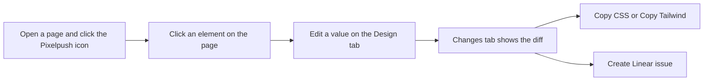
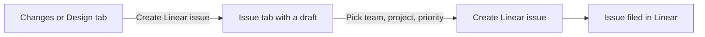

# Getting started

Install Pixelpush unpacked, open the side panel, make your first fix and file your first Linear issue.

**Docs:** [Home](README.md) · **Getting started** · [Features](features.md) · [Audit](audit.md) · [AI providers](ai-providers.md) · [Linear](linear.md) · [Privacy and permissions](privacy-and-permissions.md) · [Architecture](architecture.md) · [Development](development.md) · [Design system](DESIGN.md)

## Requirements

| You need | Why |
| --- | --- |
| Chrome 116 or later | `minimum_chrome_version` in [`extension/manifest.json`](../extension/manifest.json) is `116`. |
| This repository on disk | Pixelpush is not on the Chrome Web Store yet, so you load the `extension/` folder directly. |
| A Linear personal API key | Only to file issues. Everything else works without Linear. See [Linear](linear.md). |
| An AI provider | Optional. AI is off until you add one. See [AI providers](ai-providers.md). |
| Node 22.2 or later | Only for the repository's helper scripts (`npm run verify`, `npm run icons` and so on). Loading the extension needs no Node and no build step. See [Development](development.md). |

> [!NOTE]
> **Chrome version.** Pixelpush needs Chrome 116 or later, the first version that lets an extension open its side panel on demand. The toolbar icon and the right-click menu both open the panel that way. This repository declares Chrome only. It does not declare support for other browsers.

## Install

1. Clone this repository.
2. Open `chrome://extensions` and switch on **Developer mode**.
3. Click **Load unpacked** and choose the `extension/` folder (the one that contains `manifest.json`).
4. Pin Pixelpush to the toolbar, then click its icon to open the side panel.

There is nothing to build. When the extension is installed or updated, its service worker also injects the inspector and audit scripts into the http and https tabs you already have open, so you do not have to reload them first.

## Open the panel

You can open Pixelpush in two ways:

- Click the **Pixelpush** toolbar icon.
- Right-click the page and choose **Design with Pixelpush**.

The manifest declares no keyboard shortcut. The panel opens for the tab you were on, and each tab gets its own panel. Closing the panel switches selection mode off on that page.

<p align="center">
  
</p>

<p align="center"><em>The Design tab. Header and tab strip on top, element tree and style editor in the middle, send bar at the bottom.</em></p>

What you are looking at:

| Part | What it does |
| --- | --- |
| Header | The Pixelpush mark and name, the **selection mode** button (cursor icon), **Settings** (gear), a link to share feedback on GitHub, and, once Linear is connected, a workspace dropdown. |
| Tab strip | Design, Inspect, Colors, Issue, Changes, Audit. The Changes tab shows how many edits you have made and the Audit tab how many findings it found. |
| Send bar | Shows `Linear · <workspace>` or `Not connected to Linear — open the Issue tab to connect`, the main action button, and a copy button. |

## First fix in two minutes



*The same path in words: pick an element, edit it, review the diff on Changes, then either copy it as CSS or Tailwind or turn it into a Linear issue.*

1. **Open a page and the panel.** Any ordinary web page works. Use the toolbar icon or the right-click entry above.
2. **Pick an element.** Selection mode is on when the panel opens, so hover the page to see a violet outline and click the element you want. The element tree selects it and the editor opens below. If the element contains only text, you can also double-click it on the page to edit the text in place. Press <kbd>Enter</kbd> to keep the edit or <kbd>Esc</kbd> to discard it.
3. **Change a value.** On the **Design** tab, change something visible, such as one of the **Padding** fields under Layout or **Size** under Typography. Type the new value and press <kbd>Enter</kbd> (or click out of the field). The page updates at that point, and the field is highlighted as edited.
4. **Review and copy.** Open **Changes**. Each edit appears as `property  old → new`, grouped by element. Press **Copy CSS** or **Copy Tailwind**. A short toast (`CSS copied` or `Tailwind copied`) confirms it.

For example, after raising the top and bottom padding of a heading, **Copy CSS** puts a rule on the clipboard that starts with the element's full selector path and lists only the properties you changed:

```css
body > main > h1#title {
  padding-top: 24px;
  padding-bottom: 24px;
}
```

*Illustrative. The selector path and values come from your page and your edits.*

> [!IMPORTANT]
> Edits are live inline-style changes on that tab's page. Nothing is saved to the site. If the page reloads (or the tab finishes loading another page) while you have unsaved changes, Pixelpush copies them to the clipboard as plain text, shows `Page refreshed — N unsaved changes copied to clipboard`, and clears the list.

## File your first issue

Filing is two steps: build a draft, then create the issue.

1. **Connect Linear once.** Open the **Issue** tab, paste a personal API key (it starts with `lin_api_`) and press **Connect**. [Linear](linear.md) walks through creating the key and explains where it is stored.
2. **Build a draft.** Go back to **Changes** (or **Design**) and press **Create Linear issue** in the send bar. This does not file anything yet. It writes a title and description from your edits and notes, then switches to the **Issue** tab.
3. **Review and file.** Check the title and description, pick a **Team**, optionally a **Project**, set a **Priority**, and press **Create Linear issue** again. When it succeeds you get a toast such as `Created <identifier>` and a link to open the issue in Linear.



*In words: the first press of the main button only builds the draft and opens the Issue tab. The second press, on the Issue tab, files it.*

> [!TIP]
> Not ready to file? The clipboard button beside the main button copies the issue as Markdown instead. You can also add a note in the **Instructions** box at the top of the Design editor. It becomes the issue's **Intent** section.

> [!NOTE]
> If the page you captured is not one of your **App origins**, the Issue tab asks you to tick a confirmation before it will file. `localhost`, `127.0.0.1` and `[::1]` always count as yours. See [Linear](linear.md#first-party-app-origins-confirmation).

## Optional: run a design audit

Open the **Audit** tab to scan the page for design, accessibility and AI-generated-page problems. The scan runs each time you open the tab, and every finding is highlighted on the page. Selection mode is switched off while you are on Audit.

By default the scan first scrolls the page from top to bottom so lazy-loaded sections exist, then puts you back where you were. While it runs the panel reads `Scrolling the page to load everything… N%`. Scrolling, clicking or typing on the page stops it early, and your position is then left where it is. To scan only what is already loaded, switch off **Scroll the page first so lazy-loaded sections are audited** in the Audit settings. [Design audit](audit.md) covers the rules, the scroll pass and the optional AI review.

## Optional: add an AI provider

AI is off until you add a provider in **Settings**. Once you do, **Rewrite with AI**, **Propose edits** and **Enrich with AI** become available. Before the first request for each provider type (Local CLI aside), Pixelpush asks you to confirm what will be sent, and Enrich with AI has its own confirmation. [AI providers](ai-providers.md) covers the four provider types, their fields and what each error means.

## If something looks off

| You see | What it means |
| --- | --- |
| `Select an element on the page` | The panel has not received an element tree from the page yet. Turn selection mode on (cursor button) and click an element. If the tree never appears, the content scripts may not be running on that page. |
| `Select an element to edit styles` | The tree is loaded but no element is selected. Click one on the page or choose a row in the tree. |
| The main button is disabled | There are no edits to send, or Linear is not connected. On the Issue tab it also needs a title and a team, and for a page outside your app origins the confirmation box must be ticked. |
| `Not connected to Linear — open the Issue tab to connect` | No key has been saved. See [Linear](linear.md). |
| The cursor button is greyed out | You are on the Audit tab. Selection mode is unavailable during an audit. |
| The page scrolls by itself when you open Audit | That is the audit's scroll pass, which loads lazy sections before scanning and then returns you to your position. Scrolling or typing on the page stops it. You can turn it off in the Audit settings. See [Design audit](audit.md#scrolling-the-page-first). |

## Next

- [Features](features.md): every tab, selection mode and keyboard navigation.
- [Linear](linear.md): keys, workspaces, what the issue body contains.
- [AI providers](ai-providers.md): optional models for rewriting and proposing edits.
- [Privacy and permissions](privacy-and-permissions.md): what the extension can read and what leaves your browser.
