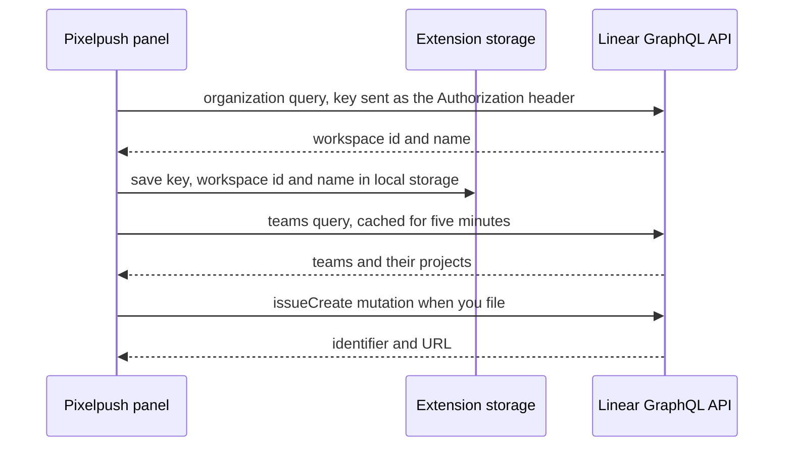
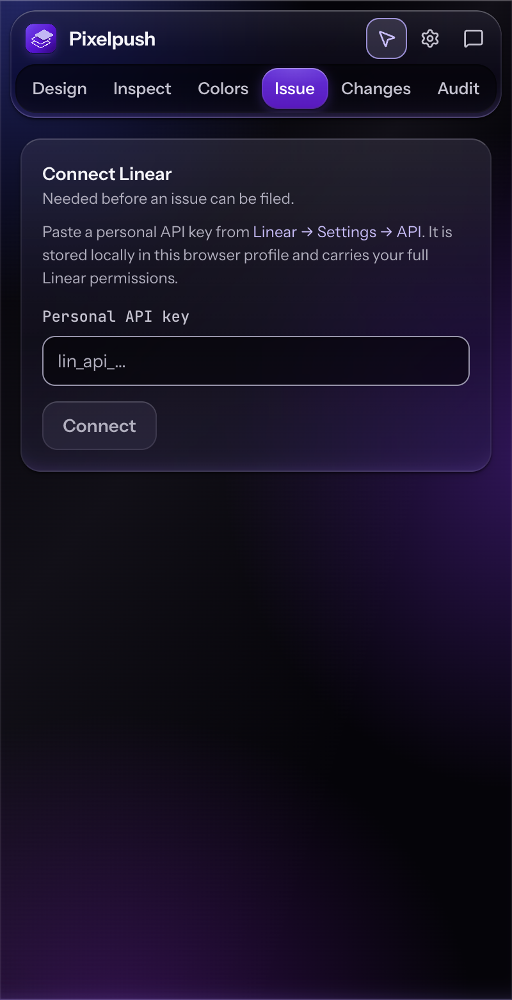

# Linear

Connect Pixelpush to Linear with a personal API key, then file your edits and audit findings as issues.

**Docs:** [Home](README.md) · [Getting started](getting-started.md) · [Features](features.md) · [Audit](audit.md) · [AI providers](ai-providers.md) · **Linear** · [Privacy and permissions](privacy-and-permissions.md) · [Architecture](architecture.md) · [Development](development.md) · [Design system](DESIGN.md)

## What you need

- A Linear account and a **personal API key** (it starts with `lin_api_`).
- A draft to file. Build one from the **Changes** or **Audit** tab. See [Features](features.md#the-send-bar).

Pixelpush talks to Linear's GraphQL API at `https://api.linear.app/graphql`, from the panel, only when you connect, load teams or issues, or file an issue.

## Create a personal API key

1. In Linear, open **Settings → API** (the panel links to `https://linear.app/settings/api`).
2. Create a personal API key and copy it.

> [!WARNING]
> A personal API key carries your full Linear permissions. Pixelpush only uses it to read your workspace, teams and issues and to create issues, but the key itself is not limited to that. Treat it like a password.

## Connect

1. Open the **Issue** tab. Until you connect, it shows **Connect Linear** with the note `Needed before an issue can be filed.`
2. Paste the key into **Personal API key** and press **Connect** (or <kbd>Enter</kbd>).



*In words: connecting sends one query that returns your workspace's id and name. If Linear accepts the key, Pixelpush saves it locally, then loads your teams. Filing later sends one `issueCreate` mutation.*

Checks and results:

- The field is a password input. If what you typed does not match `lin_api_` followed by letters and digits, it shows `Linear personal keys start with lin_api_.`
- While the request runs the button reads `Connecting…`.
- On success the send bar changes to `Linear · <workspace name>`, the header gains a **Linear workspace** dropdown, and the Issue tab becomes the composer.
- If Linear refuses the key you see `Linear rejected the credential`. Other failures show Linear's own message. See [Common errors](#common-errors).

Pixelpush trims the key and sends it as the value of the `Authorization` header, without a `Bearer` prefix.

## Where the key is stored

| Item | Where | Synced? |
| --- | --- | --- |
| Personal API key, workspace id and name | `chrome.storage.local`, entry `linearAuth` | No. It stays in this Chrome profile on this device. |
| Team and project list | `chrome.storage.local`, entry `linearTeams_<workspace id>`. Reused for five minutes. After that the cached list is shown while a fresh copy is fetched in the background. | No. |

> [!IMPORTANT]
> The key is saved as plain text in extension storage. Pixelpush does not encrypt it. There is no **Disconnect** or **Replace key** control in this build, and the key is only ever sent to `api.linear.app`.

## Workspaces

Pixelpush stores each connected workspace by its Linear organization id and remembers which one is active. The header shows a **Linear workspace** dropdown whenever at least one workspace is stored, and the send bar names the active one. In this build the panel only offers the connect form when no workspace is stored, so the dropdown will normally list a single workspace.

## Compose and file an issue

Build a draft first: on **Changes** or **Design** press **Create Linear issue**, or on **Audit** press **File N findings** (**File all N findings** when every finding is selected). That fills the composer and opens the Issue tab. Then review the fields and press **Create Linear issue** again.

<p align="center">
  
</p>

<p align="center"><em>The Issue tab: composer on top, recent and matching issues below.</em></p>

| Field | Behaviour |
| --- | --- |
| **Title** | Required. The main button stays disabled while it is empty. |
| **Description / Notes** | Markdown. Pre-filled from your draft, and editable. |
| **Team** | Required. The first team is selected once your teams load. |
| **Project** | `No project`, or one of the selected team's projects. It resets when you change team. |
| **Priority** | Urgent, High, Medium, Low or No priority. Defaults to Medium. |
| Attached element | A read-only chip with the selected element's selector path. |

**Status.** There is no status field. Pixelpush sends the team, title, priority, description and (if chosen) the project. It does not send a status, labels, assignee or cycle, so Linear applies whatever it would for a new issue. The **All / Active / Backlog / Done** buttons further down only filter the list of existing issues.

**Rewrite with AI.** If a provider is configured, **Rewrite with AI** replaces the title and body with a cleaner version and **Show raw draft** restores yours. While it runs, the title and description are read-only. See [AI providers](ai-providers.md).

**After you file.** A toast reads `Created <identifier>` and the Issue tab shows a link, `<identifier> — open in Linear`. Pixelpush clears the tracked edits and refreshes the issue list. The composer keeps its text, so pressing the button again would create a second issue. Press **Clear** to start over. Once you have filed three issues, the panel can show a banner asking for a GitHub star. **Star** opens the repository in a new tab, **Later** (or the close button) hides the banner for 14 days, and **No thanks** dismisses it for good. The banner is not shown if you have already starred it through that button or dismissed it.

> [!TIP]
> Not ready to file? The clipboard button in the send bar copies the same issue as Markdown.

## What the issue body contains

The draft is built locally, with no AI involved, from three sources: your edits, your **Instructions** note and your selected audit findings. Sections appear only when they have content, in this order:

```markdown
> This capture is `staging.example.com` and is not in your app origins.

## Intent

<your first Instructions note>

## Visual spec

### `ProfileCard`

`div.card`

| Property | From | To |
| --- | --- | --- |
| padding-top | 8px | 24px |

## Audit findings

<the selected findings, grouped under Design audit and AI, then by category and rule>

## Context

- **Page:** [<page title>](<page url>)
- **Captured:** <ISO timestamp>
- **Source:** Pixelpush browser extension
```

*The shape of a draft. Everything in angle brackets and the example names are placeholders.*

- **Third-party line.** The opening blockquote appears only when the page's host is not one of your app origins.
- **Intent or Problem.** If you wrote an Instructions note, **Intent** holds the first one. Otherwise, if you made edits, **Problem** states the largest numeric change, for example `Padding on the selected element changed from 8px to 24px.` Headings inside a note are pushed down a level so they cannot break the structure.
- **Visual spec.** One block per component (a `###` heading with the component name in code formatting), or `### Unowned DOM` when no usable component name was found, followed by the reason (`no component in this build`, `minified name (<name>)` or `third-party host`). Under it, each element appears with a compact selector (its `#id` unless it looks generated, a `data-testid`, `data-qa` or `role` attribute, a `js-` class, or the tag plus up to three non-utility classes). A `Full selector` disclosure holds the full path when it is longer. A table lists every edited property in kebab-case with its `From` and `To` values. Text edits appear as `text`.
- **Audit findings.** The selected findings, introduced by the page URL (without any `#fragment`) and the number selected. Detector findings come first under **Design audit**, and findings added by Enrich with AI come under **AI**. Each group is split into **AI tells** and **Quality issues**, then by rule, with the rule description, a `Suggested follow-ups:` line of tags (`polish` for a rule that has no tags of its own) and one bullet per occurrence (selector, `[hidden]` when relevant, `[severity]` and the detail). Rows added by Enrich with AI all share one internal rule id, so within a category they sit under a single heading (the first one's title, with its evidence in the description), each with its own bullet. Rows hidden with **Suppress**, or hidden by Enrich with AI, stay selected, so they are still counted and written into the issue; the Audit tab's **Clear** deselects everything. Headings are pushed down a level so they nest under the section.
- **Context.** Page link (the page title becomes the link text when it is usable), capture time and the source line.
- If there are no edits, no note and no selected findings, the line `_No changes were recorded._` follows the Context section.

**Title.** The title comes from the first Instructions note (capitalised and cut at 80 characters), or else from the largest change, such as `Increase padding`, or else `Audit: <N> quality issue(s) on <host><path>`, or else `Pixelpush capture · <host><path>`. You can edit it before filing.

## First-party App origins confirmation

Pixelpush assumes you only want to file issues about your own app. **App origins** (Settings) lists the hosts that count as yours.

- `localhost`, `127.0.0.1` and `[::1]` always count as first-party, as the Settings hint says. `localhost` is built in and cannot be removed, and the three loopback addresses match each other, so removing the other two from the list changes nothing.
- Add other hosts with the **Add app origin** field (press <kbd>Enter</kbd> or use **Add**). Remove one with **Remove**, or use **Restore defaults** to bring back the three loopback entries.
- An entry matches its own host and, if it contains a dot, its subdomains. `example.com` matches `app.example.com`, while an entry such as `intranet` matches only that exact host. Entries are tidied as you add them: `https://`, any path or port and a leading `www.` are stripped, and the text is lowercased. A leading `*.` is ignored when matching.

When you build a draft from a page whose host is not an app origin, the Issue tab shows a checkbox: `This capture is <host>, which is not in your app origins. Filing will create a <workspace> issue about someone else’s UI.` The main button stays disabled until you tick it (the filing code also refuses with `Acknowledge the third-party host before filing`). The draft body also gets the opening `This capture is … not in your app origins.` blockquote. The check uses the host of the tab at the moment the draft was built.

## Recent and matching issues

Below the composer, **Recent / matching issues** lists issues from Linear:

- **Scope.** **My issues** (assigned to you, up to 50), **Active cycle** (needs a selected team) or **Team** (up to 50 for the selected team, without canceled ones).
- **Search.** Typing in **Search issues…** searches your workspace after a short pause (up to 30 results) and disables the scope menu.
- **Status filters.** **All, Active, Backlog, Done**, each with a count. Backlog includes triage, Done is completed, and everything else is Active. Canceled issues are never listed.
- **Order.** By priority, Urgent first and No priority last. Within a priority, in the order Linear returned them.
- Each row links to `https://linear.app/issue/<identifier>`, and **Open Linear** opens `https://linear.app`.

If loading fails you get `Could not load issues` with the error and a **Try again** button.

## OAuth is not configured

Linear sign-in through OAuth is not available in this build, and the panel only offers a personal API key.

- The service worker has a Linear connect handler, but it always fails: its message is `Linear OAuth is not configured — use a personal API key instead`. Because the manifest does not request the `identity` permission, the handler that actually runs answers `Permission to sign in to Linear was declined`.
- The panel never calls that handler, and the OAuth client id in the panel code is an empty string.

You will not see either message in normal use. They are listed so you can recognise them in the source.

## Common errors

| Message | Where | What it means |
| --- | --- | --- |
| `Linear rejected the credential` | Connect | Linear answered `401` or `403` to the key, so it did not accept it. Check that you pasted the whole key. |
| `Linear returned no organization` | Connect | Linear accepted the request but returned no workspace. |
| Linear's own message | Connect, loading, filing | The first error Linear returned, shown as is. |
| `Linear rejected the credential (401)` or `(403)` | Loading teams or issues, filing | The saved key no longer works. |
| `Not connected to Linear` | Loading, filing | No saved credential for the active workspace. |
| `Linear returned a non-JSON response (<status>)` | Loading, filing | The reply was not JSON, for example a proxy page. While connecting, the browser's own JSON parse error is shown instead. |
| `Linear returned <status>` | Loading, filing | A non-success HTTP status with no GraphQL error body. |
| `Linear returned no data` | Loading, filing | The reply was JSON without `data`. |
| `Linear declined to create the issue` | Filing | The mutation did not report success or returned no issue. |
| `Pick a team before filing the issue` | Filing | No team is selected, for example while teams are still loading. |
| `Acknowledge the third-party host before filing` | Filing | The third-party checkbox is not ticked. |
| `Failed to fetch` (or another browser message) | Any request | The network request itself failed. Pixelpush shows the browser's message. |
| `Could not load issues` | Issue list | The list request failed. The line below shows why. |

A GraphQL error whose message mentions authentication, an unauthorized or invalid token, or an access token is treated as an auth failure and shown with Linear's wording.

## Next

- [Features](features.md#issue): the Issue tab in context.
- [AI providers](ai-providers.md): let a model rewrite the draft.
- [Privacy and permissions](privacy-and-permissions.md): what is stored and what is sent.
- [Architecture](architecture.md): where the Linear client lives.
