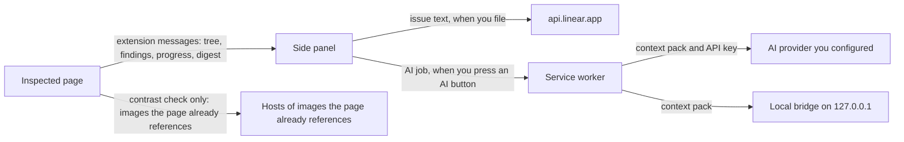
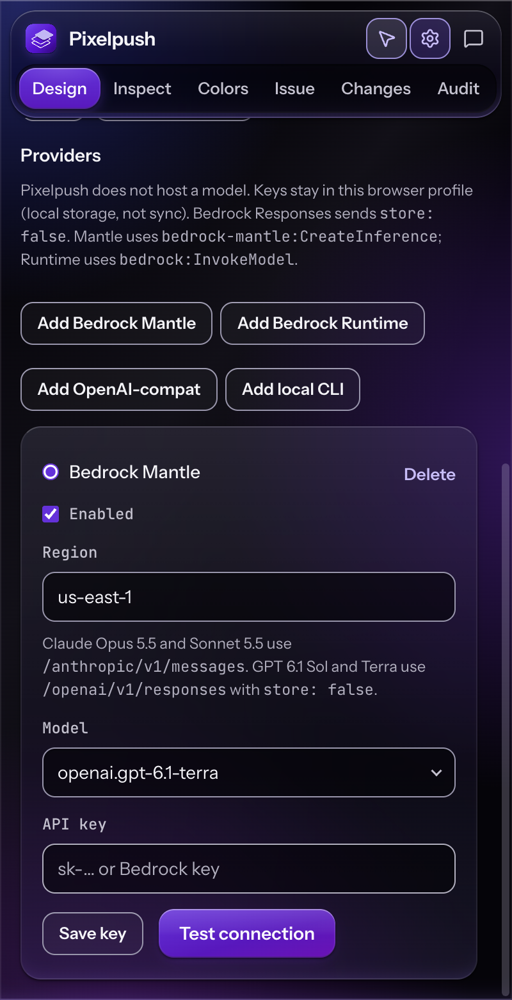

# Privacy and permissions

What Pixelpush is allowed to do in your browser, what it sends over the network and to whom, and what it keeps on disk.

**Docs:** [Home](README.md) · [Getting started](getting-started.md) · [Features](features.md) · [Audit](audit.md) · [AI providers](ai-providers.md) · [Linear](linear.md) · **Privacy and permissions** · [Architecture](architecture.md) · [Development](development.md) · [Design system](DESIGN.md)

> [!NOTE]
> This page describes the code in this repository at version 2.1.0, read directly from `extension/manifest.json`, `background.js`, `panel.js`, the content scripts and the readable detector `audit/detect.js`. The service worker, the side panel and the page inspector are minified bundles, as is the audit bridge. Section [Check it yourself](#check-it-yourself) shows how to repeat the key checks. What a provider, Linear or a local bridge does with data once it receives it is outside this repository and outside this page. How the audit itself works is on the [Audit](audit.md) page; this page covers only what it reads, changes and sends.

## Summary

- Pixelpush has no server, no account, no analytics and no telemetry. Network requests happen only to the places listed in the [network matrix](#network-matrix), and each one is started by something you do.
- Linear traffic comes from the side panel. AI traffic comes from the service worker. The inspector and the audit code make no request to Linear, to an AI provider or to any Pixelpush server. Their one network activity is the audit's contrast check, which loads images the page already references (row 10 of the [network matrix](#network-matrix)).
- An AI request carries a context pack: the page URL and title, a compact selector, your edits and notes, a list of computed styles and some page colour tokens. **Enrich with AI** sends the URL without its query string or fragment, and adds a compact outline of the page (a digest) that includes short excerpts of its text; emails, long tokens and phone-like numbers in the digest text are masked. A request does not carry cookies, raw page HTML, form values or any API key.
- Your Linear key and your AI keys are stored in `chrome.storage.local` and are never written to `chrome.storage.sync`. One field in the synced provider list holds the first three and last four characters of an AI key (see [Keys and sync](#keys-and-sync)).
- The AI features can be switched off in Settings with one checkbox. Your keys stay saved.



In words: the inspector and the audit hand what they collect to the service worker and the side panel through extension messages. Data leaves the browser in three ways, each started by something you do: the side panel posts to Linear, the service worker posts to the AI provider you configured, and the service worker posts to a local bridge on `127.0.0.1` if you added a Local CLI provider. The one request the page side makes is the audit's contrast check loading images the page already references (row 10 of the [network matrix](#network-matrix)).

## Permissions

`extension/manifest.json` declares four permissions and one host permission. The manifest does not give reasons, so the "used for" column is taken from what the code does with each one.

| Permission | Used for |
| --- | --- |
| `sidePanel` | Turning the side panel off by default and enabling it for one tab at a time (`sidePanel.setOptions`), and opening it when you click the toolbar icon or the context-menu item (`sidePanel.open`). |
| `scripting` | `scripting.executeScript`, for three purposes: injecting `inspector.js` and `audit.js` into tabs that were already open when the extension was installed or updated; injecting `audit/detect.js` into the page's own JavaScript world when the normal script tag is blocked; and running two small functions in that world that read framework component names (see [What runs on pages](#what-runs-on-pages)). |
| `contextMenus` | One item, **Design with Pixelpush**, that opens the side panel. |
| `storage` | `chrome.storage.sync` and `chrome.storage.local` (see [What is stored and where](#what-is-stored-and-where)). |
| Host permission `<all_urls>` | Lets the extension inject into, and read the URL and title of, any tab. Pixelpush scripts whichever page you open it on, and the service worker sends model requests to whatever base URL you enter for an OpenAI-compatible provider, so neither set of hosts is known in advance. The manifest does not narrow this permission and does not say why it asks for every URL. |

Things the manifest does not ask for: `tabs`, `activeTab`, `identity`, `cookies`, `webRequest`, `downloads`, `history`, `bookmarks`, `notifications`, `clipboardRead`, `clipboardWrite`, `debugger` and `nativeMessaging`. It declares no `optional_permissions`, no `externally_connectable` and no custom `content_security_policy`, so Chrome's defaults for extension pages apply.

The panel reads the active tab's `url` and `title` with `chrome.tabs.get` and `chrome.tabs.query`. Pixelpush has no separate `tabs` permission; Chrome exposes those two fields to an extension that has host access to the tab, which `<all_urls>` provides. That is Chrome behaviour, not something this repository demonstrates.

Copying to the clipboard uses `navigator.clipboard.writeText`, with a hidden-textarea `execCommand("copy")` fallback when the panel does not have focus or the write fails. No clipboard permission is requested.

### Content script scope

```json
"content_scripts": [{
  "matches": ["<all_urls>"],
  "run_at": "document_idle",
  "js": ["content-scripts/audit.js", "content-scripts/inspector.js"]
}]
```

- **Where:** every URL Chrome allows an extension to script. The manifest sets neither `all_frames` nor `match_about_blank`, so Chrome's defaults apply (top frame only).
- **When:** after the page is idle.
- **Which world:** the content-script (isolated) world. The manifest does not set `world`.
- **Programmatic injection:** when the extension is installed or updated, the service worker also injects both files into every open `http://*/*` and `https://*/*` tab, so you do not have to reload them.

### Web-accessible resource

```json
"web_accessible_resources": [{ "resources": ["audit/detect.js"], "matches": ["<all_urls>"] }]
```

The audit bridge loads the detector with a `<script src>` pointing into the extension, which requires the file to be web accessible. The side effect is that any web page can request `chrome-extension://<extension id>/audit/detect.js`, and a page that does so learns that Pixelpush is installed. The detector is loaded from the extension package, never from a server; no code in Pixelpush is fetched from the network at run time.

## What runs on pages

By reading the code, this is what the content scripts do.

**On every page, as soon as it is idle.** Both scripts register message listeners, and the audit bridge also listens for `window` messages (it ignores any that do not have the shape it expects). The inspector also registers `resize` and `scroll` listeners and URL-change hooks (`popstate`, and wrappers around `history.pushState` and `replaceState` in its own world). At load it makes no network request and does not change the page's DOM. When the URL changes, it rebuilds its element tree and asks the service worker to annotate component names, whether or not selection mode is on; the annotation writes `data-pixelpush-component` attributes (see below). The tree goes only to extension contexts. This comes from reading the code and has not been observed at run time.

Each content script also posts a message to the page's `window` when it starts. Its `type` is `<extension id>:<script name>:wxt:content-script-started`, with `contentScriptName` and a random `messageId`; it is how the WXT runtime retires an older copy of the same script after a reload. A page script can read it, so it reveals that Pixelpush is installed and what its extension id is.

**When the side panel is open and selection mode is on.** The inspector captures `mouseover`, `mouseout`, `click` and `dblclick` on the page. While it is on, clicks and double-clicks are intercepted (`preventDefault` and `stopImmediatePropagation`), so the page's own handlers do not receive them. Selection mode is on by default when the panel opens, and turns off when you open the Audit tab or close the panel. After the page reloads, the panel turns it back on.

**When you open the Audit tab or rescan.** The panel also rescans by itself when the page reloads or navigates while the Audit tab is open. Unless you turn off **Scroll the page first so lazy-loaded sections are audited** in the audit settings, the detector first walks the page, so lazy-loaded and reveal-on-scroll sections exist before it measures. The full list of limits is in [Audit](audit.md#scrolling-the-page-first). What matters here:

- **What scrolls.** The document or, when the document itself barely scrolls, the largest inner scrolling pane. A page that fits on one screen is not scrolled.
- **Pace and limits.** Steps of 70% of a viewport (clamped to 240 to 900 px), with a 130 ms pause after each and up to 450 ms more while an image in view is still loading. It stops after 48 steps, at 30 viewport heights from the top or after 6 seconds, whichever comes first, and it waits 350 ms at the bottom to see whether the page grows.
- **What ends it early.** Your own scrolling, typing or clicking (wheel, touch, a key other than a bare Shift, Control, Alt or Meta, mouse-down and pointer-down); events that a page script dispatches itself are ignored. It also stops after three steps that did not move, after three growth spurts at the bottom (an infinite feed), when the tab is hidden and when the page's path or query string changes.
- **Hidden text.** If more than 30% of the page's text (at least 150 characters) is still invisible after the walk, it scrolls up to 20 of the hidden blocks to the middle of the screen, for at most 5 seconds, to trigger their reveal.
- **Afterwards.** Unless you interrupted it or the route changed, it scrolls back to where you were; in those two cases the page is left where it is. It then waits 450 ms before measuring. For the length of the walk it sets an inline `scroll-behavior: auto` on `<html>` (and on the inner pane, if that is what scrolls) so each step is an instant jump, and puts your value back afterwards. The panel shows "Scrolling the page to load everything… N%" while it runs.

Scrolling can make the page load more of its own content; those requests belong to the page, not to Pixelpush.

The scan configuration the panel sends also switches on the detector's visual-contrast check, limited to 30 candidates per scan. For text elements that sit over an image, a video or canvas, a gradient, or a blend, filter or similar effect, it works out the colour behind the text. Where that colour comes from a CSS background image or an `` underneath the text, it can load the image into an off-screen `Image` object (images from another origin are requested with `crossOrigin = "anonymous"`, and each load gets 800 ms), draw it onto a canvas of at most 640 pixels on its longest side and read single pixels. A `<canvas>` or `<video>` under the text is drawn to a scratch canvas the same way, with no request. When the scroll setting above is on, it also scrolls off-screen text into view for this check and then restores your scroll position. When the setting is off, it scrolls nothing: text below the fold is measured later, when you scroll it into view, which can load more images and sends updated findings. The pixels are not posted anywhere. The only outcome that leaves the detector is a low-contrast finding, whose detail quotes up to 80 characters of the element's text; text whose colour cannot be resolved produces no finding.

**What it reads.**

- The element tree: tag names, ids, class lists, framework component names, and the text of non-empty text nodes, for up to 3000 nodes.
- Computed styles of the element you select.
- Computed colours of up to about 2500 elements, and CSS custom properties from stylesheets it can read.
- For the audit, the detector reads the DOM, computed styles, image load state and the rules of the stylesheets it can read, and reports findings. Some findings quote short snippets of on-page text, such as heading text, link text or an input's placeholder, and some quote the first characters of an image address.
- When you press **Enrich with AI**, the detector also builds a page digest on request (see [The page digest](#the-page-digest)).
- Framework component names, by reading React, Vue, Angular and Svelte internals on elements. This runs in the page's own JavaScript world through `scripting.executeScript`.

The code never reads `document.cookie`, `localStorage`, `sessionStorage` or IndexedDB, and never calls `captureVisibleTab` or otherwise takes a screenshot.

**What it changes on the page.**

- Inline styles, text and icons on elements you edit. These last until the page reloads.
- A temporary 2 px outline, set as an inline style, on the element under the pointer while selection mode is on. During an inline text edit the element also briefly gets `contenteditable` and `spellcheck` attributes, and an outline and cursor style; they are restored when the edit ends.
- Overlay elements for hover, selection and measurements, appended to `<html>`.
- A `data-pixelpush-target` attribute on the element you pick (the service worker removes it again right after it annotates), and `data-pixelpush-component` attributes on the elements the worker annotated. The inspector removes the component attributes when selection mode turns off.
- During an audit: a `data-audit-extension` attribute on `<html>`, a `<script>` tag for the detector (removed after it loads), overlay and spotlight elements, a `<style>` element, an `audit-hidden` class on `<body>` when you hide the overlays, and the scrolling described above, including its temporary inline `scroll-behavior`.

**What the page can see.** The detector runs in the page's own JavaScript world, and the audit bridge talks to it with `window.postMessage` calls with target origin `*`, in both directions. Scripts on the page can read them. The bridge's commands carry the scan settings (the rule ids you disabled, the line-length limit, the spotlight-blur and scroll settings, the contrast-check options and a scan id), a selector to highlight, or the request id of a digest request. The detector's replies contain audit findings (selectors, rule ids, severity, detail text), scan progress (`audit-progress`: a phase and, while scrolling, a fraction) and, when you ask for an AI review, the page digest and its map from references to selectors (`audit-digest`, see [The page digest](#the-page-digest)), not keys or credentials. The digest consists of the page's own content (masked and trimmed) plus the scroll-coverage figures; its arrival tells the page that a review was requested. The detector also leaves `window.__AUDIT_CONFIG__` (the last scan settings) and the functions `auditDetect`, `auditDetectAsync`, `auditScan`, `auditScanAsync`, `auditCollectVisualContrastCandidates`, `auditAnalyzeVisualContrast` and `auditGetLastVisualContrastAnalyses` on `window`, so a page script can call them. The page can also see the attributes and overlay elements listed above, and the start-up message described earlier.

## Network matrix

Every request below comes from code in this repository. Nothing else in the extension calls `fetch`, `XMLHttpRequest`, `sendBeacon`, `WebSocket` or `EventSource`. The one other way code here causes requests is the detector's image loading for the contrast check, in row 10.

| # | Request | Made by | Trigger | Destination | What it carries | Credential |
| --- | --- | --- | --- | --- | --- | --- |
| 1 | Verify a Linear key | Side panel | You press **Connect** on the Issue tab | `POST https://api.linear.app/graphql` | Query `{ organization { id name } }` | Your Linear key, as the `Authorization` header value |
| 2 | Load teams | Side panel | The Issue tab opens with a connected workspace (cached for 5 minutes, then refreshed in the background) | same | Query `teams` with projects, labels, members and the active cycle | same |
| 3 | List and search issues | Side panel | The Issue tab opens, you change the **My issues**, **Active cycle** or **Team** view, you type in the search box (after a 280 ms pause), or you file an issue (the list refreshes) | same | Queries for assigned issues, the active cycle's issues, a team's issues (50 each) or `issueSearch` (30), carrying the team id or the search term you typed | same |
| 4 | Create an issue | Side panel | You press **Create Linear issue** on the Issue tab | same | Mutation `issueCreate` with `teamId`, `title`, `description`, `priority` and, if chosen, `projectId` | same |
| 5 | AI job | Service worker | You press **Rewrite with AI**, **Propose edits** or **Enrich with AI** | The provider endpoint (see below) | A fixed system prompt and the job as JSON (see [What the AI request contains](#what-the-ai-request-contains)) | `Authorization: Bearer <your AI key>` |
| 6 | AI connection test | Service worker | You press **Test connection** in Settings | The provider endpoint | A fixed ping prompt, no page data. Aborted after 5 seconds | Your AI key |
| 7 | Local bridge session | Service worker | A Local CLI job, or **Test connection** on a Local CLI provider | `GET http://127.0.0.1:<port>/api/ai/session`, trying the configured port first, then 58932 and 58933 | Nothing | None |
| 8 | Local bridge job | Service worker | A Local CLI job | `POST http://127.0.0.1:<port>/api/ai` | The job, plus the provider's `binary`, `args` and `timeoutMs` | `Authorization: Bearer <session token>` from request 7 |
| 9 | Rule catalog | Side panel | The panel starts | `chrome.runtime.getURL("audit/antipatterns.json")` | Nothing. This is a file inside the extension | None |
| 10 | Images for the contrast check | Detector, in the page | An audit scan, for up to 30 text elements over a CSS background image or an ``. With the scroll setting off, also when such text is later scrolled into view | The image URLs the page already references | Nothing from Pixelpush. It is an ordinary image load; images from another origin use `crossOrigin = "anonymous"` | None added by Pixelpush |

AI endpoints for rows 5 and 6, by provider:

| Provider | Endpoint |
| --- | --- |
| OpenAI compatible | `<base URL>/chat/completions` when the base URL ends in `/v1`, otherwise `<base URL>/v1/chat/completions`. A trailing slash is trimmed. A base URL that already ends in `/chat/completions` or `/responses` is used as typed. |
| Bedrock Mantle, Claude models | `https://bedrock-mantle.<region>.api.aws/anthropic/v1/messages` |
| Bedrock Mantle, GPT 6.1 models | `https://bedrock-mantle.<region>.api.aws/openai/v1/responses` |
| Bedrock Runtime, Claude models (Anthropic Messages route) | `https://bedrock-runtime.<region>.amazonaws.com/anthropic/v1/messages` |
| Bedrock Runtime, GPT 6.1 and Kimi K3 (Chat Completions route) | `https://bedrock-runtime.<region>.amazonaws.com/openai/v1/chat/completions` |

`<region>` is the Region field of the provider card (default `us-east-1`). Which model ids each Bedrock provider accepts is covered in [AI providers](ai-providers.md).

**Links you open yourself.** These are ordinary navigations opened by clicking, not requests made by Pixelpush: `linear.app/settings/api` (from the connect form), `linear.app/issue/<id>` and `linear.app` (from the issue list), the GitHub issues page (the feedback icon in the header), and the project's GitHub page (the **Star** button of a one-off prompt that appears after three successful sends).

**In the code but not reachable.**

- `https://api.linear.app/oauth/token` is referenced by an OAuth refresh path in the panel. The connect form only creates personal-API-key credentials, so that path has no credential to refresh, and the client id the code passes is an empty string. The service worker also has a `linear-connect` handler that the panel never sends and that can only fail: it checks for `chrome.identity?.launchWebAuthFlow`, the manifest does not request `identity`, and the branch it takes replies "Permission to sign in to Linear was declined". The branch behind that check throws "Linear OAuth is not configured". OAuth is not usable in this build.
- The panel bundle contains a list of analytics-style event names such as `issue_filed` and `pixelpush_changes_sent`. Every use of them in the bundle is a bare property read with no function call, and there is no network code besides the rows above, so nothing sends them.
- A Vite-style `modulepreload` helper in `panel.js` can `fetch` `<link rel="modulepreload">` URLs. `sidepanel.html` has no such links.

**Not present:** analytics, crash reporting, remote configuration, update checks of its own, remote fonts, remote stylesheets or images (the two fonts are bundled), and any request that starts without you opening a tab, pressing a button or typing in the search box. The one automatic case is the audit rescan noted above, which repeats the contrast check's image loading.

## What the AI request contains

AI is optional. Only three code paths build a job, and each is a button: **Rewrite with AI** (Issue tab), **Propose edits** (Design tab, needs a note) and **Enrich with AI** (Audit tab).

### Confirmation

The first time you use a provider kind, the panel shows a browser confirm dialog. For **Rewrite with AI** and **Propose edits** the text is:

> Pixelpush does not host a model. A context pack (page URL, compact selector, edits, notes — not cookies, HTML, or keys) will be sent to *host*. Bedrock Responses storage is forced off (store: false). Pixelpush does not train on captures. Continue?

**Enrich with AI** has its own dialog, shown once per provider kind as well, because it sends more of the page. The two consents are separate entries: agreeing to Rewrite with AI or Propose edits does not cover the review, and agreeing to the review does not cover them. The review's dialog is checked before the page is asked for a digest, so declining it sends nothing and builds nothing:

> Pixelpush does not host a model. An AI design review sends *host* the page URL, a compact outline of the page (headings, button and link labels, short copy excerpts, style statistics) and the audit findings. It does not send raw HTML, form values, cookies or keys; emails and long tokens in the text are masked. Bedrock Responses storage is forced off (store: false). Continue?

*host* is `bedrock-mantle.<region>.api.aws`, `bedrock-runtime.<region>.amazonaws.com` or the base URL you typed. Cancel stops the request. Continue stores an entry in `acceptedDisclosures` (the provider kind, such as `bedrock-mantle`, for Rewrite and Propose, or the provider kind followed by `:audit-page`, such as `bedrock-mantle:audit-page`, for the review) and that dialog does not return for that entry. The entry belongs to the provider kind, not to a single provider card or model. There is no dialog for a Local CLI provider.

### The job

The panel sends the service worker `{ type: "AI_COMPLETE", job }`, where `job` is `{ id, kind, createdAt, pack, input }`. The worker sends the model a fixed system prompt for the job kind and one user message, which is `JSON.stringify({ kind, pack, input }, null, 2)`.

| Job (`kind`) | `pack` holds | `input` holds |
| --- | --- | --- |
| `rewrite_issue` | `page`, `product`, `selection` (if an element is selected), `styles`, `edits`, `tokens` | `rawTitle` and `rawBody` (the generated issue draft, which can contain the page URL, selectors, the edit table and any audit findings you selected), and `notes` (your per-element notes) |
| `propose_edits` | `page`, `product`, `selection`, `styles`, `edits`, `tokens` | `note` (the instruction you typed) and `allowlistedStyles` (the same style map as `styles`) |
| `enrich_audit` | `page`, `product`, `audit` (every current finding), `tokens`, `digest` | `findingKeys` (an empty list) |

The fields of `pack`:

| Field | Content |
| --- | --- |
| `page` | `url` (for Rewrite and Propose, the tab URL exactly as Chrome reports it, query string and fragment included; for Enrich with AI, only the origin and path), `host`, `pathname`, `title` (the tab title as Chrome reports it, not masked), `capturedAt`, and a `viewport` that is always `{ w: 0, h: 0 }` |
| `product` | `appOriginMatch` (whether the host is in your app origins) and `knownAppOrigins` (your whole app-origins list) |
| `selection` | `hook` (a compact selector), `selectorFull` (the full selector path, cut at 500 characters), `tag`, `component`, `componentLikelyMinified`, and `textSnippet` (the first 200 characters of the element's text) |
| `styles` | The computed values the inspector returned for the 29 editable properties, strings only. For an element that holds only text this includes `textContent` |
| `edits` | One entry per change: `hook`, `prop`, `from`, `to`, and `note` if present. An element with a note but no change gets one entry with `prop: "note"` |
| `audit` | One entry per finding: `key`, `ruleId`, `category`, `severity`, `detail` and `hook`. `detail` is written by the detector and is not masked. Some rules quote short snippets of page text (a heading word, link text, an input's placeholder, a sentence fragment, or up to 80 characters of an element's text for the contrast rule), and the `broken-image`, `missing-alt` and `stock-avatars` rules quote the first characters of an image address or file name |
| `tokens` | Up to 40 colour tokens from the page's readable stylesheets, as `{ name, value }`: colour custom properties, plus colours defined by `.bg-*` and `.text-*` classes |
| `digest` | `enrich_audit` only: a compact outline of the page (see [The page digest](#the-page-digest)). Left out if the page does not answer within 9 seconds |

The pack is capped at 40 KiB of JSON. If it is larger, the panel drops things in this order and stops as soon as it fits: the `digest` (the pack then carries `digestDropped: true` if that alone was enough), all `tokens` (and sets `truncated: true`), `selection.selectorFull`, then `audit` beyond its first 30 entries. If it still does not fit, no request is made. **Propose edits** and **Enrich with AI** show "The capture is too large to send. Select fewer findings or edits."; **Rewrite with AI** shows only "The capture is too large to send." The cap applies to `pack`, not to `input`.

**What is not in the pack:** cookies, raw page HTML, form values, link URLs, a screenshot, any API key or Linear credential, or the element tree. The dialogs say as much, and the code that builds the pack contains no path for them. Text you edited, text in a selected element, the digest's copy excerpts and the quotes in finding details can still be page content, and for Rewrite and Propose the tab URL can carry a token in its query string (Enrich with AI sends the origin and path only), so look at the page you are on before you press an AI button.

### The page digest

When you press **Enrich with AI** and agree to its dialog, the panel asks the page for a digest with `audit-digest-request`, and the detector builds it in the page (its style census reads up to 6,000 elements). It is the largest source of page text in any AI request. What it holds:

| Part | Content |
| --- | --- |
| Page | Title (up to 100 characters), `lang`, viewport size, page width and height, which of `header`, `nav`, `main`, `footer` and `aside` exist, and whether a viewport meta tag exists |
| Counts | Elements, gradients, glass (backdrop blur) surfaces, blurred decorative shapes, shadows, emoji headings and emoji-only elements, images, images without `alt`, broken and lazy images, form fields and unlabelled ones, small tap targets, fixed or sticky elements, and `h1` elements |
| Type, colour and radii | The most used font families (5), font sizes (10), weights (6), text colours (6) as hex values, background colours (8) and corner radii (6), with their counts; the number of distinct sizes, text colours, background colours and radii; and `accentHues`, the number of distinct hue bands (each 28 degrees wide) among the clearly coloured text and background colours |
| Headings | Up to 28 headings with level and text (up to 90 characters each) |
| Calls to action | Up to 14 `<button>` elements and filled or outlined links and `role="button"` elements, with their label (up to 40 characters) and a style of `gradient`, `filled`, `outline` or `plain` |
| Sections | Up to 16 top-level sections with position, height, heading, up to 200 characters of text, background colour, alignment, image and button counts, and a repeated-structure group if one exists |
| Copy | The `h1`, the lead paragraph under it (up to 180 characters) and up to six call-to-action labels |
| Prose samples | Up to six paragraphs, quotes or list items of at least 60 characters: the first two, the middle two and the last two of the page's body text (not navigation, footer or code), each cut to 220 characters |
| Hero | For the first `h1`: its word count, font size, alignment and top position, whether the first screen has a large image, video, canvas or SVG, and how many calls to action sit in the first screen |
| Coverage | How the scroll pass ended (`stoppedBy`: `bottom`, `steps`, `time`, `distance`, `blocked`, `feed`, `hidden`, `navigated` or `interrupted`), how far it scrolled in pixels, the page height before and after, whether it completed (true only when it reached the bottom) and whether the page looked like an infinite feed. `not-scrolled` if no pass has run |

All text in the digest (the title, headings, button labels, section text, the `h1` and lead lines and the prose samples) is whitespace-collapsed and cut to length, and three patterns are masked, in this order: email addresses become `[email]`, runs of 28 or more letters, digits, underscores or hyphens become `[token]`, and digit runs of at least 10 characters (digits with spaces, dots, hyphens or parentheses, optionally starting with `+`) become `[number]`. The code builds the digest without page HTML, form values or link URLs. Masking is pattern-based, so names, addresses and other free text in headings, button labels and section copy are sent as they appear. It covers the digest only: the tab title in `page.title` and the detector's finding details are sent as they are.

The digest is limited to 14,000 characters of JSON. If it is larger, the detector sheds detail in a fixed order (headings beyond 16, then section text beyond 100 characters, then calls to action beyond 8, then sections beyond 10, then headings beyond 8 and copy lines beyond 4) until it fits, and drops the references nothing mentions any more.

Each element the model may cite gets an opaque reference such as `e4`. The map from references to selectors goes back to the side panel in the `audit-digest` message (page scripts can read that message, see [What runs on pages](#what-runs-on-pages)) and stays there: the model receives the digest with its references, not the map. The system prompt tells the model that all page text in the pack is untrusted data and that it must not follow instructions found in it.

If the page does not answer within 9 seconds, or answers with an error, the request is still sent, without a digest. The model's suppressions and rewrites of detector findings still apply, but no AI-added finding is kept.

### What the panel does with the answer

The worker keeps at most 8 AI-added findings from a reply (title cut to 120 characters, detail to 500, evidence to 160, at most 6 references each). The panel then checks each one against the digest and drops it when:

- it cites references and none of them exists in the digest, or it cites none and is not marked page-level;
- the evidence it quotes is missing, too short to check or not found in the digest: the quote is split into fragments, at least 60% of the fragments of four or more letters or digits must appear in the digest, and at least one matching fragment must be six or more characters;
- it restates a detector finding on the same element (word overlap of 0.6 or more, ignoring words of three letters or fewer).

A kept finding has its severity lowered from high to medium when it is an AI tell, or when none of the references it cites is a heading or a call to action. If at least 3 suggestions came back and at least half of them were ungrounded, every AI-added finding is discarded and the panel says the output was mostly ungrounded. Otherwise it appends the number of dropped suggestions to the review's summary, for example "2 AI suggestions were dropped: not grounded in the page." Kept findings appear in the Audit list marked **AI**.

### What providers receive

| Provider | Request details |
| --- | --- |
| All HTTP providers | `POST` with `Authorization: Bearer <key>` and `Content-Type: application/json`. Pixelpush adds no cookies and no other headers of its own, apart from the two in the Messages API row (the browser adds its usual ones). |
| Responses API (Bedrock Mantle, GPT 6.1 models) | Body includes `store: false`, and `reasoning.effort: "medium"` for GPT 6.1 Sol and Terra. The code refuses to send a Responses request that does not set `store: false`. |
| Messages API (Claude models on Bedrock Mantle or Bedrock Runtime) | Adds the headers `anthropic-version: 2023-06-01` and `anthropic-beta: effort-2025-11-24`, and the body carries `anthropic_beta: ["effort-2025-11-24"]` and `output_config.effort: "medium"`. If the provider answers HTTP 400 with a message that names the beta, `output_config` or effort fields, Pixelpush drops them and retries once. |
| Chat Completions (OpenAI compatible, and Bedrock Runtime for GPT 6.1 and Kimi K3) | Body includes `response_format: { "type": "json_object" }`. The output limit is sent as `max_completion_tokens` when the model id contains `gpt-6.1` and as `max_tokens` otherwise, and GPT 6.1 Sol and Terra also get `reasoning_effort: "medium"`. If a 400 names the limit parameter as unsupported, Pixelpush sends the other name and retries once. |
| Local CLI | No model endpoint is called. The job goes to the bridge together with `binary`, `args` and `timeoutMs` from your provider card. The bridge is not in this repository. |

Pixelpush sends `store: false` only on the Responses API. For other APIs, retention is the provider's policy.

A Local CLI provider shows no confirmation dialog, because the first hop is your own machine. What happens next depends on the CLI you pointed the bridge at. If that CLI calls a hosted model, the pack goes there.

The service worker only accepts `AI_COMPLETE`, `AI_ABORT` and `AI_TEST` from an extension page. A message from a content script has a `tab` and is rejected with "Inference jobs can only start from the Pixelpush side panel", so a web page cannot start a job through the inspector.

## What is stored and where

### `chrome.storage.sync`

Chrome may sync this area across your signed-in devices.

| Key | Holds |
| --- | --- |
| `pixelpushAiSettings` | `aiDisabled`, `activeProviderId`, `providers`, `appOrigins`, `acceptedDisclosures` (provider kinds you have confirmed, and `<kind>:audit-page` entries for the AI review), `sidecarPort` |
| `pixelpushAiPins` | A list of `{ origin, ruleId }`: audit rules you pinned as suppressed, with the page host |
| `disabledRules`, `lineLengthMode`, `spotlightBlur`, `autoScroll` | Audit settings, stored as top-level keys |

Each provider entry holds `id` (a random UUID), `kind`, `enabled`, `label`, `model`, `maxOutputTokens`, plus `region` (Bedrock), `baseUrl` (OpenAI compatible), `profile`, `binary`, `args` and `timeoutMs` (Local CLI), and `keyLast4` once a key has been saved. For a Local CLI provider, `binary` can be an absolute path on your machine, and it syncs. `appOrigins` (the hosts you list in Settings) and the `origin` host names in `pixelpushAiPins` sync as well.

### `chrome.storage.local`

This area stays in the browser profile.

| Key | Holds |
| --- | --- |
| `pixelpushAiSecret:<providerId>` | The AI API key for that provider, as you typed it |
| `linearAuth` | `{ workspaces, activeOrgId }`. Each workspace holds `orgId`, `name` and a credential `{ kind: "apiKey", accessToken }` that is your Linear key |
| `linearTeams_<orgId>` | A cached copy of the `teams` query result (team, project and label names, member names and display names, the active cycle) with a timestamp. Once it is older than 5 minutes it is refreshed in the background |
| `reviewPrompt` | `successfulSendCount`, `status`, and `snoozedUntil` for the GitHub star prompt |

Pixelpush does not encrypt either key. They sit in Chrome's extension storage as plain strings.

### Keys and sync

Neither your Linear key nor your AI keys are ever written to `chrome.storage.sync`; the code that saves an AI key writes only to `chrome.storage.local`. The synced provider entry does hold `keyLast4`, which despite its name contains the **first three and last four characters** of the key joined by an ellipsis (a key of four characters or fewer is stored as `••••`). It is shown in Settings as "Saved as ...". If you do not want that fragment in synced storage, delete the provider when you are done with it (see [Controls](#controls)).

### Never stored

Edits, notes, the draft issue, the element tree, page colours and tokens, audit findings, the page digest and AI results exist only in the side panel's memory. Closing the panel or reloading the side panel discards them. Nothing is written to `localStorage`, `sessionStorage`, IndexedDB or cookies, and `chrome.storage.session` is not used.

### Clipboard

Pixelpush writes to the clipboard when you press a copy button (CSS, Tailwind, a colour value, the issue body). It also copies automatically in one case: if the tab reloads while the panel is open and you have unsaved edits, the panel copies them as text, prefixed with the page URL when it is known, and shows "Page refreshed — N unsaved changes copied to clipboard" (singular for one). The side panel never reads the clipboard. The only paste handling is on the page: while you edit text inline, the inspector takes the plain text from your own paste event and inserts it.

## Controls



*Settings: the AI checkbox, the app origins list and the Providers section.*

| To do this | Do this |
| --- | --- |
| Turn off every AI feature but keep your keys | Settings, then tick **Disable AI features**. The panel hides the three AI buttons, and the service worker refuses `AI_COMPLETE` (it answers "Add a provider in Settings.") while the box is ticked. **Test connection** in Settings is a manual action on a named provider and still contacts that provider if you press it. |
| Never use AI | Do not add a provider. With none enabled, the AI buttons are disabled (their tooltip reads "Add a provider in Settings") and no job can be built. |
| Stop one provider | Untick **Enabled** on its card. |
| Remove a provider and its key | Press **Delete** on its card. It removes the provider from the synced list and the key from `chrome.storage.local`. |
| Control which hosts count as yours | Settings, **App origins**. `localhost`, `127.0.0.1` and `[::1]` always count. For any other host, the Issue tab shows a checkbox you must tick before filing, and the AI pack records `appOriginMatch: false`. |
| Stop the audit from scrolling the page | Audit tab, the **Audit settings** button, then untick **Scroll the page first so lazy-loaded sections are audited**. The contrast check then no longer scrolls text into view either. The setting is saved in `chrome.storage.sync` as `autoScroll`. |
| Stop the local bridge | Stop the process you started. Pixelpush starts none. |
| Disconnect Linear | This build has no disconnect button; nothing in the code removes `linearAuth`. Revoke the key in Linear (**Settings, API**), which is what actually ends its access. To also remove the stored copy, run `chrome.storage.local.remove("linearAuth")` in the side panel's DevTools console, or uninstall the extension. That command has not been exercised in a live browser. |

**Uninstalling** removes the extension and its storage from the profile. Delete your providers first if you want the keys gone from your own records, and revoke the Linear key in Linear. What Chrome does with the extension's synced data after an uninstall is Chrome's behaviour, and this repository cannot confirm it.

## Check it yourself

From the repository root, these commands list every URL literal and every `fetch` call site in the two bundles that talk to the network, and look for any other way to send data:

```sh
grep -ohE 'https?://[A-Za-z0-9._:/${}-]*' extension/background.js extension/panel/panel.js | sort -u
grep -ohE 'fetch\([^)]{0,60}' extension/background.js extension/panel/panel.js
grep -cE 'XMLHttpRequest|sendBeacon|WebSocket|EventSource' extension/panel/panel.js extension/background.js extension/content-scripts/*.js extension/audit/detect.js
```

What to expect from the current code:

- The first command lists the Linear, OpenAI, Bedrock, GitHub, `linear.app` and `127.0.0.1` addresses from the matrix, plus bare `http://` and `https://` prefixes, namespace strings (`www.w3.org/...`) and `react.dev/errors/`, which are not requests.
- The second lists five call sites: the bridge session probe, the bridge job, the provider request, the `modulepreload` helper and the rule-catalog fetch. The Linear requests go through a `fetch` that is passed in as a function, so they do not match this pattern; search for `api.linear.app/graphql` to find them.
- The third prints a count of `0` after every file name.

You can also watch the traffic live. Open the side panel, right-click inside it, choose **Inspect**, and use the Network tab; for the service worker, open **Inspect views: service worker** on the extension's card at `chrome://extensions`.

## Report a problem

If this page and the behaviour you see disagree, open an issue at [github.com/andrewr303/pixelpush/issues](https://github.com/andrewr303/pixelpush/issues).

## Next

- [AI providers](ai-providers.md): set up a provider and see how each one behaves.
- [Linear](linear.md): connect a key and file issues.
- [Architecture](architecture.md): how the pieces and messages fit together.
